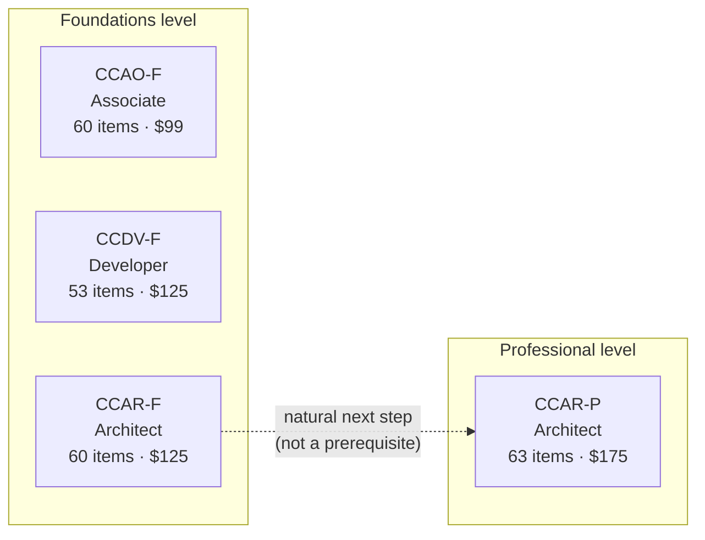
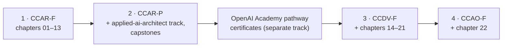
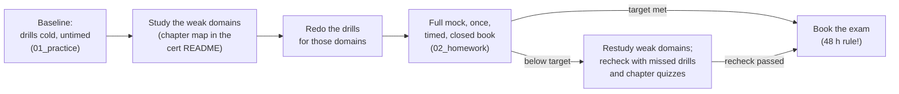

# Claude exam prep — certification ladder, program rules and study checklist

> **What this page is:** the index for all four Anthropic certifications. It holds no notebooks. Each certification gets its own folder with a README, scenario drills and an original mock exam.
> **Facts checked:** 2026-10-03 against the four official exam guides (v1.0, effective July 2026), the Partner Academy certification pages, FAQ and policies, the Certification Terms and Exam Policy PDFs, and the Pearson VUE Anthropic page; FAQ (seat time, 48-hour rule) and [claude.com/partners](https://claude.com/partners) re-checked 2026-10-04 · **Status:** 📝

Anthropic runs four Claude certifications, all delivered by Pearson VUE (the program moved its exam delivery to Pearson on June 30, 2026). This page covers what they have in common: who may sit them, how booking works, the rules that apply on exam day and after it, and which official courses to take alongside the chapters of this repo. It also sets the rules this public journal follows so that nothing here breaks the exam NDA.

Certification programs change often. **Where this page and the official pages disagree, the official pages win.** Re-check the [FAQ](https://anthropic-partners.skilljar.com/page/faq-certifications) and [policies](https://anthropic-partners.skilljar.com/page/policies-certifications) before you book.

## Contents

- [The certification ladder](#the-certification-ladder)
- [Recommended order for this repo](#recommended-order-for-this-repo)
- [Per-certification folders](#per-certification-folders)
- [Program rules (all four exams)](#program-rules-all-four-exams)
  - [Eligibility: partners only](#eligibility-partners-only)
  - [How an organization joins the Claude Partner Network](#how-an-organization-joins-the-claude-partner-network)
  - [Registration, fees and partner-tier discounts](#registration-fees-and-partner-tier-discounts)
  - [Scheduling with Pearson VUE](#scheduling-with-pearson-vue)
  - [Exam format and scoring](#exam-format-and-scoring)
  - [OnVUE online proctoring setup](#onvue-online-proctoring-setup)
  - [Exam-day conduct and the NDA](#exam-day-conduct-and-the-nda)
  - [Results, retakes, validity and renewal](#results-retakes-validity-and-renewal)
  - [Appeals and support](#appeals-and-support)
  - [Booking checklist](#booking-checklist)
- [Academy and Partner Academy prep checklist](#academy-and-partner-academy-prep-checklist)
- [Sharing the journey without breaking the NDA](#sharing-the-journey-without-breaking-the-nda)
- [How to use the mocks](#how-to-use-the-mocks)
- [Self-check](#self-check)
- [Certification coverage](#certification-coverage)
- [Official documentation and sources](#official-documentation-and-sources)

---

## The certification ladder

There are three roles (Associate, Developer, Architect). Each role has a Foundations exam, and the Architect role also has a Professional exam. The program landing page puts it as "Start at Foundations, then advance to Professional where available."



| Code | Name | Level | Who it is for (official guide) | Items | Time | Pass | Fee (USD list) | Counts toward CPN tier |
|---|---|---|---|---|---|---|---|---|
| **CCAO-F** | Claude Certified Associate – Foundations | Foundations | Professionals who use Claude as a productivity tool and build Claude Projects: operations, marketing, project management, education, communications, consultants. No software-development or API experience needed. | 60 | 120 min | 720 / 1,000 | $99 | **No** |
| **CCDV-F** | Claude Certified Developer – Foundations | Foundations | Hands-on engineers who build, integrate and ship applications, agents and workflows with the API, client SDKs, Claude Code and MCP (recommended: 1–5 years of software engineering, Python and/or TypeScript) | 53 | 120 min | 720 / 1,000 | $125 | Yes |
| **CCAR-F** | Claude Certified Architect – Foundations | Foundations | Solution architects who design and implement production applications with Claude (Agent SDK, Claude Code, Claude API, MCP; 6+ months of practical experience) | 60 (4 scenarios drawn from a bank of 6) | 120 min (about 135 min seat time) | 720 / 1,000 | $125 | Yes |
| **CCAR-P** | Claude Certified Architect – Professional | Professional | Mid- to senior-level architects, AI/ML engineers and technical leads who design, build and govern enterprise Claude solutions (recommended: 3+ years in systems architecture or platform engineering) | 63 | 120 min | 720 / 1,000 | $175 | Yes |

What all four share: multiple-choice and multiple-response items, a scaled score from 100 to 1,000 with a cut score of 720, closed book, English only, online proctoring (OnVUE) or a Pearson test center, and 12 months of validity. Details are under [Program rules](#program-rules-all-four-exams).

> **Naming.** The official codes are **CCAO-F, CCDV-F, CCAR-F and CCAR-P**. Community material often writes "CCA-F" and "CCA-P", the Partner Academy's page configuration used the key `ccaaf` for the Associate exam when checked on 2026-10-03 (an internal identifier that can change without notice), and the Pearson VUE page calls the roles "Practitioner, Architect, and Developer". Anthropic's own pages say "Associate".

<details>
<summary><strong>Domains and weights for all four exams</strong></summary>

Weights are official. The "≈ items" column is my estimate (weight × item count, each row rounded on its own, so a column can add up to one more or less than the exam's item count). Anthropic does not publish per-domain item counts.

**CCAR-F** (5 domains, 30 task statements, 6 published scenarios)

| Domain | Weight | ≈ items of 60 |
|---|---|---|
| D1 Agentic Architecture & Orchestration | 27% | ~16 |
| D2 Tool Design & MCP Integration | 18% | ~11 |
| D3 Claude Code Configuration & Workflows | 20% | ~12 |
| D4 Prompt Engineering & Structured Output | 20% | ~12 |
| D5 Context Management & Reliability | 15% | ~9 |

**CCDV-F** (8 domains, 25 weighted skills; the only guide that weights individual skills)

| Domain | Weight | ≈ items of 53 |
|---|---|---|
| D1 Agents and Workflows | 14.7% | ~8 |
| D2 Applications and Integration | 33.1% | ~18 |
| D3 Claude Code | 3.1% | ~2 |
| D4 Eval, Testing, and Debugging | 2.6% | ~1 |
| D5 Model Selection and Optimization | 16.8% | ~9 |
| D6 Prompt and Context Engineering | 11.0% | ~6 |
| D7 Security and Safety | 8.1% | ~4 |
| D8 Tools and MCPs | 10.6% | ~6 |

**CCAO-F** (7 domains; numbering follows the guide, the landing page sorts by weight)

| Domain | Weight | ≈ items of 60 |
|---|---|---|
| D1 Prompting and Task Execution | 14% | ~8 |
| D2 Output Evaluation and Validation | 21% | ~13 |
| D3 Product and Model Selection | 12% | ~7 |
| D4 Workflow Integration and Solution Design | 16% | ~10 |
| D5 Configuration and Knowledge Management | 12% | ~7 |
| D6 Governance, Risk, and Responsible Use | 15% | ~9 |
| D7 Troubleshooting and Optimization | 10% | ~6 |

**CCAR-P** (7 domains, 38 objectives; no scenario bank or appendix is published)

| Domain | Weight | ≈ items of 63 |
|---|---|---|
| D1 Solution Design & Architecture | 17% | ~11 |
| D2 Claude Models, Prompting & Context Engineering | 13% | ~8 |
| D3 Integration | 19% | ~12 |
| D4 Evaluation, Testing & Optimization | 16% | ~10 |
| D5 Governance, Safety & Risk Management | 14% | ~9 |
| D6 Stakeholder Communication & Lifecycle Management | 14% | ~9 |
| D7 Developer Productivity & Operational Enablement | 7% | ~4 |

</details>

---

## Recommended order for this repo

There are no mandatory prerequisites between the exams, so any order is allowed. Foundations does not upgrade to Professional automatically, and you can sit Professional without holding Foundations. The order below is this repo's choice for someone whose goal is to hold **both Architect levels** and work as an Applied AI Solution Architect:



| Step | Exam | Why it sits here |
|---|---|---|
| 1 | **CCAR-F** | Chapters 01–13 are written against its blueprint, and it is the closest match to the solution-architect goal. It counts toward Partner Network tier eligibility. |
| 2 | **CCAR-P** | The second half of the primary goal. It is the hardest exam: it explicitly tests RAG, evaluation design, governance and compliance, stakeholder communication and lifecycle management, which are the subject of the vendor-neutral [applied-ai-architect](../../applied-ai-architect/README.md) track (chapters planned) and the [capstones](../../applied-ai-architect/capstones/README.md). Its recommended experience (3+ years of systems architecture, production delivery) takes time to build, so start the applied track while you prepare for CCAR-F. |
| — | OpenAI | Between the Architect exams and the side certifications, this repo works through the OpenAI Academy pathway certificates on the [OpenAI track](../../openai-codex/README.md). They are not Anthropic exams and have their own rules. |
| 3 | **CCDV-F** | A secondary target. It shares most of CCAR-F's ground (agents, tools, MCP, Claude Code, prompting) and adds what CCAR-F leaves out of scope: streaming, error handling in API clients, vision and files, model selection and cost, security and guardrails. Applications and Integration alone is 33.1% of the exam. The planned chapters 14–21 fill these gaps. It counts toward Partner Network tier eligibility. |
| 4 | **CCAO-F** | A secondary target and the business-user lens: Projects, artifacts, output validation and responsible use. It is the cheapest exam and needs the least new study after the others, and an architect who advises customers benefits from knowing what their end users are tested on. It does **not** count toward Partner Network tier eligibility. |

**Plan around validity.** Each credential is valid for 12 months and can be renewed for free before it expires (see [Results, retakes, validity and renewal](#results-retakes-validity-and-renewal)). Keep a calendar entry per credential so that renewals do not all land in the same month.

---

## Per-certification folders

Each folder follows the same shape: a README (blueprint, domain → chapter map, study plan, common traps), `01_practice.ipynb` (scenario drills by domain) and `02_homework.ipynb` (a full-length original mock in the exam's item count, weights and format). Planned folders are listed without links until they exist.

| Folder | Exam | Status | Focus |
|---|---|---|---|
| [ccar-f/](ccar-f/README.md) | Claude Certified Architect – Foundations | 📝 | All 30 task statements, drills for the 6 official scenarios, an original 60-item mock (4 scenarios × 15 items), the out-of-scope list |
| `ccdv-f/` (planned) | Claude Certified Developer – Foundations | ⏳ | Skill-level map for all 25 weighted skills, an original 53-item mock |
| `ccao-f/` (planned) | Claude Certified Associate – Foundations | ⏳ | Business scenarios without code, an original 60-item mock |
| `ccar-p/` (planned) | Claude Certified Architect – Professional | ⏳ | Enterprise cases (mostly mapped to the [applied-ai-architect](../../applied-ai-architect/README.md) track), an original 63-item mock |

The four hands-on exercises from the CCAR-F guide are built as dual Claude and OpenAI capstones in [applied-ai-architect/capstones/](../../applied-ai-architect/capstones/README.md) (capstones 01–04), not in this folder.

---

## Program rules (all four exams)

### Eligibility: partners only

- **Partner organizations only.** Certification is "currently available only to organizations in the Claude Partner Network" (FAQ). You must be employed at, or affiliated with, a partner organization.
- **Partner email on a recognized domain.** You register with your company address. Personal addresses (Gmail and similar) are rejected. If the site says "You aren't signed in with a partner company employee email," contact partner-support@anthropic.com. Domain changes take 7–10 days.
- **Certify under the right domain.** The domain must be on your organization's partner record. Certifications earned on an unrecognized domain, including subsidiary and regional domains, do not credit to the partner account. If your company uses several domains, partner support can roll them up to the parent domain.
- **Age 18 or older,** checked against your government ID at check-in.
- **Country restrictions.**
  - Holders of IDs from Belarus, Cuba, North Korea, Russia, Syria or restricted regions of Ukraine cannot use OnVUE and must test at a Pearson test center.
  - Since September 8, 2026, Pearson has suspended delivery (online and in test centers) to residents of Iran.
  - Anthropic may exclude other countries or regions.
- **No mandatory prerequisites,** neither courses nor other certifications.
- **Partner Network credit.** CCDV-F, CCAR-F and CCAR-P count toward your organization's Claude Partner Network tier eligibility. CCAO-F does not. The Partner Portal shows your organization's total certification count, updated weekly.

### How an organization joins the Claude Partner Network

Membership belongs to an **organization**, not to an individual. Anthropic's [launch announcement](https://www.anthropic.com/news/claude-partner-network) (March 12, 2026) says that "any organization that is bringing Claude to market is eligible to join" and that "membership is free of charge". The certification landing page links non-partners to "Apply to become one".

1. **Check whether your employer is already a partner.** Ask your alliances, partnerships or practice lead. If it is, skip to step 4.
2. **The organization applies** through the form linked from [claude.com/partners](https://claude.com/partners). The page lists cloud partners, a services partner directory (consulting and implementation) and a "Powered by Claude" directory (companies building Claude into products).
3. **Wait for acceptance.** Anthropic does not publish the review criteria or timeline (re-checked on claude.com/partners, 2026-10-04). The certification FAQ names the partner tiers Registered, Select, Preferred and Global Premier; the tier sets your exam discount (see the next section).
4. **Get your email domains onto the partner record.** If your company uses more than one domain, email partner-support@anthropic.com with the parent domain and the other domains that should roll up to it. Allow 7–10 days.
5. **Start the Claude Partner Network Learning Path** in the Partner Academy, described there as "an introductory foundation to the Claude Partner Network and the first step toward unlocking certification" (courses listed in the [prep checklist](#claude-partner-network-learning-path)).
6. **Register for an exam** with your partner email (next section).

> **For individual learners.** Without a partner organization you cannot book an exam, but every public Anthropic Academy course and everything in this repo is open to you. Whether a sole proprietor or freelancer can join the network on their own is not stated in the official sources (the FAQ and [claude.com/partners](https://claude.com/partners) were re-checked on 2026-10-04 and neither addresses it); ask partner support before you rely on it.

### Registration, fees and partner-tier discounts

- **Where to register.** Register and pay by credit card on the exam's page in the [Anthropic Partner Academy](https://anthropic-partners.skilljar.com/page/partner-certifications). Pearson then emails you a scheduling link, and you book either online (OnVUE) or at a test center.
- **What you accept.** Before you register, read the exam guide, the [Certification Terms and Conditions](https://everpath-course-content.s3-accelerate.amazonaws.com/instructor%2F34hhd92iyp94a0gtbr15cy5jk%2Fpublic%2F1782870634%2FCertification+Terms+and+Conditions.pdf), the [Certification Exam Policy](https://everpath-course-content.s3-accelerate.amazonaws.com/instructor%2F34hhd92iyp94a0gtbr15cy5jk%2Fpublic%2F1782870704%2FAnthropic+Certification+Exam+Policy.pdf) and the [Anthropic Usage Policy](https://www.anthropic.com/legal/aup). Registering means you accept all of them.
- **Registration lifetime.** A registration stays valid for **5 years**, so there is no deadline to sit the exam.

| Exam | List fee | Registered tier | Select · Preferred | Global Premier |
|---|---|---|---|---|
| CCAO-F | $99 | $99 | $49.50 | 50% off; **free through Dec 31, 2026** |
| CCDV-F | $125 | $125 | $62.50 | 50% off; **free through Dec 31, 2026** |
| CCAR-F | $125 (was $99 until June 30, 2026) | $125 | $62.50 | 50% off; **free through Dec 31, 2026** |
| CCAR-P | $175 | $175 | $87.50 | 50% off; **free through Dec 31, 2026** |

Discounts follow your organization's tier and are applied automatically at checkout. The discounted amounts are simple arithmetic on the 50% rule, not prices quoted by Anthropic. Bulk vouchers are described as "in progress" and are not yet available.

### Scheduling with Pearson VUE

- **Reschedule or cancel at least 48 hours before your appointment.** Inside 48 hours, or on a no-show, you forfeit the fee.

  > **Note: the exam guides say 24 hours.** All four exam guide PDFs (v1.0) say you may cancel or reschedule "up to 24 hours" before the appointment. The [policies page](https://anthropic-partners.skilljar.com/page/policies-certifications), the [FAQ](https://anthropic-partners.skilljar.com/page/faq-certifications) and the [Pearson VUE Anthropic page](https://www.pearsonvue.com/us/en/anthropic.html) all say **48 hours**. Plan around 48 hours.

- **Cancelling is not the same as a refund.** The policies page says a cancellation made at least 48 hours ahead gets a full refund. The FAQ adds that cancelling in Pearson only frees the appointment slot and does not end your registration or trigger a refund. To get your money back, email certifications-support@anthropic.com.
- **After rescheduling,** check that the new date appears in your Pearson profile. If it does not, the change may not have gone through.
- **Your name must match your ID exactly.** The name on your Pearson profile must match your government photo ID. To correct it, email certifications-support@anthropic.com at least 24 hours before the exam with the subject "Name Correction Request", using Latin characters only and with first and last name clearly labelled. A mismatch at check-in forfeits the fee.
- **Accommodations come first.** Request them through Pearson **before** you schedule, ideally 10 or more days ahead, and do not book until they are approved.
- **Switching delivery mode.** To move between OnVUE and a test center, cancel and rebook. The 48-hour rule applies.

### Exam format and scoring

- **Item types.** Multiple-choice and multiple-response. Each item states how many responses to select. The FAQ also calls them "scenario-based multiple response questions."
- **Time.** 120 minutes of exam time. The FAQ says to plan for about 135 minutes of total seat time (check-in, instructions and a brief post-exam survey).
- **Scoring.** Criterion-referenced and scaled from 100 to 1,000. The cut score is **720** for all four exams, set by a formal standard-setting study. Scaling equates scores across exam forms, so 720 is not "72% correct".
- **Results.** Your score appears on screen when you finish. The report shows pass or fail, the scaled score, and percent correct per domain. The domain percentages are feedback only; they do not decide pass or fail.
- **Closed book, English only.** No notes, no documentation, no browser translation tools and no AI assistants.
- **No official practice exam.** The old practice exam was retired in the move to Pearson. Each guide's sample questions are the only official practice material, which is why each folder here has an [original mock](#how-to-use-the-mocks).
- **Guessing penalty, partial credit, item review.** Neither the guides nor the FAQ mention a guessing penalty, partial credit on multiple-response items, or whether you can flag and revisit items (FAQ re-checked 2026-10-04). Silence is not the same as an official "no penalty" statement, but an unanswered item cannot earn credit, so answer every item. Check the Pearson VUE tutorial at the start of the exam for the review features.

### OnVUE online proctoring setup

Do these steps on the same computer and network you will use on exam day. The full list is on the Partner Academy [computer and network setup page](https://anthropic-partners.skilljar.com/page/computer-and-network-setup).

1. **Run the system test** on that exact machine and network, using the Anthropic-specific link on the setup page ([system-test.onvue.com, client code ANTHROPIC](https://system-test.onvue.com/system_test?customer=pearson_vue&clientcode=ANTHROPIC&locale=en_US)).
2. **Make sure the network does not block Pearson's domains.** Corporate firewalls and VPNs often do.

   <details>
   <summary>Domains that must be reachable</summary>

   `*.ably-realtime.com`, `*.ably.io`, `*.certiport.com`, `*.gettesting.com`, `*.onvue.com`, `*.pdricloud.net`, `*.pearson.com`, `*.pearsonvue.com`, `*.programworkshop.com`, `*.programworkshop2.com`, `*.pvue1.com`, `*.pvue2.com`, `*.startpractice.com`, `*.starttest.com`, `*.starttest2.com`, `*.twilio.com`, `*.verifyreadiness.com`, `*.wowza.com`

   </details>

3. **Close apps that block the OnVUE browser.**
   - **Windows:** Edge, Chrome, the Claude desktop app, Zoom, the Teams updater, Discord, Outlook, AnyDesk, Chrome Remote Desktop, Tailscale, Webex, Windows Terminal Host and others listed on the setup page.
   - **macOS:** jamfhelper, Microsoft AutoUpdate, Microsoft Defender, osascript, Screenshot.
   - A managed work laptop may not let you close these. Use a personal computer on a personal network, or book a test center.

### Exam-day conduct and the NDA

- **ID.** Bring a valid, unexpired, government-issued photo ID. Online testing also needs a private room and a stable internet connection.
- **Online proctoring rules.** Stay in view of the webcam the whole time. Keep the workspace clear: no notes, books, phones or second monitors. Do not talk to anyone. Do not capture or copy any content.
- **Prohibited items.** Phones, smart watches, headphones, study materials and recording devices. Only scratch paper provided by the proctor is allowed, if any is.
- **Other prohibited conduct** (Exam Policy §2):
  - impersonation, or misrepresenting your country;
  - using AI products;
  - improper assistance, or using leaked items;
  - reverse engineering the exam;
  - unscheduled breaks;
  - having unauthorized items, including during breaks.
- **Confidentiality agreement.** You accept a confidentiality agreement (NDA) before the exam starts. Declining ends the session with no refund. You may never share, reproduce or discuss exam questions, including in study groups and forums.
- **Possible sanctions:**
  - a required retake, or future exams only at a test center;
  - an invalidated result, or a suspended or revoked credential;
  - a ban from the program, or a referral for legal action;
  - action under the partner agreement when a pattern of misconduct involves one partner organization;
  - no refund in any of these cases.

### Results, retakes, validity and renewal

- **Badge and certificate.** Passing earns a Credly badge, usually within minutes for online exams (a little longer for test centers), plus a downloadable certificate PDF. The credential belongs to you and moves with you between employers. Add a personal email to your Credly account so you keep access after changing jobs.
- **Retake waiting periods.** 14 days after a first fail, 30 days after a second and 90 days after a third. You can attempt each exam at most **4 times per rolling 12 months**. The policies page says waiting periods and attempt counts reset when an exam moves to a new version.
- **Retake cost.** Each retake costs the full fee, minus your tier discount, and you register again in the Partner Academy. You cannot retake an exam you passed to improve your score.
- **Validity.** **12 months** from the date earned. Credentials earned before June 30, 2026 under the old 6-month rule were extended to 12 months automatically. Do not present yourself as certified after expiry (Terms §2).
- **Renewal (recertification).** Before your credential expires, pass a free, open-book, non-proctored online assessment on the Partner Academy. You can retry it as often as you need, and each renewal extends validity by 12 months from your current expiry date. Anthropic says full details will be published before the first renewals fall due.
- **If it lapses.** You must retake the full proctored exam at the full fee. If an exam changes substantially, Anthropic may require the current full exam instead of the renewal assessment.

### Appeals and support

- **Appeals** go to Pearson within **14 days** of a decision notice or of your exam date. The policies page says that if Anthropic confirms a faulty question affected your result, the remedy is a free retake, not a changed score. The exam guides add that the standard-setting outcome and the content of individual items are not themselves subject to appeal.
- **Reporting a problem with a question.** Report it to Pearson. Reporting never counts against you.

| Need | Contact |
|---|---|
| Scheduling, exam-day technical problems, appeals | Pearson VUE (via your Pearson account or the [Anthropic page](https://www.pearsonvue.com/us/en/anthropic.html)) |
| Name corrections, refunds | certifications-support@anthropic.com |
| Partner email domains, certification credit to your organization | partner-support@anthropic.com |
| Credly badge access | support.credly.com |
| Academy courses | academy-support@anthropic.com |

### Booking checklist

- [ ] My organization is in the Claude Partner Network, and my email domain is on its partner record
- [ ] I have read the exam guide, the Terms and Conditions, the Exam Policy and the Usage Policy
- [ ] Any accommodations are approved by Pearson (request 10+ days ahead, before scheduling)
- [ ] My Pearson profile name matches my government ID exactly
- [ ] Registered and paid in the Partner Academy, then scheduled through Pearson's emailed link
- [ ] Calendar reminder set for **48 hours** before the exam (last moment to reschedule without losing the fee)
- [ ] OnVUE only: system test passed on the exam machine and network, Pearson domains reachable, blocking apps closed, private room ready
- [ ] Original mock passed under exam conditions (see [How to use the mocks](#how-to-use-the-mocks))
- [ ] After passing: claim the Credly badge, add a personal email to Credly, set a renewal reminder about 2 months before expiry

---

## Academy and Partner Academy prep checklist

There are two course catalogs on Skilljar:

- The **public [Anthropic Academy](https://anthropic.skilljar.com/)** is free and open to everyone.
- The **[Anthropic Partner Academy](https://anthropic-partners.skilljar.com/)** is for partners only. It hosts the exams, the three certification prep paths, the Partner Network pages and a few partner-only courses, and mirrors most public courses.

In the tables below, links to repo chapters point to folders that exist today. Chapters that are still planned are named in plain text (numbers refer to `anthropic-claude/` unless prefixed `AA`, which means a planned chapter of the [applied-ai-architect](../../applied-ai-architect/README.md) track).

### Claude Partner Network Learning Path

The Partner Academy calls this path "the first step toward unlocking certification". All four courses are also free in the public catalog.

- [ ] [Introduction to agent skills](https://anthropic.skilljar.com/introduction-to-agent-skills) → [05](../05-claude-code/README.md) (skills); planned 17
- [ ] [Building with the Claude API](https://anthropic.skilljar.com/claude-with-the-anthropic-api) → [01](../01-claude-api-fundamentals/README.md), [02](../02-tool-use/README.md), [04](../04-model-context-protocol/README.md), [06](../06-prompt-engineering/README.md), [08](../08-task-decomposition/README.md); planned 14–16
- [ ] [Introduction to Model Context Protocol](https://anthropic.skilljar.com/introduction-to-model-context-protocol) → [04](../04-model-context-protocol/README.md)
- [ ] [Claude Code in Action](https://anthropic.skilljar.com/claude-code-in-action) → [05](../05-claude-code/README.md); planned 19, 20

### Courses each certification recommends

Sources: **Path** = the prerequisites listed on a prep path; **Page** = the CCAR-F prep-courses page; **Config** = the prep-course keys in the certification pages' embedded configuration (read on 2026-10-03; not visible page text, so Anthropic can change it without notice). A dash means the course is not recommended for that exam.

| Course | CCAO-F | CCDV-F | CCAR-F | CCAR-P | Repo chapters |
|---|---|---|---|---|---|
| [Claude 101](https://anthropic.skilljar.com/claude-101) | Path, Config | Path | Page, Config | Path | planned 22 |
| [AI Fluency: Framework & Foundations](https://anthropic.skilljar.com/ai-fluency-framework-foundations) | Path, Config | Path | Page, Config | Path | planned AA 01, AA 02 |
| [AI Capabilities and Limitations](https://anthropic.skilljar.com/ai-capabilities-and-limitations) | Path | Path | — | Path | planned AA 01 |
| [Introduction to Claude Cowork](https://anthropic.skilljar.com/introduction-to-claude-cowork) | Config | — | — | — | planned 22 |
| [Claude Code 101](https://anthropic.skilljar.com/claude-code-101) | — | Path | — | — | [05](../05-claude-code/README.md), [04](../04-model-context-protocol/README.md); planned 19, 20 |
| [Claude Platform 101](https://anthropic.skilljar.com/claude-platform-101) | — | Path | — | — | [01](../01-claude-api-fundamentals/README.md), [02](../02-tool-use/README.md), [03](../03-agent-sdk/README.md), [04](../04-model-context-protocol/README.md), [05](../05-claude-code/README.md), [11](../11-context-management/README.md); planned 14, 16, 17, 21 |
| [Claude Code in Action](https://anthropic.skilljar.com/claude-code-in-action) | — | Path, Config | Page, Config | Path | [05](../05-claude-code/README.md); planned 19, 20 |
| [Building with the Claude API](https://anthropic.skilljar.com/claude-with-the-anthropic-api) | — | Path, Config | Page, Config | Path, Config | [01](../01-claude-api-fundamentals/README.md)–[06](../06-prompt-engineering/README.md), [08](../08-task-decomposition/README.md); planned 14–16, AA 04, AA 06, AA 08 |
| [Introduction to Model Context Protocol](https://anthropic.skilljar.com/introduction-to-model-context-protocol) | — | Path, Config | Page, Config | Path, Config | [04](../04-model-context-protocol/README.md) |
| [Model Context Protocol: Advanced Topics](https://anthropic.skilljar.com/model-context-protocol-advanced-topics) | — | Path | — | Config | planned 18 |
| [Claude with Amazon Bedrock](https://anthropic.skilljar.com/claude-in-amazon-bedrock) | — | — | Page, Config | Config | same as the API course, plus planned AA 14 |
| [Claude on Google Cloud](https://anthropic.skilljar.com/claude-with-google-vertex) | — | — | Page, Config | Config | same as the API course, plus planned AA 14 |

> **CCAR-F and the cloud courses.** Two of the seven CCAR-F prep courses cover Bedrock and Vertex AI, but the CCAR-F guide lists "Specific cloud provider configurations (AWS, GCP, Azure)" as out of scope. The FAQ calls the exam guide "the authoritative source for exam scope", so take those courses for their API and agent content, not for cloud setup details.

Useful courses that no certification officially recommends:

- [ ] [Introduction to subagents](https://anthropic.skilljar.com/introduction-to-subagents) → [03](../03-agent-sdk/README.md); planned 19
- [ ] [Deploying Claude Enterprise with Confidence](https://anthropic.skilljar.com/deploying-claude-enterprise-with-confidence) → planned AA 17
- [ ] [Working with Claude Fable 5.1](https://anthropic-partners.skilljar.com/working-with-claude-fable-51) (partner-only) → planned 16
- [ ] [Partner Basecamp](https://anthropic-partners.skilljar.com/partner-basecamp) (partner-only, two-day enablement program) → [03](../03-agent-sdk/README.md); planned 16, 22, AA 04, AA 05, AA 17. Its public pre-work (Phase 0) opens with an intake survey and closes with a takeaways lesson; the live Day 1 and Day 2 content is not listed publicly.

### Course checkpoints

Several public courses end with a quiz or final assessment. Use each one as a checkpoint once you have finished the matching repo chapters. These are course quizzes, not certification exams, and passing one does not earn a credential.

- [ ] Claude Platform 101: final quiz (after chapters 01–05 and 11; its managed-agents lessons map to planned chapter 21)
- [ ] Building with the Claude API: welcome lesson and course survey at the start, final assessment and wrap-up at the end (after chapters 01–08)
- [ ] Claude with Amazon Bedrock: introduction at the start, final assessment quiz and wrap-up at the end (after chapters 01–08)
- [ ] Claude on Google Cloud: welcome lesson and course survey at the start, final assessment quiz and wrap-up at the end (after chapters 01–08)

### Partner Academy prep paths

Three exams have a dedicated prep path in the Partner Academy (free, partner login required). CCAR-F has none; its seven recommended courses are in the table above and in the [CCAR-F folder](ccar-f/README.md). Only module titles, durations and learning objectives are public; lesson lists need a partner login. The module → domain column is my alignment from the module descriptions, not an official mapping.

**CCAO-F path** (8 modules, about 389 min). Recommended first: Claude 101, AI Fluency: Framework & Foundations, AI Capabilities and Limitations.

| | Module | Min | Exam domain | Repo chapters |
|---|---|---|---|---|
| ☐ | 1 Claude Platform & Model Foundations | 59 | D3 | planned 22, 16 |
| ☐ | 2 Prompting & Task Execution | 53 | D1 | [06](../06-prompt-engineering/README.md); planned AA 01 |
| ☐ | 3 Evaluating & Validating Claude's Output | 74 | D2 | planned AA 01, 22 |
| ☐ | 4 Workflow Integration & Solution Design | 63 | D4 | planned AA 02, AA 18 |
| ☐ | 5 Configuration & Knowledge Management | 47 | D5 | planned 22 |
| ☐ | 6 Governance, Risk & Responsible Use | 55 | D6 | planned AA 11, AA 12 |
| ☐ | 7 Troubleshooting & Optimization | 30 | D7 | planned AA 01, AA 02 |
| ☐ | 8 Course Summary & Next Steps | 8 | recap and exam overview | `ccao-f/` (planned) |

**CCDV-F path** (5 modules, about 774 min). Recommended first: Claude 101, Claude Code 101, Claude Platform 101, Claude Code in Action, AI Fluency: Framework & Foundations, Building with the Claude API, Introduction to MCP, MCP: Advanced Topics, AI Capabilities and Limitations.

| | Module | Min | Exam domain | Repo chapters |
|---|---|---|---|---|
| ☐ | 1 MSO Foundations (Model Selection & Optimization) | 57 | D5 | [01](../01-claude-api-fundamentals/README.md), [06](../06-prompt-engineering/README.md); planned 14, 16 |
| ☐ | 2 Production-Grade Prompting, Agents & Tool Use | 209 | D1, D2 (API mechanics), D6, D8 (tools) | [02](../02-tool-use/README.md), [06](../06-prompt-engineering/README.md), [11](../11-context-management/README.md); planned 14, 15, 21 |
| ☐ | 3 Claude Code, MCP & Integration | 142 | D3, D2 (configuration), D8 (MCP, customization), D7 (secrets) | [05](../05-claude-code/README.md); planned 17–20, AA 13 |
| ☐ | 4 Production Engineering, Evals & Security | 211 | D4, D7, D5 (cost) | planned 14, AA 08, AA 09, AA 10, AA 15 |
| ☐ | 5 Accelerators & IP Contribution | 155 | D2 (life cycle, vendors, versioning) | planned AA 13, AA 14, AA 19 |

**CCAR-P path** (5 modules, about 733 min). Recommended first: Claude 101, Claude Code in Action, AI Fluency: Framework & Foundations, Building with the Claude API, Introduction to MCP, AI Capabilities and Limitations.

| | Module | Min | Exam domain | Repo chapters |
|---|---|---|---|---|
| ☐ | 1 Claude Platform & Solution Design | 238 | D1, D2 | planned 16, AA 03, AA 04, AA 07, AA 14 |
| ☐ | 2 Enterprise Integration & Production | 158 | D3, D4 | planned AA 03, AA 08, AA 09, AA 13, AA 19 |
| ☐ | 3 Responsible AI, Safety & Risk for Architects | 114 | D5 | planned AA 11, AA 12 |
| ☐ | 4 Stakeholder Engagement, Lifecycle & GTM | 178 | D6 | planned AA 03, AA 14, AA 18, AA 19 |
| ☐ | 5 Team Enablement & Operational Productivity | 45 | D7 | planned 19, 20, AA 16 |

Path totals are my sums of the per-module minutes shown on the path pages.

### Partner Network Connect on-demand library

Recorded partner webinars in the Partner Academy. They cover program news, not exam content, so watch them for context on certification and tier changes:

- [ ] Episode 01: May product news, certification updates and the new Anthropic Partner Academy
- [ ] Episode 02: Claude Partner Network program launch, with a portal walkthrough
- [ ] Episode 03: partner-exclusive training, certification program updates and a Partner Academy deep-dive
- [ ] Episode 04: training and certification updates, a "Claude tag" in Slack demo, a customer story, program and funding updates
- [ ] Episode 05: what partners can build today, plus program and incentive updates ahead of the October 1 tier advancement date

---

## Sharing the journey without breaking the NDA

This repo is a public learning journal, shared on LinkedIn, X and Threads. The NDA you accept at the start of every exam covers all exam content (questions, answer options and scenarios as they appear on the exam), in any form and on any channel. These rules keep the journal on the right side of it:

| ✅ Fine to share | ❌ Never share |
|---|---|
| What you studied, the notebooks you built and what you learned from them | Anything about specific questions you saw, even paraphrased or "roughly" |
| Concepts from the public docs and the public exam guides: domains, task statements, the published scenario names | "Recalled" questions, answer options or scenario details from a sitting |
| The guides' own sample questions, by reference ("see sample question 4 in the guide"), with your take on the principle they test | Copies of the guide's sample questions pasted into the repo or a post |
| The original practice items in this repo, labelled as original | Any claim that this repo's items resemble or come from the real exam |
| Your study plan, booking experience and OnVUE setup tips | Topic breakdowns of a real sitting ("lots of questions on X") |
| Your pass result, scaled score and Credly badge | Screenshots, photos or notes of anything on the exam screen |
| General advice that is already in the official guide or FAQ | Links to "exam dumps" or leaked items. Using leaked items is itself a policy violation |

**Rules for content in this repo:**

1. Every practice question here is written from scratch to test a published objective. None is copied from official sample questions or from anyone's exam sitting, and none reuses a sample question's set-up and answer options. Because the items and the samples test the same task statements, some items reach the same principle as a sample (for example, a deterministic hook beats a prompt rule); items that followed a sample's structure too closely have been rewritten.
2. Official sample questions are summarized as the **principle** they test ("deterministic enforcement beats prompt guidance when errors cost money"), never reproduced. Read the originals in the exam guide PDFs.
3. Nothing gets committed or posted after an exam that was not already in the repo or in public sources before it. If in doubt, leave it out.
4. Pull requests or issues that contain recalled exam content will be closed and the content removed.

A post template that stays safe:

```text
AI Solution Architect journey: passed Claude Certified Architect – Foundations (CCAR-F).

What helped most:
1. Building every concept as a notebook, not just reading about it.
2. Practising "most appropriate" answers: deterministic controls over prompt instructions for hard rules.
3. Timed original mocks under exam conditions.

Study notes + notebooks (original practice items, no exam content):
https://github.com/EldanGS/Applied-AI-Solution-Architect
#ClaudeAI #Anthropic #AIArchitecture #BuildInPublic
```

---

## How to use the mocks

There is no official practice exam (it was retired in the move to Pearson). Each certification folder therefore has two kinds of original practice:

- **`01_practice.ipynb` — scenario drills.** Short sets grouped by domain or scenario, untimed, with an explanation after each answer. Use them while you study.
- **`02_homework.ipynb` — one full-length mock.** Same item count, domain weights and item types (multiple-choice and multiple-response with the number to select stated) as the real exam. It runs offline: no API key, auto-graded cells, a per-domain score report.

At the time of writing only the [CCAR-F](ccar-f/README.md) folder exists; the other three will follow the same pattern.



1. **Take a baseline early, with the drills.** Answer the `01_practice` drills cold and untimed before you study, without looking anything up. Their per-domain report (first attempts only) tells you where to start, which matters most for heavily weighted domains (CCAR-F D1 at 27%, CCDV-F D2 at 33.1%, CCAO-F D2 at 21%, CCAR-P D3 at 19%).
2. **Study by weakness, not by order.** Each cert README maps every domain and task statement to repo chapters. Re-read those sections and redo their homework notebooks.
3. **Drill.** Use `01_practice` for the weak domains. For every item, write one sentence on why each wrong option is wrong. That habit transfers; memorized answers do not.
4. **Sit the mock once, under exam conditions, at the end of the study plan.** Keep it unseen until then: it is your one full-length, timed check. One sitting, a 120-minute timer, closed book, no AI assistant, no second screen. Pace yourself with the table below.
5. **Read the score honestly.** Percent correct on a mock is not a scaled score, and 720 does not mean 72%. This repo's readiness rule of thumb (my heuristic, not an official threshold), used the same way in every cert folder: **80% or more overall and 70% or more in every domain** means book; 72–79% overall, or any domain below 70%, means fix the weak domains first; below 72% means not yet.
6. **Do not retake the mock as a readiness check.** The mock is fixed, so a second attempt measures memory, not skill. After restudying, recheck with the drills you missed, the chapter homework quizzes and your written explanations.
7. **Finish with the official samples.** Work through the sample questions in the exam guide PDF last, as a final check on item style. They are not reproduced in this repo.

| Exam | Items | Time | Pace per item | Checkpoint |
|---|---|---|---|---|
| CCAO-F | 60 | 120 min | 2:00 | item 30 by minute 60 |
| CCDV-F | 53 | 120 min | about 2:15 | item 27 by minute 60 |
| CCAR-F | 60 | 120 min | 2:00 (read each of the 4 scenarios once, carefully) | item 30 by minute 60 |
| CCAR-P | 63 | 120 min | about 1:55 | item 32 by minute 60 |

**Scoring conventions in this repo's mocks.** A multiple-response item scores only when you select exactly the right set (all-or-nothing). The official guides do not say whether partial credit exists, so the mocks take the stricter assumption. Unanswered items score zero, which is why you should answer everything.

---

## Self-check

Answer these before you book. Each one points to the section that holds the answer.

1. Your employer is not in the Claude Partner Network. Can you register for an exam, and what has to happen first? ([Eligibility](#eligibility-partners-only), [Joining the network](#how-an-organization-joins-the-claude-partner-network))
2. You registered with a regional subsidiary domain. Why might your pass not count for your organization, and who fixes it? ([Eligibility](#eligibility-partners-only))
3. Which of the four exams does **not** count toward Partner Network tier eligibility? ([The certification ladder](#the-certification-ladder))
4. The exam guide says you can reschedule up to 24 hours ahead. What deadline should you actually plan around, and why? ([Scheduling](#scheduling-with-pearson-vue))
5. Does a scaled score of 720 mean you answered 72% of the items correctly? ([Exam format and scoring](#exam-format-and-scoring))
6. You failed a first attempt on March 1. When is the earliest retake, and how many attempts do you have in a rolling 12 months? ([Results and retakes](#results-retakes-validity-and-renewal))
7. Your credential expires next month. What does renewal involve, and what happens if you let it lapse? ([Results and retakes](#results-retakes-validity-and-renewal))
8. Name three things you may share publicly about your exam and three you may never share. ([Sharing the journey](#sharing-the-journey-without-breaking-the-nda))

---

## Certification coverage

Requirement IDs come from the official exam guides, the Partner Academy FAQ and policies pages, and the Academy catalogs (see the [Claude path overview](../README.md)). This table feeds the repo coverage matrix. All 39 program-wide (PROG) requirements live on this page. "Primary" means this page is the main place the item is covered.

| Requirement ID | What it asks (short) | Where in this chapter | Depth (Primary/Supporting) |
|---|---|---|---|
| `PROG/ELIG/1` | Belong to a Claude Partner Network organization | [Eligibility](#eligibility-partners-only), [Joining the network](#how-an-organization-joins-the-claude-partner-network) | Primary |
| `PROG/ELIG/2` | Register with a partner email on a recognized domain; personal email fails; domain changes take 7–10 days | [Eligibility](#eligibility-partners-only), [Joining the network](#how-an-organization-joins-the-claude-partner-network) step 4 | Primary |
| `PROG/ELIG/3` | Certify under a domain on the partner record; subsidiary and regional domains do not credit | [Eligibility](#eligibility-partners-only) | Primary |
| `PROG/ELIG/4` | Minimum age 18, checked against ID | [Eligibility](#eligibility-partners-only) | Primary |
| `PROG/ELIG/5` | Country restrictions (OnVUE-excluded IDs, Iran suspension) | [Eligibility](#eligibility-partners-only) | Primary |
| `PROG/ELIG/6` | No mandatory course or certification prerequisites | [Eligibility](#eligibility-partners-only), [Recommended order](#recommended-order-for-this-repo) | Primary |
| `PROG/ELIG/7` | CCDV-F, CCAR-F, CCAR-P count toward CPN tier; CCAO-F does not | [Ladder](#the-certification-ladder), [Eligibility](#eligibility-partners-only) | Primary |
| `PROG/REG/1` | Register and pay in the Partner Academy, then schedule at Pearson VUE | [Registration](#registration-fees-and-partner-tier-discounts) | Primary |
| `PROG/REG/2` | Read the guide, Terms, Exam Policy and Usage Policy before registering | [Registration](#registration-fees-and-partner-tier-discounts), [Booking checklist](#booking-checklist) | Primary |
| `PROG/REG/3` | Fees: $99 / $125 / $125 / $175; CCAR-F price change | [Ladder](#the-certification-ladder), [Registration](#registration-fees-and-partner-tier-discounts) | Primary |
| `PROG/REG/4` | Tier discounts: Registered full price; Select, Preferred, Global Premier 50%; Global Premier free through 2026 | [Registration](#registration-fees-and-partner-tier-discounts) | Primary |
| `PROG/REG/5` | Registration valid 5 years | [Registration](#registration-fees-and-partner-tier-discounts) | Primary |
| `PROG/REG/6` | Reschedule or cancel at least 48 h ahead (guides say 24 h); refunds via support | [Scheduling](#scheduling-with-pearson-vue) | Primary |
| `PROG/REG/7` | Pearson profile name must match ID; correction procedure | [Scheduling](#scheduling-with-pearson-vue) | Primary |
| `PROG/REG/8` | Accommodations approved before scheduling | [Scheduling](#scheduling-with-pearson-vue) | Primary |
| `PROG/REG/9` | Switching OnVUE ↔ test center means cancel and rebook | [Scheduling](#scheduling-with-pearson-vue) | Primary |
| `PROG/FMT/1` | Multiple-choice and multiple-response; count stated | [Exam format](#exam-format-and-scoring) | Primary |
| `PROG/FMT/2` | 120 min, about 135 min seat time | [Exam format](#exam-format-and-scoring), [Mocks](#how-to-use-the-mocks) | Primary |
| `PROG/FMT/3` | Scaled 100–1,000, cut score 720, standard-setting study | [Exam format](#exam-format-and-scoring) | Primary |
| `PROG/FMT/4` | Score on screen; report with domain percentages that do not affect pass/fail | [Exam format](#exam-format-and-scoring) | Primary |
| `PROG/FMT/5` | Closed book, English only, no translation tools, no AI | [Exam format](#exam-format-and-scoring) | Primary |
| `PROG/FMT/6` | No practice exam; use guide samples | [Exam format](#exam-format-and-scoring), [Mocks](#how-to-use-the-mocks) | Primary |
| `PROG/CONDUCT/1` | Valid government photo ID; private room and stable connection online | [Conduct](#exam-day-conduct-and-the-nda) | Primary |
| `PROG/CONDUCT/2` | Online rules: stay in view, clear desk, no communication, no capture | [Conduct](#exam-day-conduct-and-the-nda) | Primary |
| `PROG/CONDUCT/3` | Prohibited items | [Conduct](#exam-day-conduct-and-the-nda) | Primary |
| `PROG/CONDUCT/4` | Other prohibited conduct (Exam Policy §2) | [Conduct](#exam-day-conduct-and-the-nda) | Primary |
| `PROG/CONDUCT/5` | Accept the NDA; never share or discuss questions | [Conduct](#exam-day-conduct-and-the-nda), [NDA-safe sharing](#sharing-the-journey-without-breaking-the-nda) | Primary |
| `PROG/CONDUCT/6` | Sanctions for misconduct | [Conduct](#exam-day-conduct-and-the-nda) | Primary |
| `PROG/TECH/1` | Run the OnVUE system test on the exam machine and network | [OnVUE setup](#onvue-online-proctoring-setup) | Primary |
| `PROG/TECH/2` | Pearson domains must be reachable | [OnVUE setup](#onvue-online-proctoring-setup) | Primary |
| `PROG/TECH/3` | Close blocking apps (Windows, macOS) | [OnVUE setup](#onvue-online-proctoring-setup) | Primary |
| `PROG/RETAKE/1` | Waits of 14 / 30 / 90 days; 4 attempts per rolling 12 months; reset on new version | [Results and retakes](#results-retakes-validity-and-renewal) | Primary |
| `PROG/RETAKE/2` | Full fee per retake; no retake of a passed exam | [Results and retakes](#results-retakes-validity-and-renewal) | Primary |
| `PROG/VALID/1` | Valid 12 months; older credentials extended; no claims after expiry | [Results and retakes](#results-retakes-validity-and-renewal) | Primary |
| `PROG/RECERT/1` | Free, open-book, non-proctored renewal before expiry | [Results and retakes](#results-retakes-validity-and-renewal), [Recommended order](#recommended-order-for-this-repo) | Primary |
| `PROG/RECERT/2` | Lapsed credential means the full exam at full fee | [Results and retakes](#results-retakes-validity-and-renewal) | Primary |
| `PROG/BADGE/1` | Credly badge and certificate; credential is portable; add a personal email | [Results and retakes](#results-retakes-validity-and-renewal), [Booking checklist](#booking-checklist) | Primary |
| `PROG/APPEAL/1` | Appeal to Pearson within 14 days; faulty items lead to a free retake | [Appeals and support](#appeals-and-support) | Primary |
| `PROG/SUPPORT/1` | Who to contact for what | [Appeals and support](#appeals-and-support) | Primary |

Academy items whose primary home is this page:

| Requirement ID | What it asks (short) | Where in this chapter | Depth (Primary/Supporting) |
|---|---|---|---|
| `ACAD/cpn-learning-path/1` – `ACAD/cpn-learning-path/4` | Complete the four Claude Partner Network Learning Path courses | [CPN Learning Path](#claude-partner-network-learning-path) | Primary |
| `ACAD/cpnc-on-demand-library/1` – `ACAD/cpnc-on-demand-library/5` | Partner Network Connect webinar episodes (context, not exam material) | [On-demand library](#partner-network-connect-on-demand-library) | Primary |
| `ACAD/claude-platform-101/14` | Claude Platform 101 quiz | [Course checkpoints](#course-checkpoints) | Primary |
| `ACAD/claude-with-the-anthropic-api/1`, `ACAD/claude-with-the-anthropic-api/11`, `ACAD/claude-with-the-anthropic-api/84`, `ACAD/claude-with-the-anthropic-api/85` | Building with the Claude API: welcome, survey, final assessment, wrap-up | [Course checkpoints](#course-checkpoints) | Primary |
| `ACAD/claude-in-amazon-bedrock/1`, `ACAD/claude-in-amazon-bedrock/82`, `ACAD/claude-in-amazon-bedrock/83` | Claude with Amazon Bedrock: introduction, final quiz, wrap-up | [Course checkpoints](#course-checkpoints) | Primary |
| `ACAD/claude-with-google-vertex/1`, `ACAD/claude-with-google-vertex/11`, `ACAD/claude-with-google-vertex/92`, `ACAD/claude-with-google-vertex/93` | Claude on Google Cloud: welcome, survey, final quiz, wrap-up | [Course checkpoints](#course-checkpoints) | Primary |
| `ACAD/partner-basecamp/1`, `ACAD/partner-basecamp/8` | Partner Basecamp intake survey and takeaways | [Courses each certification recommends](#courses-each-certification-recommends) (useful extras) | Primary |

The certification-specific items (each exam's prep steps, sample questions, scenarios, recommended experience and the CCAR-F prep-course list) live in the per-certification folders.

---

## Official documentation and sources

- **Official program pages:** [certification landing page](https://anthropic-partners.skilljar.com/page/partner-certifications), [FAQ](https://anthropic-partners.skilljar.com/page/faq-certifications), [policies](https://anthropic-partners.skilljar.com/page/policies-certifications), [computer and network setup](https://anthropic-partners.skilljar.com/page/computer-and-network-setup), [exam prep courses](https://anthropic-partners.skilljar.com/page/claude-certification-exam-prep-courses), [CCAR-F prep courses](https://anthropic-partners.skilljar.com/page/claude-certified-architect-foundations-prep-courses), [Claude Partner Network Learning Path](https://anthropic-partners.skilljar.com/page/claude-partner-network-learning-path).
- **Official exam guides (PDF, v1.0, effective July 2026):** [CCAO-F](https://everpath-course-content.s3-accelerate.amazonaws.com/instructor%2F6nizmqk8tpzpfjvt6qmmav7rh%2Fpublic%2F1783542847%2FClaude+Certified+Associate+%E2%80%93+Foundations+Exam+Guide.pdf) · [CCDV-F](https://everpath-course-content.s3-accelerate.amazonaws.com/instructor%2F6nizmqk8tpzpfjvt6qmmav7rh%2Fpublic%2F1783542875%2FClaude+Certified+Developer+%E2%80%93+Foundations+Exam+Guide.pdf) · [CCAR-F](https://everpath-course-content.s3-accelerate.amazonaws.com/instructor%2F6nizmqk8tpzpfjvt6qmmav7rh%2Fpublic%2F1783542750%2FClaude+Certified+Architect+%E2%80%93+Foundations+Exam+Guide.pdf) · [CCAR-P](https://everpath-course-content.s3-accelerate.amazonaws.com/instructor%2F6nizmqk8tpzpfjvt6qmmav7rh%2Fpublic%2F1783542810%2FClaude+Certified+Architect+%E2%80%93+Professional+Exam+Guide.pdf)
- **Official policy documents:** [Certification Terms and Conditions](https://everpath-course-content.s3-accelerate.amazonaws.com/instructor%2F34hhd92iyp94a0gtbr15cy5jk%2Fpublic%2F1782870634%2FCertification+Terms+and+Conditions.pdf) · [Certification Exam Policy](https://everpath-course-content.s3-accelerate.amazonaws.com/instructor%2F34hhd92iyp94a0gtbr15cy5jk%2Fpublic%2F1782870704%2FAnthropic+Certification+Exam+Policy.pdf) · [Pearson VUE Anthropic page](https://www.pearsonvue.com/us/en/anthropic.html)
- **Partner Network:** [launch announcement (March 12, 2026)](https://www.anthropic.com/news/claude-partner-network) · [claude.com/partners](https://claude.com/partners)
- **Courses:** [Anthropic Academy](https://anthropic.skilljar.com/) (public) · [Anthropic Partner Academy](https://anthropic-partners.skilljar.com/) (partners)
- **Community study guide:** [paullarionov/claude-certified-architect](https://github.com/paullarionov/claude-certified-architect/blob/main/guide_en.md), which shaped the chapter order of this track. Its exam-format details predate the official v1.0 guide; this page follows the official sources and is written in my own words.
- Facts were checked on **2026-10-03**. If something here looks out of date, please open an issue.

---

[← Chapter 13 — Claude Code Built-in Tools](../13-claude-code-builtin-tools/README.md) | [↑ Claude path overview](../README.md) | [CCAR-F exam prep →](ccar-f/README.md)
