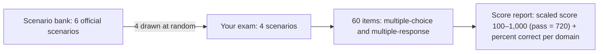
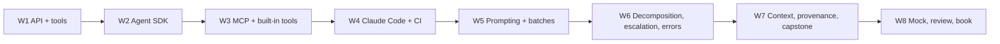

# CCAR-F — Claude Certified Architect – Foundations: Exam Prep

> **Exam:** CCAR-F (all five domains, all 30 task statements, all six scenarios) · **Files:** this README, [01_practice.ipynb](01_practice.ipynb) (30 scenario drills), [02_homework.ipynb](02_homework.ipynb) (60-item timed mock exam) · **Est. time:** 8 weeks part-time with the chapters, or 2–3 weeks as a final review · **Cost:** $0 (both notebooks run offline, no API key needed) · **Facts checked:** 2026-10-03 against the official exam guide v1.0 (effective July 2026) and current docs · **Status:** [ ] not started

This folder turns the thirteen Claude chapters into an exam plan. It maps every official task statement to the section that teaches it, gives you scenario drills with instant feedback, and ends with a full-length mock exam in the real format: 4 scenarios, 60 items, multiple-choice and multiple-response, 120 minutes, a per-domain score report and a scaled-score estimate.

Everything here is built from the **public** exam guide and public documentation. The drills and the mock are **original items** written for this repo. The guide's 12 sample questions are summarized as **principles** (see [Trap patterns](#trap-patterns-principles-from-the-official-sample-questions)), never reproduced, and nothing comes from the live exam. Read the sample questions in the guide itself; they are worth it.

## Contents

- [Exam blueprint](#exam-blueprint)
- [Task statement → chapter map (all 30)](#task-statement--chapter-map-all-30)
- [Out of scope: what will not be tested](#out-of-scope-what-will-not-be-tested)
- [Changed since the guide: answer the exam, build with today's docs](#changed-since-the-guide-answer-the-exam-build-with-todays-docs)
- [8-week study plan using this repo](#8-week-study-plan-using-this-repo)
- [How to use the drills and the mock](#how-to-use-the-drills-and-the-mock)
- [Exam-day strategy](#exam-day-strategy)
- [Trap patterns: principles from the official sample questions](#trap-patterns-principles-from-the-official-sample-questions)
- [Official preparation resources](#official-preparation-resources)
- [Self-check](#self-check)
- [Certification coverage](#certification-coverage)
- [Official documentation and sources](#official-documentation-and-sources)
- [Share your progress](#share-your-progress)

---

## Exam blueprint

### Format at a glance

| Parameter | Value (official exam guide v1.0) |
|---|---|
| Exam code | CCAR-F |
| Items | **60** |
| Item types | Multiple-choice **and** multiple-response. Each item states how many responses to select. |
| Structure | Scenario-based: **4 scenarios drawn at random from a bank of 6** |
| Time | **120 minutes** of exam time; plan for about **135 minutes** in the seat (check-in, instructions, a short post-exam survey, per the FAQ) |
| Passing score | Scaled **720** on a 100–1,000 scale (criterion-referenced; set by a standard-setting study) |
| Score report | Pass/fail, scaled score, and **percent correct per domain** (the domain percentages are informational; pass/fail depends only on the total scaled score) |
| Delivery | Pearson VUE, online proctored or test center |
| Fee and validity | $125; valid 12 months, with free on-time renewal (details in the exam prep index: [results, retakes, validity and renewal](../README.md#results-retakes-validity-and-renewal)) |



### Domains and weights

The weights are the approximate share of scored items. With 60 items that is roughly 16 / 11 / 12 / 12 / 9.

| # | Domain | Weight | ≈ items of 60 | Task statements | Mock items | Drill items |
|---|---|---|---|---|---|---|
| 1 | Agentic Architecture & Orchestration | **27%** | ≈ 16 | 7 (1.1–1.7) | 16 | 5 |
| 2 | Tool Design & MCP Integration | **18%** | ≈ 11 | 5 (2.1–2.5) | 11 | 5 |
| 3 | Claude Code Configuration & Workflows | **20%** | ≈ 12 | 6 (3.1–3.6) | 12 | 5 |
| 4 | Prompt Engineering & Structured Output | **20%** | ≈ 12 | 6 (4.1–4.6) | 12 | 7 |
| 5 | Context Management & Reliability | **15%** | ≈ 9 | 6 (5.1–5.6) | 9 | 8 |
| | **Total** | **100%** | **60** | **30** | **60** | **30** |

Domain 1 is more than a quarter of the exam, and Domains 1 and 5 together are 42%: agent design and reliability carry most of the weight, not configuration trivia.

### The six scenarios

Each scenario frames a group of items. You will see four of these six, so prepare all six.

| # | Official scenario | Primary domains (per the guide) | Drill section | In the mock |
|---|---|---|---|---|
| SC1 | Customer Support Resolution Agent | D1, D2, D5 | S1 | Scenario A |
| SC2 | Code Generation with Claude Code | D3, D5 | S2 | Scenario B |
| SC3 | Multi-Agent Research System | D1, D2, D5 | S3 | Scenario C |
| SC4 | Developer Productivity with Claude | D2, D3, D1 | S4 | — (drills only) |
| SC5 | Claude Code for Continuous Integration | D3, D4 | S5 | Scenario D |
| SC6 | Structured Data Extraction | D4, D5 | S6 | — (drills only) |

The mock draws four scenarios, like the real exam. It uses SC1, SC2, SC3 and SC5 because that combination reproduces the official domain weights exactly; SC4 and SC6 are covered by the drills.

### Item format

- **Multiple-choice:** one correct answer (the guide's sample questions all have four options, A–D).
- **Multiple-response:** the stem says how many to select ("Select TWO"). Selecting the wrong number of options makes the item wrong. The guide does not say whether multiple-response items earn partial credit, so this repo's grader gives none (all or nothing).
- Several options are usually *possible*. The exam asks for the **best** one for the stated constraints, which is why the [trap patterns](#trap-patterns-principles-from-the-official-sample-questions) below matter more than memorizing facts.

---

## Task statement → chapter map (all 30)

Each row was checked against the chapter itself: the "Certification coverage" table in Chapters 6–12, or the section content in Chapters 1–5 (checked 2026-10-03). Drill IDs refer to [01_practice.ipynb](01_practice.ipynb) (S1.3 = scenario S1, item 3); mock items to [02_homework.ipynb](02_homework.ipynb).

| Task | What it tests (in my words) | Where to study in this repo | Coverage | Drills | Mock items |
|---|---|---|---|---|---|
| **1.1** | Agentic loops driven by `stop_reason` | [Ch 3 §3.1](../../03-agent-sdk/README.md#31-the-agentic-loop), [Ch 1 §1.3](../../01-claude-api-fundamentals/README.md#13-stop_reason-why-the-model-stopped), [Ch 2 §2.6](../../02-tool-use/README.md#26-the-client-side-tool-loop-and-tool_result-rules-expanded-beyond-the-guide) | Full | S1.3 | Q3 |
| **1.2** | Coordinator–subagent (hub-and-spoke) orchestration | [Ch 3 §3.3](../../03-agent-sdk/README.md#33-hub-and-spoke-coordinator-and-subagents), [Ch 8 §8.2](../../08-task-decomposition/README.md#82-dynamic-adaptive-decomposition), [Ch 10 §10.1](../../10-multi-agent-error-handling/README.md#101-where-failures-happen-in-a-multi-agent-system-expanded-beyond-the-guide) | Full | S3.1 | Q31, Q32, Q33, Q37 |
| **1.3** | Subagent spawning, explicit context passing, parallel calls | [Ch 3 §3.4](../../03-agent-sdk/README.md#34-the-subagent-tool-agent-formerly-task), [Ch 3 §3.2](../../03-agent-sdk/README.md#32-agentdefinition-configuration), [Ch 11 §11.5](../../11-context-management/README.md#115-delegate-exploration-to-subagents-to-protect-the-coordinators-context), [Ch 12 §12.5](../../12-provenance/README.md#125-carrying-mappings-through-every-hop-expanded-beyond-the-guide) | Full | S3.2 | Q34, Q35, Q36 |
| **1.4** | Enforced workflow order and structured handoffs | [Ch 9 §9.4](../../09-escalation-human-in-the-loop/README.md#94-programmatic-enforcement-vs-prompt-guidance), [Ch 9 §9.6](../../09-escalation-human-in-the-loop/README.md#96-structured-handoff-protocols), [Ch 3 §3.5](../../03-agent-sdk/README.md#35-hooks-in-the-agent-sdk), [Ch 8 §8.9](../../08-task-decomposition/README.md#89-decomposing-multi-concern-requests) | Full | — | Q2, Q4, Q5 |
| **1.5** | Hooks: intercept tool calls, normalize tool results | [Ch 3 §3.5](../../03-agent-sdk/README.md#35-hooks-in-the-agent-sdk), [Ch 9 §9.4](../../09-escalation-human-in-the-loop/README.md#94-programmatic-enforcement-vs-prompt-guidance) | Full | S1.4 | Q1, Q6 |
| **1.6** | Task decomposition: fixed chains vs adaptive plans | [Ch 8 §8.1](../../08-task-decomposition/README.md#81-fixed-pipelines-prompt-chaining), [Ch 8 §8.2](../../08-task-decomposition/README.md#82-dynamic-adaptive-decomposition), [Ch 8 §8.3](../../08-task-decomposition/README.md#83-multi-pass-code-review), [Ch 6 §6.3](../../06-prompt-engineering/README.md#63-prompt-chaining) | Full | — | Q25 |
| **1.7** | Sessions: named resume, fork, fresh start with a summary | [Ch 3 §3.6](../../03-agent-sdk/README.md#36-sessions-resume-and-fork-bonus-from-domain-17), [Ch 5 §5.10](../../05-claude-code/README.md#510-sessions-resume-name-fork), [Ch 11 §11.7](../../11-context-management/README.md#117-sessions-resume-fork-or-start-fresh-task-17) | Full | S2.1 | Q23, Q24 |
| **2.1** | Tool descriptions and boundaries that prevent misrouting | [Ch 2 §2.2](../../02-tool-use/README.md#22-tool-definition) | Full | — | Q7 |
| **2.2** | Structured MCP errors: `isError`, categories, retryable | [Ch 4 §4.4](../../04-model-context-protocol/README.md#44-the-iserror-flag-and-structured-errors), [Ch 10 §10.2](../../10-multi-agent-error-handling/README.md#102-error-categories-and-the-retryable-flag), [Ch 10 §10.3](../../10-multi-agent-error-handling/README.md#103-access-failure-vs-valid-empty-result), [Ch 10 §10.4](../../10-multi-agent-error-handling/README.md#104-structured-error-responses-from-tools), [Ch 10 §10.5](../../10-multi-agent-error-handling/README.md#105-local-recovery-before-propagation) | Full | — | Q8, Q9, Q39 |
| **2.3** | Scoped toolsets per agent and `tool_choice` | [Ch 2 §2.2](../../02-tool-use/README.md#22-tool-definition), [Ch 2 §2.3](../../02-tool-use/README.md#23-the-tool_choice-parameter), [Ch 3 §3.2](../../03-agent-sdk/README.md#32-agentdefinition-configuration) | Full | S3.5 | Q10, Q38, Q59 |
| **2.4** | MCP servers in Claude Code and agents: scopes, env vars, resources | [Ch 4 §4.3](../../04-model-context-protocol/README.md#43-configuring-mcp-servers), [Ch 4 §4.5](../../04-model-context-protocol/README.md#45-resources-give-the-agent-a-map), [Ch 4 §4.6](../../04-model-context-protocol/README.md#46-beyond-claude-code-mcp-from-the-agent-sdk-and-the-messages-api) | Full | S4.4 | Q29, Q40, Q60 |
| **2.5** | Built-in tools: Read, Write, Edit, Bash, Grep, Glob | [Ch 13 §13.1](../../13-claude-code-builtin-tools/README.md#131-the-six-core-tools-and-how-claude-chooses-among-them), [Ch 13 §13.2](../../13-claude-code-builtin-tools/README.md#132-grep-vs-glob-content-search-vs-path-search), [Ch 13 §13.4](../../13-claude-code-builtin-tools/README.md#134-when-edit-fails-anchors-replace_all-and-the-read--write-fallback), [Ch 13 §13.6](../../13-claude-code-builtin-tools/README.md#136-incremental-investigation-grep-read-repeat), [Ch 13 §13.7](../../13-claude-code-builtin-tools/README.md#137-tracing-through-wrapper-modules), [Ch 13 §13.8](../../13-claude-code-builtin-tools/README.md#138-built-in-tools-vs-mcp-tools) | Full | S4.1, S4.2, S4.3 | Q30 |
| **3.1** | CLAUDE.md hierarchy, `@` imports, `/memory` | [Ch 5 §5.1](../../05-claude-code/README.md#51-the-claudemd-hierarchy), [Ch 5 §5.2](../../05-claude-code/README.md#52-path-imports-modular-claudemd), [Ch 5 §5.8](../../05-claude-code/README.md#58-memory-and-auto-memory) | Full | — | Q16, Q18 |
| **3.2** | Custom slash commands and skills (`context: fork`, `allowed-tools`, `argument-hint`) | [Ch 5 §5.4](../../05-claude-code/README.md#54-custom-slash-commands--skills), [Ch 5 §5.5](../../05-claude-code/README.md#55-skills-in-depth-skillmd-frontmatter) | Full | S2.2 | Q19, Q20 |
| **3.3** | Path-scoped rules in `.claude/rules/` | [Ch 5 §5.3](../../05-claude-code/README.md#53-clauderules-topic-files-and-path-scoped-rules) | Full | — | Q17 |
| **3.4** | Plan mode vs direct execution; the Explore subagent | [Ch 5 §5.6](../../05-claude-code/README.md#56-plan-mode-vs-direct-execution), [Ch 11 §11.5](../../11-context-management/README.md#115-delegate-exploration-to-subagents-to-protect-the-coordinators-context) | Full | S2.3 | Q21 |
| **3.5** | Iterative refinement: I/O examples, tests first, interview pattern | [Ch 6 §6.9](../../06-prompt-engineering/README.md#69-matching-the-strategy-to-the-task-and-iterating-expanded-beyond-the-guide), [Ch 6 §6.4](../../06-prompt-engineering/README.md#64-the-interview-pattern), [Ch 6 §6.1](../../06-prompt-engineering/README.md#61-few-shot-prompting) | Full | S2.4, S2.5 | Q22 |
| **3.6** | Claude Code in CI/CD: `-p`, JSON output, independent review | [Ch 5 §5.9](../../05-claude-code/README.md#59-claude-code-in-cicd-headless-mode), [Ch 8 §8.4](../../08-task-decomposition/README.md#84-independent-review-instances-why-self-review-is-weak) | Full | S5.4 | Q46, Q47, Q48, Q49, Q50 |
| **4.1** | Explicit criteria instead of vague instructions | [Ch 6 §6.2](../../06-prompt-engineering/README.md#62-explicit-criteria-vs-vague-instructions) | Full | S5.3 | Q51, Q52 |
| **4.2** | Few-shot examples for consistency and ambiguous cases | [Ch 6 §6.1](../../06-prompt-engineering/README.md#61-few-shot-prompting) | Full | — | Q12, Q41, Q53 |
| **4.3** | Structured output via tool use and JSON schemas | [Ch 2 §2.3](../../02-tool-use/README.md#23-the-tool_choice-parameter), [Ch 2 §2.4](../../02-tool-use/README.md#24-json-schemas-for-structured-output), [Ch 2 §2.5](../../02-tool-use/README.md#25-syntax-vs-semantic-errors) | Full | S6.1 | Q11, Q42 |
| **4.4** | Validation, retry with feedback, self-correction | [Ch 6 §6.5](../../06-prompt-engineering/README.md#65-validation-and-retry-with-feedback), [Ch 6 §6.6](../../06-prompt-engineering/README.md#66-self-correction) | Full | S6.2, S6.3 | Q54 |
| **4.5** | Batch processing with the Message Batches API | [Ch 7 §7.1](../../07-message-batches/README.md#71-what-the-message-batches-api-is), [Ch 7 §7.2](../../07-message-batches/README.md#72-batch-vs-synchronous-matching-the-api-to-latency-requirements), [Ch 7 §7.3](../../07-message-batches/README.md#73-what-can-and-cannot-be-batched), [Ch 7 §7.6](../../07-message-batches/README.md#76-result-types-and-resubmitting-only-the-failures), [Ch 7 §7.8](../../07-message-batches/README.md#78-sla-planning-and-submission-cadence) | Full | S5.1, S5.2 | Q55, Q56 |
| **4.6** | Multi-instance and multi-pass review | [Ch 8 §8.3](../../08-task-decomposition/README.md#83-multi-pass-code-review), [Ch 8 §8.4](../../08-task-decomposition/README.md#84-independent-review-instances-why-self-review-is-weak), [Ch 8 §8.5](../../08-task-decomposition/README.md#85-verification-passes-and-confidence-based-routing) | Full | S5.5 | Q57, Q58 |
| **5.1** | Preserving critical facts in long conversations | [Ch 11 §11.1](../../11-context-management/README.md#111-extract-facts-into-a-persistent-case-facts-block), [Ch 11 §11.2](../../11-context-management/README.md#112-trim-verbose-tool-results), [Ch 11 §11.3](../../11-context-management/README.md#113-position-aware-input-lost-in-the-middle) | Full | S1.5 | Q15 |
| **5.2** | Escalation triggers and ambiguity resolution | [Ch 9 §9.1](../../09-escalation-human-in-the-loop/README.md#91-when-to-escalate), [Ch 9 §9.2](../../09-escalation-human-in-the-loop/README.md#92-escalation-patterns), [Ch 9 §9.3](../../09-escalation-human-in-the-loop/README.md#93-resolving-ambiguity-ask-dont-guess) | Full | S1.1, S1.2 | Q13, Q14 |
| **5.3** | Error propagation across multi-agent systems | [Ch 10 §10.3](../../10-multi-agent-error-handling/README.md#103-access-failure-vs-valid-empty-result), [Ch 10 §10.5](../../10-multi-agent-error-handling/README.md#105-local-recovery-before-propagation), [Ch 10 §10.6](../../10-multi-agent-error-handling/README.md#106-the-structured-subagent-result), [Ch 10 §10.9](../../10-multi-agent-error-handling/README.md#109-coverage-annotations-in-the-final-synthesis) | Full | S3.3 | Q45 |
| **5.4** | Context in large codebase exploration | [Ch 11 §11.4](../../11-context-management/README.md#114-scratchpad-files), [Ch 11 §11.5](../../11-context-management/README.md#115-delegate-exploration-to-subagents-to-protect-the-coordinators-context), [Ch 11 §11.6](../../11-context-management/README.md#116-structured-state-persistence-and-crash-recovery), [Ch 5 §5.7](../../05-claude-code/README.md#57-compact-and-managing-the-context-window) | Full | S4.5 | Q26, Q27, Q28 |
| **5.5** | Human review workflows and confidence calibration | [Ch 9 §9.7](../../09-escalation-human-in-the-loop/README.md#97-confidence-calibration), [Ch 9 §9.8](../../09-escalation-human-in-the-loop/README.md#98-segment-accuracy-and-stratified-sampling), [Ch 9 §9.9](../../09-escalation-human-in-the-loop/README.md#99-routing-review-work-with-limited-capacity) | Full | S6.4, S6.5 | — |
| **5.6** | Provenance and uncertainty in multi-source synthesis | [Ch 12 §12.1](../../12-provenance/README.md#121-the-attribution-loss-problem), [Ch 12 §12.2](../../12-provenance/README.md#122-handling-conflicting-data), [Ch 12 §12.3](../../12-provenance/README.md#123-include-dates-for-correct-interpretation), [Ch 12 §12.4](../../12-provenance/README.md#124-render-by-content-type) | Full | S3.4 | Q43, Q44 |

The exam guide's knowledge and skill bullets under each task are the real checklist. Every chapter's "Certification coverage" section maps those bullets one by one.

---

## Out of scope: what will not be tested

The guide lists these topics as out of scope for CCAR-F. Do not spend exam-prep time on them. Some are still taught in this repo because CCDV-F, CCAR-P or the job needs them.

| # | Out of scope for CCAR-F | Still touched in this repo (for other exams or real work) |
|---|---|---|
| 1 | Fine-tuning or training custom models | Planned in the [applied-ai-architect track](../../../applied-ai-architect/README.md) |
| 2 | Claude API authentication, billing, account management | [Chapter 0 setup](../../../00-prerequisites/README.md) only |
| 3 | Detailed language or framework implementation (beyond tool and schema configuration) | — |
| 4 | Deploying or hosting MCP servers (infrastructure, networking, containers) | Transports only: [Ch 4 §4.2](../../04-model-context-protocol/README.md#42-mcp-servers-clients-and-transports) |
| 5 | Claude's internal architecture, training, model weights | — |
| 6 | Constitutional AI, RLHF, safety-training methods | — |
| 7 | Embedding models and vector-database internals | Planned in the applied-ai-architect track (RAG chapters) |
| 8 | Computer use (browser or desktop automation) | — |
| 9 | Vision and image analysis | — |
| 10 | Streaming API implementation, server-sent events | — |
| 11 | Rate limits, quotas, pricing calculations | [Ch 7 §7.9](../../07-message-batches/README.md#79-cost-modeling-batch-discount-prompt-caching-and-model-choice), [Ch 7 §7.11](../../07-message-batches/README.md#711-operations-rate-limits-retention-privacy-and-platforms) |
| 12 | OAuth, API key rotation, authentication protocols | — |
| 13 | Cloud-provider configuration (AWS, GCP, Azure) | — |
| 14 | Performance benchmarking, model comparison metrics | [Ch 1 §1.7](../../01-claude-api-fundamentals/README.md#17-model-selection-basics) (model selection basics) |
| 15 | Prompt caching implementation details (knowing it exists **is** in scope) | [Ch 11 §11.12](../../11-context-management/README.md#1112-prompt-caching-and-context-management-beyond-the-guide) |
| 16 | Token counting algorithms, tokenization | [Ch 1 §1.6](../../01-claude-api-fundamentals/README.md#16-tokens-counting-before-measuring-after), [Ch 11 §11.8](../../11-context-management/README.md#118-context-windows-token-budgets-and-counting-beyond-the-guide) |

> **Exam trap:** an option that "fixes" a design problem with an out-of-scope mechanism (a vector database, a fine-tuned classifier, a bigger context window bought through pricing tricks) is almost never the intended answer. The exam rewards design choices inside the blueprint.

---

## Changed since the guide: answer the exam, build with today's docs

The official guide (v1.0, July 2026) was written against slightly older behavior, and the platform keeps moving. Where they differ, **answer the exam in the guide's terms**: the intent behind its wording still holds. **Build with the current behavior.** Every chapter marks these differences with "Note: changed since the guide".

| The guide says | Current docs (checked 2026-10-03) | How to read exam options | Details |
|---|---|---|---|
| Subagents are spawned with the `Task` tool; `allowedTools` must include `"Task"` | The tool is `Agent` (older versions emitted `Task`); `allowed_tools` pre-approves tools, and `AgentDefinition.tools` is the hard per-subagent restriction | Read `Task` as "the subagent-spawning tool" | [Ch 3 §3.4](../../03-agent-sdk/README.md#34-the-subagent-tool-agent-formerly-task), [Ch 3 §3.2](../../03-agent-sdk/README.md#32-agentdefinition-configuration) |
| Custom slash commands live in `.claude/commands/` | Commands were merged into skills; `.claude/skills/<name>/SKILL.md` is recommended, and old command files still work | Both locations are project-scoped and shared through git | [Ch 5 §5.4](../../05-claude-code/README.md#54-custom-slash-commands--skills) |
| `allowed-tools` in SKILL.md restricts tools | `allowed-tools` **pre-approves**; `disallowed-tools` or a read-only `agent` actually restricts | "Restrict with `allowed-tools`" is still the intended answer for a skill that did something destructive | [Ch 5 §5.5](../../05-claude-code/README.md#55-skills-in-depth-skillmd-frontmatter) |
| Path-scoped rules load when editing matching files | They load on Read, Write or Edit of a matching file | Same answer: rules with `paths` globs | [Ch 5 §5.3](../../05-claude-code/README.md#53-clauderules-topic-files-and-path-scoped-rules) |
| Three CLAUDE.md levels (user, project, directory) | Also managed policy and `CLAUDE.local.md` | The user-vs-project distinction is what gets tested | [Ch 5 §5.1](../../05-claude-code/README.md#51-the-claudemd-hierarchy) |
| `~/.claude.json` is "user configuration" for MCP | Two scopes live there: local (per project, the default) and user (all projects) | Team config goes in `.mcp.json`; personal config stays outside git | [Ch 4 §4.3](../../04-model-context-protocol/README.md#43-configuring-mcp-servers) |
| `--resume <session-name>`, `fork_session` | Names come from `-n`/`--name` or `/rename`; the CLI fork is `--fork-session` (or `/branch`), the SDK option is `fork_session` | Same concepts | [Ch 5 §5.10](../../05-claude-code/README.md#510-sessions-resume-name-fork) |
| CI-invoked Claude Code reads the project `CLAUDE.md` | Still true for plain `claude -p`, but the docs now recommend `--bare` for scripted runs (it skips `CLAUDE.md`, hooks, skills and MCP discovery) and plan to make it the `-p` default | Same answer: project context reaches CI through `CLAUDE.md`. With `--bare`, pass it explicitly (for example `--append-system-prompt-file`) | [Ch 5 §5.9](../../05-claude-code/README.md#59-claude-code-in-cicd-headless-mode) |
| Built-in tools Read, Write, Edit, Bash, Grep, Glob | On macOS, Linux and WSL, Claude Code leaves `Glob` and `Grep` out of the default tool set and searches with `find`/`grep` through `Bash`; naming them in `--tools` or `--allowedTools` (or the Agent SDK options) restores them, as does removing `Bash` from the session or a subagent whose `tools` list names them and leaves out `Bash`. `Edit` can also resolve a non-unique match with a longer `old_string` or `replace_all` | The exam tests each tool's purpose (Grep = contents, Glob = paths) and the Read + Write fallback | [Ch 13 §13.2](../../13-claude-code-builtin-tools/README.md#132-grep-vs-glob-content-search-vs-path-search), [Ch 13 §13.4](../../13-claude-code-builtin-tools/README.md#134-when-edit-fails-anchors-replace_all-and-the-read--write-fallback) |
| `tool_choice` `any` and forced `tool` guarantee a tool call | Claude Opus 5.5, Sonnet 5.5, Fable 5.1 and Mythos 5.1 reject both with a 400 (models that still support forced tool use, such as Claude Opus 5, reject it only with manual extended thinking); on those four, use `auto` + `strict: true` + a code check, or structured outputs | The exam tests the `auto` / `any` / forced semantics: learn them | [Ch 2 §2.3](../../02-tool-use/README.md#23-the-tool_choice-parameter) |

---

## 8-week study plan using this repo

About **8–10 hours a week**, assuming [00-prerequisites](../../../00-prerequisites/README.md) is done. Each week: read the chapter README, run both notebooks, pass the chapter homework (72% bar), then do the listed drills. Log every drill or mock miss in an error log (task number, why you missed it, the principle).

| Week | Focus | Chapters | Drills | Checkpoint |
|---|---|---|---|---|
| 1 | API foundations and tool use (D2, D4 basics) | [01](../../01-claude-api-fundamentals/README.md), [02](../../02-tool-use/README.md) | S1.3, S6.1 | Ch 1–2 homework ≥ 72% |
| 2 | Agentic architecture, the biggest domain (D1, 27%) | [03](../../03-agent-sdk/README.md) | S1.4, S2.1, S3.1, S3.2 | Explain hub-and-spoke and hooks vs prompts from memory |
| 3 | MCP and built-in tools (D2) | [04](../../04-model-context-protocol/README.md), [13](../../13-claude-code-builtin-tools/README.md) | all of S4 | Ch 4 and Ch 13 homework ≥ 72% |
| 4 | Claude Code for a team and in CI (D3) | [05](../../05-claude-code/README.md) | S2.2–S2.5, S5.4 | Configure a real repo: CLAUDE.md, a path rule, a forked skill, `.mcp.json` |
| 5 | Prompting, structured output, batches (D4) | [06](../../06-prompt-engineering/README.md), [07](../../07-message-batches/README.md) | S5.1–S5.3, S6.2, S6.3 | Ch 6–7 homework ≥ 72% |
| 6 | Decomposition, escalation, multi-agent errors (D1, D5) | [08](../../08-task-decomposition/README.md), [09](../../09-escalation-human-in-the-loop/README.md), [10](../../10-multi-agent-error-handling/README.md) | S1.1, S1.2, S3.3, S5.5, S6.4, S6.5 | Ch 8–10 homework ≥ 72% |
| 7 | Context and provenance; one capstone (D5) | [11](../../11-context-management/README.md), [12](../../12-provenance/README.md), [capstones](../../../applied-ai-architect/capstones/README.md) | S1.5, S3.4, S3.5; then redo every drill you missed | Error log reviewed; drills ≥ 85% |
| 8 | Mock exam, targeted review, book the exam | this folder | — | Mock once, under exam conditions; ≥ 80% raw and ≥ 70% in every domain before you book |



**Short on time?** If you already build with Claude every day: week 1 = Chapters 3, 5 and 9–11 with their drills; week 2 = Chapters 2, 4, 6–8 and 12 with the rest of the drills; week 3 = mock, review, book.

**Closing the experience gap.** The guide's target candidate has 6+ months of hands-on work with the Claude API, the Agent SDK, Claude Code and MCP. If you have less, you can make up much of it with deliberate practice: run every notebook and change one thing per section, build at least one capstone end to end, and use Claude Code on a real repository every day of the plan.

---

## How to use the drills and the mock

**[01_practice.ipynb](01_practice.ipynb): scenario drills (learning mode, untimed).** One section per official scenario: a short original brief, then 5 items. Answer in the cell under each item and run it. You get instant feedback for the option you chose, plus links to the chapter sections behind the item. Keys are stored as SHA-256 hashes and the feedback notes are masked, so scrolling through the code won't give the answers away. A final cell reports your drill accuracy by domain and the sections to reread.

**[02_homework.ipynb](02_homework.ipynb): full-length mock (exam mode, timed).**

1. Take it **once, in one sitting, closed book**: 120 minutes, no docs, no notes, no Claude. Start the timer cell first.
2. Fill the single `answers` dict. Use one letter for multiple-choice items and the right number of letters for "Select TWO" items (`"BD"`, `"B,D"` or `["B", "D"]` all work).
3. Run the grader. It prints a score report like the real one: percent correct per domain, a **scaled-score estimate** and PASS/RETRY at 720, plus the task statements behind each miss.
4. Only then open the explanations at the bottom (collapsed). Each one says why the right answer wins, why each distractor loses, and which chapter section to reread.

**Reading your result** (my guidance, not an official mapping; the same rule as the [exam prep index](../README.md#how-to-use-the-mocks)):

| Raw score | What it suggests |
|---|---|
| ≥ 80% (48+/60) **and** ≥ 70% in every domain | Ready: book the exam and keep the drills warm |
| 72–79%, **or** 80%+ with any domain below 70% | Borderline: fix your weakest domains, redo their drills, then book |
| < 72% | Not yet: go back to the weeks for your weakest domains before booking |

The scaled score in the grader is a **linear approximation** that maps 72% raw to 720 (0% → 100, 72% → 720, 100% → 1,000). Anthropic does not publish its raw-to-scaled conversion, and real scaling equates forms of different difficulty, so treat the estimate as a rough signal only. A retake of the same mock measures memory, not skill: for a second check, use the drills you missed and the chapter homework quizzes.

---

## Exam-day strategy

- **Budget the clock by scenario.** 120 minutes for 4 scenarios is about **30 minutes per scenario**, or **2 minutes per item**. Check the clock at each scenario boundary.
- **Read the scenario once, and note its constraints:** targets (first-contact resolution, SLA hours), thresholds ($ limits), who can see what (humans without transcripts), what is shared (team vs personal). Many items turn on one constraint.
- **Read the question line before the options.** "Most effective *first* step", "root cause", "guarantee", "most maintainable" each point to a different kind of answer.
- **Count the selections.** For "Select TWO" pick exactly two; check this before moving on.
- **Eliminate before you choose.** Strike options that rely on prompts for a hard guarantee, invent a flag or config file, over-engineer the first step, push work onto users or developers, or reach for a bigger model or window. Then compare what is left.
- **Answer every item.** The guide does not mention a penalty for wrong answers, and an unanswered item cannot score (this is an inference, not an official statement).
- **Flag and return** if the exam interface allows it (the guide does not describe item review or flagging, so check the Pearson VUE tutorial at the start). Do not change an answer later without a concrete reason.
- **Logistics:** valid government photo ID matching your registration, online-proctoring system check the day before, and about 135 minutes of total seat time. See [Program rules](../README.md#program-rules-all-four-exams) and the [booking checklist](../README.md#booking-checklist) in the exam prep index, and [Exam-day tips](../../README.md#exam-day-tips) in the Claude path overview.

---

## Trap patterns: principles from the official sample questions

The guide's section 9 publishes 12 sample questions with explanations, across SC1, SC2, SC3 and SC5. Below is what they teach, distilled into principles. The questions themselves are not reproduced here; read them in the guide.

| # | Principle | Signals in the stem | Distractors that are usually wrong |
|---|---|---|---|
| P1 | **Guarantees belong in code, not in prompts.** When a rule has financial, identity or compliance consequences, prefer a hook or a programmatic gate. | A measured rate of skipped or out-of-order steps; money, identity, compliance; "must never" | A stronger system prompt; more few-shot examples; a mechanism that controls *which* tools exist rather than *when* they may run |
| P2 | **Fix the root cause with the smallest change that addresses it first.** | "First step", "most effective"; a component that is under-specified (thin descriptions, vague criteria) | Routing classifiers, routing layers, merging tools, new ML infrastructure before the prompt or description has been fixed |
| P3 | **Self-assessment and sentiment are not decision signals.** Uncalibrated self-reported confidence and customer mood do not track case complexity. | Escalation rate too high or too low, calibration | "Escalate below confidence N", sentiment thresholds, a separately trained classifier as the first move |
| P4 | **Shared means version-controlled project scope; personal means your home directory.** | Everyone on the team should get it; one person wants a private variant | User-level files for team needs; CLAUDE.md as a place for things that are not instructions |
| P5 | **Only real mechanisms count.** Distractors include plausible-sounding flags, environment variables and config files that do not exist. | CLI behavior, configuration location | Invented flags or settings; shell workarounds instead of the documented flag |
| P6 | **When complexity is stated up front, plan first.** | Many files, architectural decisions, several valid designs, stated before work starts | "Start directly and switch if it gets hard"; "very detailed upfront instructions" in direct execution |
| P7 | **Load conventions by file pattern when files are spread across the tree.** | Conventions by file type; matching files scattered across many directories | One root file with sections; a CLAUDE.md per directory; on-demand skills for conventions that must apply automatically |
| P8 | **Find the component that is actually wrong.** Read the evidence in the stem (logs, assignments) before blaming a downstream agent that did its assigned job. | Downstream agents report success; logs or assignments are quoted in the stem | Fixing downstream agents that worked correctly within their scope |
| P9 | **Failures must be visible and specific.** | Timeouts, unavailable sources, partial results | Generic "unavailable" statuses; empty results marked as success; terminating the whole workflow over one failure |
| P10 | **Least privilege, with a narrow exception for the frequent case.** | Most cases are simple; extra round trips; latency | Giving an agent every tool; batching dependent work; speculative caching |
| P11 | **Match the API to the latency contract.** Batches suit work that can wait; blocking steps stay synchronous. | A blocking step vs overnight or weekly jobs; an SLA in hours | Batching blocking checks; relying on batches usually finishing early; worrying about result order (`custom_id` handles correlation) |
| P12 | **Attention, not window size, is the bottleneck in large reviews.** | Many files in one pass; uneven depth; findings that contradict each other | A bigger model or context window; consensus voting that hides intermittent real bugs; pushing the work back onto developers |

**Cross-cutting distractor families** to watch for in every scenario: over-engineering the first step, shifting work to users or developers, arbitrary caps (iterations, findings, retries), "use a bigger model", and anything that silently hides uncertainty.

---

## Official preparation resources

**The guide's "How to prepare" list, mapped to this repo:**

| Guide recommendation | Where to practice it here |
|---|---|
| Build an Agent SDK agent: loop, tool calls, errors, sessions, subagents with explicit context | [Chapter 3](../../03-agent-sdk/README.md), [Chapter 10](../../10-multi-agent-error-handling/README.md), [capstone 01](../../../applied-ai-architect/capstones/01-support-resolution-agent/README.md) |
| Configure Claude Code for a real project: CLAUDE.md hierarchy, `.claude/rules/`, skills with `context: fork` and `allowed-tools`, one MCP server | [Chapter 5](../../05-claude-code/README.md), [Chapter 4](../../04-model-context-protocol/README.md), [capstone 04](../../../applied-ai-architect/capstones/04-coding-agents-for-a-team/README.md) |
| Design and test MCP tools: differentiated descriptions, structured errors with categories and retryable flags, ambiguous-request testing | [Chapter 2](../../02-tool-use/README.md), [Chapter 4](../../04-model-context-protocol/README.md), drills S1 and S4 |
| Build an extraction pipeline: tool use + JSON schemas, validation-retry, nullable fields, Message Batches | [Chapter 2](../../02-tool-use/README.md), [Chapter 6](../../06-prompt-engineering/README.md), [Chapter 7](../../07-message-batches/README.md), [capstone 03](../../../applied-ai-architect/capstones/03-extraction-pipeline-at-scale/README.md) |
| Practice prompt engineering: few-shot for ambiguity, explicit review criteria, multi-pass review | [Chapter 6](../../06-prompt-engineering/README.md), [Chapter 8](../../08-task-decomposition/README.md), drills S5 |
| Study context management: fact extraction, scratchpads, subagent delegation | [Chapter 11](../../11-context-management/README.md), drills S2 and S3 |
| Review escalation and human-in-the-loop: when to escalate, confidence-based review routing | [Chapter 9](../../09-escalation-human-in-the-loop/README.md), drills S1 and S6 |

The guide's four preparation exercises are built as end-to-end capstones in the [capstones folder](../../../applied-ai-architect/capstones/README.md) (exercise 1 → [capstone 01](../../../applied-ai-architect/capstones/01-support-resolution-agent/README.md), exercise 2 → [capstone 04](../../../applied-ai-architect/capstones/04-coding-agents-for-a-team/README.md), exercise 3 → [capstone 03](../../../applied-ai-architect/capstones/03-extraction-pipeline-at-scale/README.md), exercise 4 → [capstone 02](../../../applied-ai-architect/capstones/02-multi-agent-research-with-provenance/README.md)).

**The seven free courses on the official CCAR-F prep page** (links in the exam prep index: [Courses each certification recommends](../README.md#courses-each-certification-recommends)):

- [ ] AI Fluency: Framework & Foundations
- [ ] Claude 101
- [ ] Building with the Claude API
- [ ] Introduction to Model Context Protocol
- [ ] Claude Code in Action
- [ ] Claude with Amazon Bedrock
- [ ] Claude on Google Cloud

The two cloud courses give deployment context; cloud-provider configuration itself is out of scope.

---

## Self-check

Answer these from memory before you book. If one takes you more than a minute, reread the linked section.

1. Which two domains together make up 42% of the exam, and which single domain is the largest? ([Domains and weights](#domains-and-weights))
2. You will see four of the six scenarios. Name all six and the primary domains of each. ([The six scenarios](#the-six-scenarios))
3. A "Select TWO" item: what happens if you select one or three options, and what does this repo's grader assume about partial credit? ([Item format](#item-format))
4. An option fixes a misrouting problem with a vector database or a fine-tuned classifier. Why is that almost never the intended answer? ([Out of scope](#out-of-scope-what-will-not-be-tested))
5. The guide says the subagent tool is `Task` and that `allowed-tools` restricts a skill. How should you read those options on the exam, and how do you build today? ([Changed since the guide](#changed-since-the-guide-answer-the-exam-build-with-todays-docs))
6. State principles P1, P3 and P11 in one sentence each, and name a distractor each one rules out. ([Trap patterns](#trap-patterns-principles-from-the-official-sample-questions))
7. Your mock score is 74% raw. What does that suggest, and why is the grader's scaled score only a rough signal? ([Reading your result](#how-to-use-the-drills-and-the-mock))

---

## Certification coverage

"Primary" means this folder is the main place the item is covered; "Supporting" means a chapter or capstone teaches it and this folder maps or drills it. Every ID below exists in the requirement list built from the official CCAR-F exam guide v1.0.

| Requirement ID | What it asks (short) | Where in this chapter | Depth (Primary/Supporting) |
|---|---|---|---|
| `CCAR-F/SC1` – `CCAR-F/SC6` | The six official exam scenarios | [The six scenarios](#the-six-scenarios); drills S1–S6 in [01_practice.ipynb](01_practice.ipynb); mock scenarios A–D in [02_homework.ipynb](02_homework.ipynb) | Primary |
| `CCAR-F/SQ1` – `CCAR-F/SQ12` | The guide's 12 sample questions | [Trap patterns](#trap-patterns-principles-from-the-official-sample-questions) P1–P12, as principles only (SQ1 → P1, SQ2 → P2, SQ3 → P3, SQ4 → P4/P5, SQ5 → P6, SQ6 → P7, SQ7 → P8, SQ8 → P9, SQ9 → P10, SQ10 → P5, SQ11 → P11, SQ12 → P12) | Primary |
| `CCAR-F/MQC/8` | 6+ months of hands-on experience with the API, Agent SDK, Claude Code and MCP | [Closing the experience gap](#8-week-study-plan-using-this-repo) | Primary |
| `CCAR-F/PREP/1` – `CCAR-F/PREP/7` | The guide's "How to prepare" recommendations | [Official preparation resources](#official-preparation-resources) | Primary |
| `CCAR-F/PREP/8`, `ACAD/ccar-f-prep/1` – `ACAD/ccar-f-prep/7` | Complete the seven listed prep courses | [Course checklist](#official-preparation-resources) | Primary |
| `CCAR-F/APPX/OUT/1` – `CCAR-F/APPX/OUT/16` | Out-of-scope topics | [Out of scope](#out-of-scope-what-will-not-be-tested) | Primary |
| `CCAR-F/D1/1.1` – `CCAR-F/D5/5.6` (all 30 task statements and their knowledge and skill bullets) | Domain objectives | [Task statement map](#task-statement--chapter-map-all-30), drills, mock | Supporting (primary: the chapters) |
| `CCAR-F/EX1/1` – `CCAR-F/EX4/5` | The four preparation exercises | [Official preparation resources](#official-preparation-resources) (exercise → capstone map) | Supporting (primary: the [capstones](../../../applied-ai-architect/capstones/README.md)) |
| `CCAR-F/APPX/TECH/1` – `CCAR-F/APPX/TECH/14`, `CCAR-F/APPX/IN/1` – `CCAR-F/APPX/IN/18` | Technologies and in-scope topics from the guide's appendix | [Task statement map](#task-statement--chapter-map-all-30), [Changed since the guide](#changed-since-the-guide-answer-the-exam-build-with-todays-docs); exercised across drills and mock | Supporting (primary: the chapters) |

---

## Official documentation and sources

- **Official:** [Claude Certified Architect – Foundations Exam Guide v1.0](https://everpath-course-content.s3-accelerate.amazonaws.com/instructor%2F6nizmqk8tpzpfjvt6qmmav7rh%2Fpublic%2F1783542750%2FClaude+Certified+Architect+%E2%80%93+Foundations+Exam+Guide.pdf) (effective July 2026): blueprint, scenarios, task statements, sample questions, scoring and policies. Where this folder and the guide disagree on exam facts, the guide wins.
- **Program pages:** [certification program](https://anthropic-partners.skilljar.com/page/partner-certifications), [FAQ](https://anthropic-partners.skilljar.com/page/faq-certifications), [policies](https://anthropic-partners.skilljar.com/page/policies-certifications), [CCAR-F prep courses](https://anthropic-partners.skilljar.com/page/claude-certified-architect-foundations-prep-courses), [Pearson VUE](https://www.pearsonvue.com/us/en/anthropic.html).
- **Technical docs** behind the "changed since the guide" table: [Define tools: forcing tool use](https://platform.claude.com/docs/en/agents-and-tools/tool-use/define-tools), [Batch processing](https://platform.claude.com/docs/en/build-with-claude/batch-processing), [Claude Code headless mode](https://code.claude.com/docs/en/headless), [Agent SDK subagents](https://code.claude.com/docs/en/agent-sdk/subagents), [Skills](https://code.claude.com/docs/en/slash-commands), [Memory](https://code.claude.com/docs/en/memory). Each chapter lists its own pages.
- **Community study guide:** [paullarionov/claude-certified-architect](https://github.com/paullarionov/claude-certified-architect/blob/main/guide_en.md), whose syllabus this branch follows. It is unofficial and has no license, so it serves only as a topic checklist: everything here is written in my own words and nothing is copied from it. Its exam-format section is out of date (it describes 1-of-4 items and an 8-scenario bank; the official guide says multiple-response items exist and the bank has 6).
- **Study sources (gap review, November 2026).** This folder's topic list was checked against the community guide above and two official sources:
  - The [official exam guide v1.0](https://anthropic-partners.skilljar.com/claude-certified-architect-foundations-certification) (Skilljar certification page, effective July 2026). All 30 task statements are covered. The one thin item, F2.4f (use an existing community MCP server for standard integrations; build custom only for team-specific workflows), is being expanded in [Chapter 4](../../04-model-context-protocol/README.md).
  - The [Partner Academy catalog](https://anthropic-partners.skilljar.com/) and its [CCAR-F prep course list](https://anthropic-partners.skilljar.com/page/claude-certified-architect-foundations-prep-courses). Partner courses beyond CCAR-F are recorded in the [planned chapters](../../README.md#roadmap).- **Exam integrity:** all drill and mock items are original. Nothing here comes from the live exam, and nothing should: the exam NDA covers every question, answer option and scenario you see on test day.

---

## Share your progress

Keep posts NDA-safe: share what you studied and built, never anything about the questions you saw.

```text
CCAR-F prep, week N: <one concept that finally clicked>

What I practiced: <drills / mock / a capstone>
One principle I keep coming back to: guarantees belong in code, not in prompts.

Notes + original drills: https://github.com/EldanGS/Applied-AI-Solution-Architect
#ClaudeAI #AIArchitecture #LearningInPublic
```

---

[↑ Exam prep index](../README.md) | [Claude path overview](../../README.md) | [Capstones 01–04](../../../applied-ai-architect/capstones/README.md) | [Practice: scenario drills →](01_practice.ipynb)
