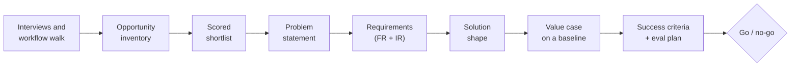

# Chapter 03 — Discovery, Use-Case Scoping and Value Case

> **Serves:** CCAR-P Domain 1 Solution Design (1.1, 1.6) and Domain 6 Stakeholder Communication (6.1) · CCDV-F Domain 2 Understanding Requirements (2.1) · OpenAI Academy **Scope AI Solutions** (main) and **AI Leadership** (business value, priorities) · Role areas **DISC** and **CHANGE**
> **Est. time:** 5–6 hours (reading + 2 notebooks) · **Status:** [ ] not started

Most AI projects that fail were scoped badly before any code was written: the wrong workflow, no baseline, a vague goal and a demo nobody could turn into a decision. This chapter is the architect's first job with a customer. You run discovery, pick the use case worth building, write it down as a problem statement and requirements, sketch the first solution shape on Claude or OpenAI, and agree on the numbers that will decide go or no-go. Everything here is vendor-neutral. The vendor chapters are linked where the build details live.

## What you'll learn

- Run **structured discovery** with business and technical stakeholders and turn what they say into facts, assumptions and open questions.
- Find **AI opportunities inside a real workflow**, then qualify and **prioritize** them on value and feasibility.
- Tell **structural gain** from **marginal gain** and map a use case to the **value pillars** (efficiency, productivity, transformation, cost, SLAs).
- Write a **problem statement**, then derive **functional and infrastructure requirements** from business requirements.
- Choose a **first-cut solution shape** (entry point, pattern, model tier, context strategy) on Claude and on OpenAI.
- Build a **value case** on a measured baseline, and define **success criteria** and an evaluation plan that end in a go/no-go decision.

## Prerequisites

[00-prerequisites](../../00-prerequisites/README.md) (Python, Pydantic) · Claude [01 §1.7](../../anthropic-claude/01-claude-api-fundamentals/README.md#17-model-selection-basics) or OpenAI [01 §1.7](../../openai-codex/01-responses-api-fundamentals/README.md#17-model-selection-and-reasoning-effort) (model tiers) · Claude [08 §8.7](../../anthropic-claude/08-task-decomposition/README.md#87-workflow-or-agent-choosing-the-level-of-autonomy) (augmented call vs workflow vs agent) · Claude [07 §7.9](../../anthropic-claude/07-message-batches/README.md#79-cost-modeling-batch-discount-prompt-caching-and-model-choice) or OpenAI [07 §7.10](../../openai-codex/07-batch-and-cost/README.md#710-cost-modeling-per-request-and-per-workload) (token cost modeling)

## Concepts

One running example ties the sections together. **Harbor Mutual** (a fictional home insurer) receives about **4,000 first-notice-of-loss emails a week**. An adjuster reads each one, finds the policy, classifies the loss, types the details into the claims system and opens a claim. The COO's request is "we need AI for claims". The sections below turn that sentence into a decision. Code snippets assume `claude = anthropic.Anthropic()`, `oai = openai.OpenAI()` and the usual Pydantic and `typing` imports; the notebooks define everything they use.

### 3.1 The discovery arc and owning ambiguity

Discovery produces a chain of small artifacts. Each one is the input to the next, and each one can end the engagement early, which is a good outcome when the idea is weak.



You will rarely have complete information. **Owning ambiguity** means you do not wait for it. Write a working hypothesis on day one ("intake triage is the best first use case"). Keep an **assumptions log**, time-box discovery (two weeks is typical), and make the call with what you have, stating your confidence. When an assumption breaks, change the plan in the open.

| Assumption | If wrong | How we test it | Owner | By |
|---|---|---|---|---|
| Emails contain the policy number 80%+ of the time | Extraction needs a policy lookup tool | Label 200 historical emails | Claims ops lead | Day 5 |
| Claims system has a create-draft API | Integration effort triples | Read API docs, call a sandbox | IT architect | Day 3 |
| Adjusters will review drafts, not retype them | No time saved | Shadow 3 adjusters on a mock-up | Architect | Day 8 |

Sort the log by "if wrong" impact and test the riskiest assumption first. That is ruthless prioritization in practice: the work that can kill the project goes first.

### 3.2 Structured discovery with stakeholders

Interview each role that can block or benefit from the project. Non-technical stakeholders talk in outcomes and pain, so your job is to **translate**: every statement becomes a number with a source, or an assumption to test.

| Stakeholder | What you need from them | A question that gets it |
|---|---|---|
| Executive sponsor | The business priority and what "worth it" means | "Which company goal does this move, and by how much would make it worth funding?" |
| Process owner | Volume, cycle time, the cost of errors | "How many a week? Where does the number come from?" |
| People doing the work | The real workflow and its exceptions | "Walk me through the last one you handled, step by step." |
| IT and security | Systems, data access, identity, hard constraints | "Where does the data live, who may see it, and what review would this need?" |
| Data or compliance owner | What may be sent to a model and kept | "Is this data regulated? Where may it be processed?" |
| Finance | How benefits are counted | "Do you count freed capacity, or only avoided spend?" |

Good discovery habits:

- **Ask for the last real case, not the average.** Averages hide the exceptions that break a design.
- **Separate the requested solution from the problem.** "We need a chatbot" is a solution. Ask what happens today and what it costs.
- **Get a number and its source.** "We're drowning" becomes "4,000 emails a week (claims-system export), 18 minutes each (time study, 3 adjusters)".
- **Play it back.** End each interview with a summary the stakeholder can correct.

A model can structure your notes, but it must not invent facts. Ask for quotes, and keep unconfirmed statements visible.

```python
class Fact(BaseModel):
    topic: Literal["goal", "workflow", "volume", "pain", "data",
                   "risk", "constraint", "success"]
    statement: str
    quote: str            # the stakeholder's own words
    confirmed: bool       # False = an assumption to verify

class DiscoveryNotes(BaseModel):
    facts: list[Fact]
    open_questions: list[str]

def extract_notes(vendor: str, transcript: str) -> DiscoveryNotes:
    if vendor == "claude":
        r = claude.messages.parse(
            model="claude-sonnet-5-5", max_tokens=2000, system=NOTES_SYSTEM,
            messages=[{"role": "user", "content": transcript}],
            output_format=DiscoveryNotes)
        return r.parsed_output
    r = oai.responses.parse(model="gpt-6-luna", instructions=NOTES_SYSTEM,
                            input=transcript, text_format=DiscoveryNotes)
    return r.output_parsed
```

The notebook adds the `stop_reason` and status checks (Claude [02](../../anthropic-claude/02-tool-use/README.md), OpenAI [02](../../openai-codex/02-function-calling-and-structured-outputs/README.md) explain structured outputs).

### 3.3 Finding AI opportunities in a real workflow

Do not start from a list of AI features. Start from **one workflow** and walk it step by step with the people who do it. For each step, record the input, the output, who does it, the minutes it takes, the weekly volume and what an error costs. Then tag each step:

| Tag | Signal | What to do |
|---|---|---|
| **Rule** | The logic can be written as code (premium math, date checks) | Use code. An LLM adds cost and variance. |
| **Language judgment** | Reads or writes unstructured text, needs nuanced judgment, or replaces a rule set nobody can maintain | **LLM candidate** |
| **Human-only** | Accountability, negotiation, a relationship, a final legal decision | Keep it human, but support it with drafts or summaries |
| **Already automated** | A system does it well | Leave it |

OpenAI's [practical guide to building agents](https://cdn.openai.com/business-guides-and-resources/a-practical-guide-to-building-agents.pdf) points at the same signals: complex decisions, rules that are hard to maintain, and heavy use of unstructured data. Add two of your own: **volume** (small wins repeated thousands of times add up) and **tolerance for review** (a human can check the output cheaply).

At Harbor Mutual the walk produces five steps. Reading and classifying the email and extracting its fields are language judgment. Policy lookup and duplicate checks are rules. Approving a large claim is human-only. That gives a candidate ("intake triage and extraction") that is specific enough to score.

### 3.4 Qualifying and prioritizing use cases

Qualify first, then score. **Hard gates** remove ideas that cannot succeed whatever their value. **Scores** rank what is left.

Hard gates (fail one, and the idea is parked with a reason):

- The data is reachable, and policy allows a model to process it.
- There is an **owner** with budget, and the outcome is **measurable** against a baseline.
- A wrong output can be caught or reversed at acceptable cost.

Then score **value** and **feasibility** from 1 to 5. Four qualification criteria carry most of the signal: **volume** (enough repetitions to matter), **complexity fit** (hard enough for a model to add value, structured enough to evaluate), **measurability** (you can measure before and after), and **readiness** (the team, data and systems are ready to adopt it).

```python
GATES = ("data_accessible", "owner", "measurable", "errors_reversible")

def prioritize(uc: dict) -> tuple[str, float, float]:
    failed = [g for g in GATES if not uc[g]]
    if failed:
        return ("park: " + ", ".join(failed), 0.0, 0.0)
    value = (0.4 * uc["pain_size"] + 0.3 * uc["strategic_fit"]
             + 0.3 * uc["volume"])
    feas = (0.3 * uc["data_readiness"] + 0.3 * uc["complexity_fit"]
            + 0.2 * uc["integration_ease"] + 0.2 * uc["team_readiness"])
    if value >= 3.5 and feas >= 3.5:
        quadrant = "quick win: pilot first"
    elif value >= 3.5:
        quadrant = "strategic bet: plan and fund"
    elif feas >= 3.5:
        quadrant = "self-service: enable, do not build"
    else:
        quadrant = "park"
    return (quadrant, round(value, 2), round(feas, 2))
```

**Strategic fit** is how you connect an initiative to business priorities: score it high only when the sponsor can name the company goal it moves. OpenAI's [Identifying and scaling AI use cases](https://cdn.openai.com/business-guides-and-resources/identifying-and-scaling-ai-use-cases.pdf) uses a similar impact/effort quadrant. Start with a quick win to earn trust, and fund strategic bets once you have a measured result.

### 3.5 Value pillars: structural vs marginal gain

Name the gain before you promise it. A **marginal gain** makes the same work faster: adjusters read a summary instead of the whole email. It is real, but it is spread thin and noisy, so it is hard to prove in a 30-day pilot. A **structural gain** changes the unit of work: claims open automatically from extracted fields, and adjusters review only flagged exceptions. Fewer steps, hand-offs or people touch each item. That shows up clearly in a short pilot and holds up in an executive readout.

Map each use case to the value pillar it moves and the metric that proves it:

| Pillar | What changes | Metric that proves it | Harbor Mutual example |
|---|---|---|---|
| **Efficiency** | Same output, less effort per unit | Minutes per claim, cost per claim | 18 → 6 minutes per intake |
| **Productivity** | More output per person | Claims per adjuster per day | Backlog cleared without new hires |
| **Transformation** | The process or the offer changes | New capability, cycle time | Same-hour claim opening, 24/7 |
| **Cost** | Unit economics of running it | Cost per successful task | Model + review cost per claim |
| **Performance SLAs** | Turnaround and reliability | p95 latency, % within SLA | 95% opened within 1 business hour |

Cost and SLA math are taught in Claude [07 §7.8–7.9](../../anthropic-claude/07-message-batches/README.md#78-sla-planning-and-submission-cadence) and OpenAI [07 §7.5](../../openai-codex/07-batch-and-cost/README.md#75-sla-planning-and-choosing-sync-background-flex-or-batch). Here you only need to know which pillar you are claiming.

### 3.6 The problem statement

Turn the strongest candidate into a problem statement the sponsor can sign. It names the user, the job, today's numbers, the target and the limits, and it **contains no solution words** ("chatbot", "agent", "GPT").

| Part | Harbor Mutual |
|---|---|
| **Who** | Claims intake adjusters (42 people, 2 sites) |
| **Job** | Turn a loss email into an opened, correctly classified claim |
| **Today (baseline)** | 18 min per email; median 26 h from email to open claim; 6% reopened for wrong data |
| **Target** | Median under 2 h; reopen rate at or below 6%; no extra headcount |
| **Constraints** | US data only; PII; existing claims system; adjusters approve every claim over $25k |
| **Out of scope** | Fraud scoring, payments, customer replies (phase 2) |
| **Decision by** | Day 30 of the pilot, on the success criteria in 3.10 |

Two warning signs: a baseline you cannot source (go and measure it) and a target with no number ("faster", "better experience").

### 3.7 From business requirements to functional and infrastructure requirements

A **business requirement** says what the organization needs. A **functional requirement (FR)** says what the system must do. An **infrastructure requirement (IR)** says what the system must run on and within: throughput, latency, availability, data location, identity, integration, retention and cost. Every business requirement should trace to at least one FR, and each FR to the IRs it needs.

| Business requirement | Functional requirement | Infrastructure requirement |
|---|---|---|
| BR1 Claims open within 1 business hour | FR1 Classify the loss type; FR2 extract policy number, loss date, address, contact; FR3 create a draft claim | IR1 Peak 150 emails/hour after storms; IR2 p95 under 90 s per email; IR3 claims-system REST API with a service account |
| BR2 Fewer claims reopened for wrong data | FR4 Validate fields against the policy record; FR5 route low-confidence or mismatched fields to an adjuster | IR4 Read access to the policy database; IR5 review queue in the existing work tool |
| BR3 Customer data stays in the US and is auditable | FR6 Log inputs, outputs and the reviewer of every claim | IR6 US-region processing on the chosen platform; IR7 SSO for reviewers; IR8 audit logs kept 7 years |

The IR column is where platform choice gets decided later: data residency in chapter 14 (planned), integration, SSO and identity in chapter 13 (planned); both are in the [chapter plan](../README.md#chapter-plan). Capture them now, because they are the questions a security review will ask first.

### 3.8 A first-cut solution shape on Claude and OpenAI

Scoping ends with a sketch, not a design. Make four decisions and write one sentence of reasoning for each. The [Building effective agents](https://www.anthropic.com/engineering/building-effective-agents) rule applies: pick the simplest shape that meets the requirements.

1. **Entry point:** where users meet it. Is it a chat app for knowledge workers, an integration inside an existing system, an embedded agent, developer tooling, or a tool server that other clients use?
2. **Pattern:** augmented call, workflow or agent ([chapter 04 §4.2](../04-solution-architecture-patterns/README.md#42-augmented-llm-workflow-or-agent), [Claude 08 §8.7](../../anthropic-claude/08-task-decomposition/README.md#87-workflow-or-agent-choosing-the-level-of-autonomy)).
3. **Model tier:** the smallest tier that passes the eval, chosen by measurement, not by brand.
4. **Context strategy:** prompt only, tools that look things up, retrieval over documents, or long context.

| Entry point | Claude | OpenAI | Fits when |
|---|---|---|---|
| Chat app for staff | Claude Enterprise (projects, connected data) | ChatGPT Enterprise (projects, connected data) | Knowledge work with no system to integrate |
| API inside an existing system | Messages API | Responses API | Fixed workflow, structured output, your own UI |
| Embedded agent | Claude Agent SDK | OpenAI Agents SDK | Open-ended, multi-step, tool-heavy work |
| Developer tooling | Claude Code | Codex | Software delivery |
| Tools and data for any client | MCP server | MCP server (remote MCP tool) | Many clients share one integration |

Harbor Mutual: **API inside the claims system** (adjusters keep their current tool); a **workflow** (classify → extract → validate in code → draft claim or route to a review queue), because the steps are known; a **small tier for classification and a mid tier for extraction** (Claude Haiku 4.5 and Sonnet 5.5, or `gpt-6-luna` with `gpt-6.1-sol` as the step-up, settled by the eval); **tools** for policy lookup, with no retrieval in phase 1. Entry points and patterns in depth are in [chapter 04](../04-solution-architecture-patterns/README.md#44-platform-entry-points); picking the model by eval is [chapter 05 §5.2](../05-model-strategy-and-customization/README.md#52-eval-driven-model-selection).

### 3.9 Baselines, the value case and ROI

**No baseline, no denominator.** Measure the current process **before day 1** of the pilot: volume, minutes per task (from system timestamps or a time study), error and rework rate, and cycle time. A number measured after the pilot starts can never be compared fairly.

The value case is small arithmetic with honest inputs:

```python
def value_case(volume, min_before, min_after, rate_per_hour, adoption,
               run_cost_per_task, build_cost, yearly_fixed_cost):
    """One year. volume = tasks/year; adoption = share that uses it."""
    hours_saved = volume * adoption * (min_before - min_after) / 60
    benefit = hours_saved * rate_per_hour
    yearly_cost = volume * adoption * run_cost_per_task + yearly_fixed_cost
    net = benefit - yearly_cost
    total_cost = build_cost + yearly_cost
    return {
        "benefit": round(benefit),
        "total_cost": round(total_cost),
        "roi_year1": round((net - build_cost) / total_cost, 2),
        "payback_months": (round(build_cost / (net / 12), 1)
                           if net > 0 else None),
    }

value_case(208_000, 18, 6, 55, 0.7, 0.02, 300_000, 150_000)
# {'benefit': 1601600, 'total_cost': 452912, 'roi_year1': 2.54,
#  'payback_months': 2.5}
```

Lessons from the numbers:

- **Model cost is rarely the problem.** About 3,000 input and 600 output tokens per claim is about $0.012 on Sonnet 5.5 ($2 / $10 per million tokens), or $2,500 a year. People, review time and fixed run costs dominate.
- **Adoption, minutes saved and the hourly rate drive the result.** Show a pessimistic, expected and optimistic case, and say which input the decision depends on.
- **Hours freed are not dollars saved.** Finance counts *hard* savings (overtime, contractors, hires avoided) differently from *soft* capacity. Label both.
- **Price the human review.** Report the **cost per successful task**, including review and rework, not the token cost per call.

### 3.10 Success criteria, pilot design and the evaluation plan

Agree on success criteria **before** the build, with a number, a measurement method and a data source for each. Use three kinds:

| Kind | Example (Harbor Mutual) | Measured on |
|---|---|---|
| **Business target** | Median email-to-claim time under 2 h | Claims-system timestamps, pilot cohort vs baseline |
| **Quality threshold** | Policy number correct ≥ 98%; loss type correct ≥ 92% | 300 historical emails, stratified by loss type, labeled by 2 adjusters |
| **Guardrail** (must not break) | 0 claims auto-created on the wrong policy; p95 ≤ 90 s; ≤ $0.05 per claim; ≤ 25% routed to review | Eval set + pilot logs |

The **pilot design** answers who, how long and what decides: one or two teams as the cohort, a comparable team as control, 30 days, baseline captured beforehand, and the decision rule written down. A missed guardrail means **no-go** whatever the business number says. A missed target with green guardrails means **iterate**.

```python
def decide(results: dict, criteria: list[tuple]) -> str:
    """criteria: (metric, "<=" or ">=", threshold, kind)."""
    def passed(metric, op, limit):
        v = results.get(metric)          # not measured = not passed
        return v is not None and (v <= limit if op == "<=" else v >= limit)
    failed = [(m, kind) for m, op, limit, kind in criteria
              if not passed(m, op, limit)]
    if any(kind == "guardrail" for _, kind in failed):
        return "no-go"
    return "iterate" if failed else "go"
```

The quality thresholds become the eval suite. How to build representative datasets and graders is in [Define success criteria and build evaluations](https://platform.claude.com/docs/en/test-and-evaluate/develop-tests), OpenAI [06 §6.9](../../openai-codex/06-prompt-engineering-and-evals/README.md#69-building-your-own-eval-harness) and chapter 08 (planned).

### 3.11 Domain fluency: what changes by industry

The method is the same everywhere. What changes is the binding constraint and the first question you must ask. Learn the vocabulary of the customer's industry before the first meeting.

| Industry | Common first use cases | Binding constraints | Ask early |
|---|---|---|---|
| **Financial services** | KYC document review, research summaries, complaint triage | Model risk management, record-keeping, explainability | "Does this count as a model under your model-risk policy?" |
| **Healthcare and life sciences** | Clinical note drafting, prior-authorization packets, trial document review | HIPAA and PHI, a signed BAA, a clinician in the loop | "Is PHI in scope, and which platforms are covered by a BAA?" |
| **Public sector** | Case summaries, records requests, policy Q&A | Authorization such as FedRAMP, residency, accessibility, procurement cycles | "Which authorization level and which cloud region are required?" |
| **Legal** | Contract review, due diligence, research | Privilege, confidentiality, citation accuracy | "Who signs off on output that a client will see?" |
| **Insurance** | Claims intake, underwriting summaries | State regulation, fair treatment in claim decisions | "Which decisions must stay with a licensed person?" |
| **Cybersecurity** | Alert triage, detection-rule drafting | Untrusted input (prompt injection), isolated networks | "Can the system reach the internet, and what may it execute?" |

Treat this table as a starting checklist, not legal advice. Mapping obligations to controls is chapter 12 (planned).

## Notebooks

| Notebook | What you do |
|---|---|
| [`01_practice.ipynb`](01_practice.ipynb) | Run one section per concept on the Harbor Mutual case, offline: assumptions log, interview notes structured by both vendors through one interface (fake clients), workflow tagging, gates and scoring, gain classification, a problem-statement lint, requirement tracing, solution shape, value case with sensitivity, and a go/no-go decision. Mini-project: a one-page scope brief for a second client. |
| [`02_homework.ipynb`](02_homework.ipynb) | 8-question scenario quiz, 4 auto-checked offline exercises (prioritization, value case, requirement tracing, go/no-go), an architecture scenario with a rubric, and a scorecard (pass mark 72%) |

## Cheat-sheet

| Situation | Do | Not |
|---|---|---|
| Sponsor asks for "a chatbot" | Walk the workflow, find the costly step, write the problem first | Build the requested solution |
| Many ideas, little time | Hard gates first, then value × feasibility | A staff vote or the loudest stakeholder |
| Step is pure logic | Code | An LLM call |
| Gain is "same work, faster" | Expect a noisy pilot; look for a structural version | Promise a 30-day ROI on it |
| No baseline yet | Measure before day 1 | Estimate it after launch |
| ROI depends on one input | Show pessimistic / expected / optimistic | One optimistic number |
| Guardrail missed, target hit | No-go, fix and re-run | Ship because the KPI looks good |
| Information is incomplete | Assumptions log, test the riskiest first, decide on time | Wait for certainty |

## Common mistakes

- **Solution-first discovery.** Starting from a model or a demo instead of a workflow and its numbers.
- **Averages only.** Designing for the typical case and missing the exceptions that create most of the cost.
- **No owner, no baseline.** Picking a use case nobody owns or nobody measured, so success cannot be shown.
- **Counting hours as cash.** Presenting freed capacity as savings that finance will not recognize.
- **Token-only cost.** Ignoring review, rework and fixed run costs in the value case.
- **Criteria after the fact.** Defining success once results are in, so every pilot "succeeds".

## Self-check

**1. (Discovery)** A logistics company's COO says: "Our operations team needs a chatbot. Start building next week." You have two weeks before the steering meeting. What is your first move?

- A) Build a retrieval chatbot over the operations manuals so the COO sees progress quickly
- B) Ask the COO which vendor's model they prefer, then size the build
- C) Walk through the last few real cases with the people who do the work, capture volume, minutes and error cost with their sources, and separate the requested chatbot from the underlying problem
- D) Send an AI-ideas survey to all staff and build the idea with the most votes

<details><summary>Answer</summary>

**C.** Discovery starts from the real workflow and its numbers. Then the chatbot request can be tested against the actual problem. A commits to a solution before anyone knows the problem or the baseline. B makes a vendor choice before there are requirements. D ranks ideas by popularity, not by value, feasibility or ownership.
</details>

**2. (Prioritization)** Three candidates remain. **X**: high value, but the data sits in a system the security team will not open this year. **Y**: high value, high feasibility, an owner with budget, and system timestamps for a baseline. **Z**: high feasibility, low value, and one analyst wants it as a personal assistant. Which should you pilot first?

- A) X, because it has the highest value
- B) Y, because it passes the hard gates and scores high on both axes
- C) Z, because it is the easiest to build
- D) All three in parallel to spread the risk

<details><summary>Answer</summary>

**B.** Y is a quick win: it passes every gate and can be measured against a real baseline. A ignores a failed gate (no data access), so its value cannot be realized. C is self-service: enable the analyst with an existing chat app instead of a build. D splits a small team three ways and weakens the one result that would earn trust.
</details>

**3. (Value case)** The CFO rejects your ROI slide: "You estimated hours saved from a vendor benchmark, and hours aren't dollars." What fixes the value case?

- A) Raise the adoption assumption to 100% so the savings look bigger
- B) Measure minutes per task and volume from system timestamps before day 1, split hard savings from freed capacity, include review and fixed costs, and show a pessimistic, expected and optimistic case
- C) Replace the benchmark with a newer one from another vendor
- D) Drop the cost of human review, because reviewers are already on the payroll

<details><summary>Answer</summary>

**B.** It answers both objections: a measured baseline replaces the benchmark, and splitting hard and soft savings shows what finance can count. A and D make the case less credible by hiding real inputs. C still uses someone else's numbers instead of the customer's own.
</details>

**4. (Requirements)** A hospital network states: "Referral faxes must be processed the same day, and patient data may not leave our approved cloud region." Which translation is correct?

- A) FR: use the largest available model. IR: a faster network
- B) FR: build an agent. IR: none, because cloud platforms handle residency automatically
- C) FR: classify the referral, extract patient and referrer fields, and queue uncertain fields for staff review. IR: same-day throughput at peak fax volume, processing in the approved region on a platform covered by the hospital's BAA, SSO for reviewers, and audit logging
- D) FR: process faxes quickly. IR: keep data safe

<details><summary>Answer</summary>

**C.** It states what the system does (functional) and what it must run on and within (infrastructure), and it traces to both business requirements. A and B name implementation choices, not requirements, and B wrongly assumes residency is automatic. D restates the business requirement with nothing testable.
</details>

## Official documentation

- [Define success criteria and build evaluations](https://platform.claude.com/docs/en/test-and-evaluate/develop-tests) (Claude Docs): specific, measurable criteria and test sets
- [Choosing the right model](https://platform.claude.com/docs/en/about-claude/models/choosing-a-model) (Claude Docs): picking a tier by capability, speed and cost
- [Pricing](https://platform.claude.com/docs/en/about-claude/pricing) (Claude Docs): per-token prices for the value case
- [Building effective agents](https://www.anthropic.com/engineering/building-effective-agents) (Anthropic Engineering): start with the simplest shape
- [Identifying and scaling AI use cases](https://cdn.openai.com/business-guides-and-resources/identifying-and-scaling-ai-use-cases.pdf) (OpenAI): finding opportunities and the impact/effort framework
- [A practical guide to building agents](https://cdn.openai.com/business-guides-and-resources/a-practical-guide-to-building-agents.pdf) (OpenAI): which workflows suit agents
- [Evaluation best practices](https://developers.openai.com/api/docs/guides/evaluation-best-practices) (OpenAI Docs): from success criteria to an eval plan
- [Pricing](https://developers.openai.com/api/docs/pricing) (OpenAI Docs): per-token prices for the value case

[← Chapter 02 — Workflow design and delegation](../02-workflow-design-and-delegation/README.md) | [↑ Applied AI Architect track](../README.md) | [Chapter 04 — Solution architecture patterns →](../04-solution-architecture-patterns/README.md)

Certification coverage, more self-check questions and share text: [coverage/README.md](coverage/README.md)
