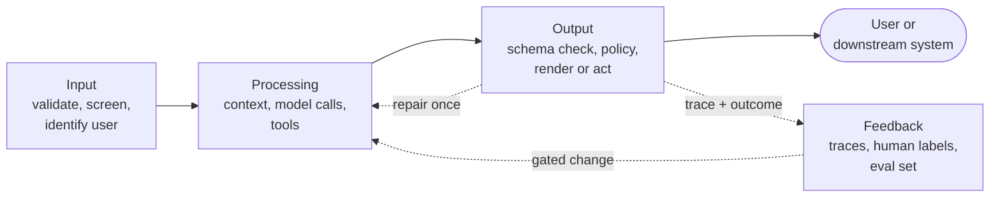

# Chapter 04 — Solution architecture patterns

> **Serves:** CCAR-P Domain 1 Solution Design & Architecture (task 1.2, end-to-end architectures) and Domain 3 Integration (task 3.7, choosing MCP, API/CLI or agent-to-agent) · OpenAI Academy *Scope AI Solutions* (implementation options, agent vs chatbot) · role areas ARCH and AGENT · also feeds CCDV-F Agents and Workflows
> **Est. time:** 5–7 hours (reading + 2 notebooks) · **Status:** [ ] not started · **Facts checked:** 2026-11-06

The vendor chapters taught the parts: a model call, tools, an agent loop, MCP, retries. This chapter is about **putting the parts together** into a system you can draw on one page, defend in a design review and run in production. Every design here is vendor-neutral, and each pattern is shown on Claude and on OpenAI behind one small interface.

The architect's job in one sentence: pick the **simplest shape that meets the requirement**, connect it to the customer's systems with the **right integration mechanism**, make it **survive failures**, and **close the loop** so it gets better after launch.

## What you'll learn

- Draw any LLM solution as **input → processing → output → feedback**, and say what each stage owns.
- Choose between an **augmented LLM call, a workflow and an agent** by what each one costs, and tell an agent apart from a chatbot.
- Start from a **reference architecture** that matches the problem shape instead of a blank page.
- Pick the right **platform entry point** (chat app, API, SDK, coding agent, MCP server) for Claude and OpenAI.
- Select **MCP, a direct API/CLI call or agent-to-agent (A2A)** for each integration.
- Apply **resilience patterns**: retries, timeouts, fallbacks, circuit breakers and idempotent tools.
- Hide two vendors behind **one thin interface**, and write the design down as a one-page record.

## Prerequisites

[00-prerequisites](../../00-prerequisites/README.md) (Python, `.env`) · Claude path chapters 01–04 or OpenAI path chapters 01–04 · strongly recommended: [Claude 08 — Task decomposition](../../anthropic-claude/08-task-decomposition/README.md) (the workflow pattern catalog) and [Claude 10 — Error handling](../../anthropic-claude/10-multi-agent-error-handling/README.md) (error categories and SDK retries).

## Concepts

Snippets are plain Python. Model calls go through the `LLM` interface from [4.7](#47-one-interface-two-vendors-claude-vs-openai). Model ids: `claude-sonnet-5-5` and `gpt-6-luna` by default.

The design walk this chapter follows, in order:

1. **Shape** the system end to end (4.1).
2. Pick the **autonomy level** (4.2), then a matching **blueprint** (4.3).
3. Choose the **entry point** users and engineers touch (4.4).
4. Choose the **integration mechanism** for every external system (4.5).
5. Add **resilience** at every boundary (4.6).
6. Put the **vendor** behind an interface (4.7) and **write it down** (4.8).

### 4.1 The end-to-end shape: input, processing, output, feedback

Every LLM solution, from a classifier to a multi-agent system, has four stages. A design review checks each one.



| Stage | What it owns | Typical components | If you skip it |
|---|---|---|---|
| **Input** | Accept only what the system can handle | Size and type checks, PII redaction, injection screening, auth and tenant id | Bad or hostile input reaches the model |
| **Processing** | Turn input into a decision or draft | Retrieval, prompt and context assembly, model calls, tool calls, the workflow or agent loop | (this is the part teams over-focus on) |
| **Output** | Make the result safe to use | Structured-output validation, business rules in code, citations check, human approval for risky actions | A plausible but wrong answer is acted on |
| **Feedback** | Make the system measurably better | Traces per request, user ratings, human corrections, an **eval set** that gates every change | Quality drifts and nobody can prove it |

There are three feedback loops, at three speeds:

- **Runtime (milliseconds):** an output check fails → one repair attempt with the error as feedback → otherwise route to a human. Never loop forever.
- **Human (minutes to days):** reviewers correct outputs; each correction is stored with the input.
- **Offline (per release):** corrections and sampled traffic become **eval cases**. A prompt, model or architecture change ships only if the eval set says it is no worse. This is what OpenAI's app-development track means by "core logic plus evals": the evals are part of the architecture, not a later project ([chapter 08](../README.md#chapter-plan) teaches them).

```python
def handle(request: dict, llm: LLM, trace: list) -> dict:
    ok, reason = check_input(request)                     # input
    if not ok:
        return {"status": "rejected", "reason": reason}
    prompt = build_context(request)                       # processing
    draft = llm.complete(SYSTEM, prompt)
    errors = check_output(draft)                          # output
    if errors:                                            # runtime loop:
        draft = llm.complete(SYSTEM, prompt +             # one repair
                             f"\n<errors>{errors}</errors>")
        errors = check_output(draft)
    status = "needs_review" if errors else "ok"
    trace.append({"id": request["id"], "status": status,  # feedback
                  "errors": errors, "model": llm.name})
    return {"status": status, "answer": draft}
```

> **Exam trap:** "Improve accuracy" questions often offer a better prompt. If the scenario has no feedback stage (no traces, no labeled cases), the stronger answer adds the **measurement** first, because without it you cannot tell whether the prompt helped.

### 4.2 Augmented LLM, workflow or agent

[Claude 08 §8.6–8.7](../../anthropic-claude/08-task-decomposition/README.md#87-workflow-or-agent-choosing-the-level-of-autonomy) and [OpenAI 08 §8.1](../../openai-codex/08-task-decomposition-and-orchestration/README.md#81-workflows-vs-agents-choosing-a-decomposition-shape) teach the patterns. Here is the architect's question: **what does each level of autonomy cost the customer?**

| | Augmented LLM call | Workflow | Agent |
|---|---|---|---|
| Who decides the next step | Nobody: one call (with retrieval, tools or structured output) | Your code, along predefined paths | The model, turn by turn, until a stop condition |
| Calls per request | 1 | Fixed or bounded | Unknown in advance (cap it) |
| Cost and latency | Lowest, predictable | Low to medium, predictable | Higher and variable |
| Testing | One eval per call | Eval each step | Eval whole trajectories |
| Blast radius of a wrong step | One answer | One step, caught by a gate | Can chain several actions |
| Pick it when | One well-prompted call meets the bar | The path is known (or chosen by a router) | Steps depend on what the environment returns |

**Agent or chatbot?** OpenAI's [Building agents](https://developers.openai.com/tracks/building-agents) track gives a useful test: an agent has **instructions** (what to do), **guardrails** (what not to do) and **tools** (what it can do), and it **acts on the user's behalf** in a loop. A chatbot that only answers questions is not an agent, even when it is very good. Anthropic draws the same line between workflows ("predefined code paths") and agents ("dynamically direct their own processes").

Four questions settle most cases:

1. Can you write the steps down before the request arrives? Yes → workflow.
2. Does the number of steps depend on what tools return? Yes → agent.
3. Are actions reversible and cheap to check? If not, keep a human approval in front of them, whatever the level ([Claude 09](../../anthropic-claude/09-escalation-human-in-the-loop/README.md)).
4. Does an augmented call already meet the success metric on the eval set? Then stop there.

> **Exam trap:** "Use an agent so the system can handle anything" is rarely right. Autonomy adds cost, latency variance and new failure modes. Choose it only when the problem is **open-ended**, and justify it with an eval result, not with flexibility.

### 4.3 Reference architectures

A **reference architecture** (blueprint) is a tested answer to a recurring problem shape. Starting from one saves weeks and avoids known failure modes. Six cover most enterprise requests:

| Blueprint | Problem shape | Autonomy | Core components | The control that matters most | Built in |
|---|---|---|---|---|---|
| **Grounded Q&A assistant** | Answer questions from the customer's documents | Augmented call | Retrieval (hybrid search, reranking), citations, refusal when nothing relevant is found | Answers only from retrieved sources | [Chapter 06](../06-rag-pipelines/README.md) (07 and capstone 05 planned) |
| **Extraction pipeline** | Turn many documents into records | Workflow (often batched) | Strict schema, validation and repair, batch API, confidence routing | Nullable fields, not invented values | [Capstone 03](../capstones/03-extraction-pipeline-at-scale/README.md) |
| **Triage and routing** | Sort requests into known queues | Workflow (router) | Cheap classifier model, `other` category, per-route handlers | An "unclear" route to a human | [Claude 08 §8.6](../../anthropic-claude/08-task-decomposition/README.md#86-the-workflow-pattern-catalog) |
| **Resolution agent** | Resolve a customer issue with account tools | Agent | Tool loop, preconditions in code, structured escalation | Policy enforced in code, not in the prompt | [Capstone 01](../capstones/01-support-resolution-agent/README.md) |
| **Research system** | Broad questions across many sources | Orchestrator-workers | Coordinator, scoped subagents, provenance per claim | Coverage check and claim-to-source mapping | [Capstone 02](../capstones/02-multi-agent-research-with-provenance/README.md) |
| **Coding agent for a team** | Change and review code | Agent in a harness | Claude Code or Codex, shared config, CI review | Sandbox, permissions and independent review | [Capstone 04](../capstones/04-coding-agents-for-a-team/README.md) |

A blueprint is only reusable if it says more than "boxes and arrows". Write each one as a **blueprint card**:

- **Fits when / does not fit when** (for example: the Q&A assistant does not fit when answers need live transactional data; that needs tools).
- **Components and contracts:** each component and the schema it hands to the next.
- **Controls:** where validation, approval and screening sit.
- **Eval set and pass bar:** what "working" means, measured.
- **Cost model:** calls and tokens per request, so a customer can budget.
- **Known limits:** what breaks first at scale.

Real systems combine blueprints: a router in front of a Q&A assistant and a resolution agent is common. Combine them at **clear boundaries** (the router's output is a structured route), not by merging prompts.

### 4.4 Platform entry points

An **entry point** is where people or code touch the vendor platform. Choose it before the integration details, because it decides who builds, who operates and what the customer pays for.

| Entry point | Claude | OpenAI | Who uses it | Pick it when |
|---|---|---|---|---|
| **Chat workspace** | Claude apps (web, desktop, mobile), Projects, Cowork; Claude Enterprise | ChatGPT; ChatGPT Enterprise | Knowledge workers | The work is interactive and a person checks every result; no code to build |
| **Model API** | Messages API (stateless) + client SDKs | Responses API (stateless or server-stateful) + SDKs | Engineers | You own the flow: a single call or a workflow inside your product |
| **Embedded agent runtime** | Claude Agent SDK (the Claude Code harness as a library) | OpenAI Agents SDK | Engineers | You need an agent loop inside your app, with your tools, storage and approvals |
| **Managed agent runtime** | Claude Managed Agents (beta) | Agents API (beta) | Engineers | The vendor should run the loop, sessions and sandbox for long tasks; check data controls first |
| **Coding agent** | Claude Code | Codex | Developers, CI | The work is in a repository or a terminal |
| **Integration surface** | MCP servers and connectors; Claude Code and Cowork plugins | MCP servers; ChatGPT and Codex plugins (skills + MCP servers + optional UI) | Platform teams | One capability should be available in many of the entry points above |

Rule of thumb: **start at the highest-level entry point that meets the requirement and move down only for control** you can name (custom UI, your own data store, a deterministic flow, strict latency). A "chat with our policies" request for 200 employees is usually a workspace project, not a custom app. Which cloud runs the model (Bedrock, Google Cloud, Microsoft Foundry, Azure) is a separate decision, taught in chapter 14 of this track; the API surface stays almost the same ([Claude 01 §1.8](../../anthropic-claude/01-claude-api-fundamentals/README.md#18-access-paths-sdks-raw-rest-async-clients-and-cloud-platforms)).

### 4.5 Integration mechanisms: MCP, API/CLI or agent-to-agent

Every external system the solution touches needs a connection. There are three families:

- **Direct API or CLI.** Your code calls the system (a REST endpoint behind a function tool, or a command such as `gh` or `aws` that a coding agent runs in its shell). No extra protocol.
- **MCP (Model Context Protocol).** The system is wrapped once as an **MCP server** exposing tools, resources and prompts; any MCP client (Claude Code, Claude Agent SDK, the Messages API MCP connector, the Responses API remote MCP tool, the OpenAI Agents SDK, Codex) can use it ([Claude 04](../../anthropic-claude/04-model-context-protocol/README.md), [OpenAI 04](../../openai-codex/04-built-in-tools-and-mcp/README.md)).
- **Agent-to-agent (A2A).** The other side is an **autonomous agent** owned by another team or vendor. The [A2A protocol](https://a2a-protocol.org/latest/) (v1.0; Google donated it to the Linux Foundation, which also hosts MCP) lets an agent publish an **Agent Card** (`/.well-known/agent-card.json`: skills, endpoint, auth) and accept **tasks** that move through states such as working, input-required, completed and failed. A2A's own summary: MCP connects an agent to its tools; A2A connects agents to each other.

| Question | Direct API / CLI | MCP | Agent-to-agent |
|---|---|---|---|
| Who is on the other side? | A deterministic system | A deterministic system | Another reasoning agent |
| How many clients need it? | One application | Many apps, agents or teams | Agents across organizations or frameworks |
| Interaction | One request, one response | Tool calls, plus resources and prompts | Multi-turn tasks that may ask for input, run long and stream progress |
| Main cost | Writing the integration per app | Running a server; tool definitions use context | Running and securing an agent endpoint |
| Typical example | `create_ticket` tool in one support app | Company-wide "orders" server used by Claude Code, the support agent and a Cowork plugin | A travel agent hands a booking task to an airline's agent |

```python
def pick_integration(other_side_reasons: bool, clients: int,
                     agent_has_shell: bool, cli_exists: bool) -> str:
    if other_side_reasons:            # it plans, asks questions, runs long
        return "a2a"
    if agent_has_shell and cli_exists:
        return "cli"                  # e.g. gh, aws: no server to build
    if clients > 1:
        return "mcp"                  # build once, reuse everywhere
    return "api"                      # one app: a function tool is enough
```

- **CLI is often the cheapest choice for coding agents.** A well-known CLI costs no tool definitions in context and is already permissioned; an MCP server is worth it when it adds something the CLI cannot (an index, auth the agent should not hold, data outside the machine). See [Claude 13 §13.8](../../anthropic-claude/13-claude-code-builtin-tools/README.md#138-built-in-tools-vs-mcp-tools).
- **Many MCP tools cost context.** Every connected tool's definition competes for the window; use tool search or deferred loading and keep tool sets small per agent.
- **Same contract, three surfaces.** Define the capability once (name, description, JSON schema) and render it as a Claude tool, an OpenAI function tool or an MCP tool. The practice notebook does this.

> **Exam trap:** Wrapping a whole remote agent as one MCP tool hides its questions and progress: the caller gets one opaque answer. The opposite mistake is just as common: using A2A for a stateless lookup that one API call (or one MCP tool) does better.

### 4.6 Resilience patterns

LLM systems fail like any distributed system, plus two new ways: outputs that are valid but wrong, and agents that repeat actions. Put a pattern at every boundary:

| Pattern | Protects against | Where it sits | Notes |
|---|---|---|---|
| **Retry with backoff and jitter** | 429, 5xx, 529 overloaded, timeouts | The SDK client | Both SDKs retry **twice by default** with backoff from 0.5 s (max 8 s) and honor `retry-after`. Let **one layer** own retries ([Claude 10 §10.2](../../anthropic-claude/10-multi-agent-error-handling/README.md#102-error-categories-and-the-retryable-flag), [OpenAI 10 §10.2](../../openai-codex/10-multi-agent-error-handling/README.md#102-openai-client-errors-retries-and-timeouts)) |
| **Timeouts and deadlines** | Hung calls, runaway loops | Per call, per step, per request | Default SDK timeout is 10 minutes: set your own. Cap agent turns and spend |
| **Fallback** | A model or vendor is down or too slow | Around the model call | Another model tier, the other vendor (behind 4.7's interface), a cached answer, or a human queue. Each fallback path needs its own eval pass |
| **Circuit breaker** | Hammering a failing dependency | Around each dependency | After N failures, fail fast for a cool-down, then let one trial call through (half-open) |
| **Idempotent tools** | Duplicate side effects after a retry or replay | Inside every tool that changes state | Key on the **business action** (order id + action), store the result, return it on repeat |
| **Concurrency limits** | Self-inflicted rate limits | In front of the API | A semaphore or queue; never "retry harder" |

```python
class CircuitBreaker:
    def __init__(self, threshold=3, cooldown_s=30.0, clock=time.monotonic):
        self.threshold, self.cooldown_s = threshold, cooldown_s
        self.clock, self.failures, self.opened_at = clock, 0, None
    def allow(self) -> bool:      # closed, or cooled down (half-open)
        return (self.opened_at is None
                or self.clock() - self.opened_at >= self.cooldown_s)
    def record(self, ok: bool) -> None:
        self.failures = 0 if ok else self.failures + 1
        if ok or self.failures >= self.threshold:
            self.opened_at = None if ok else self.clock()

def complete_with_fallback(providers, breakers, system, user):
    for llm in providers:                     # e.g. [claude, openai]
        if not breakers[llm.name].allow():
            continue                          # fail fast, skip this one
        try:
            text = llm.complete(system, user)
        except (anthropic.APIError, openai.APIError):
            breakers[llm.name].record(False)
            continue
        breakers[llm.name].record(True)
        return llm.name, text
    raise RuntimeError("all providers unavailable: route to a human queue")
```

This sketch keeps two things simple on purpose. After the cool-down it lets **every** caller try, not one trial at a time. And it falls back on **every** API error, but a 400 or 401 is your bug: it would fail on the other vendor too, so re-raise it and do not count it on the breaker. Homework exercises 2 and 4 build the strict versions.

**Why idempotency matters more with agents.** An agent that times out mid-tool-call, or a run resumed from a checkpoint, may call `issue_refund` again. The tool-call id is new each time, so it is not a safe key. Use the business identity (`refund:{order_id}`), and record the result before you return it. MCP lets a server mark a tool with `idempotentHint` and `destructiveHint` annotations: useful hints for clients, but **your tool code** still has to enforce it.

> **Exam trap:** A model call that is retried is a new generation: it costs again and may answer differently. Retries make **transport** reliable, not **answers**. Wrong-but-valid outputs need validation, evals and human review, not more retries.

### 4.7 One interface, two vendors (Claude vs OpenAI)

Customers ask "Claude or OpenAI?" in almost every engagement, and many want the option to switch or to fail over. Put the vendor behind a **thin interface at the task level**: your code asks for "complete this", "classify this" or "extract this", never for vendor-specific message shapes.

```python
class LLM(Protocol):
    name: str
    def complete(self, system: str, user: str) -> str: ...

class ClaudeLLM:
    def __init__(self, client, model="claude-sonnet-5-5"):
        self.client, self.model, self.name = client, model, "claude"
    def complete(self, system, user):
        r = self.client.messages.create(
            model=self.model, max_tokens=1024, system=system,
            messages=[{"role": "user", "content": user}])
        return "".join(b.text for b in r.content if b.type == "text")

class OpenAILLM:
    def __init__(self, client, model="gpt-6-luna"):
        self.client, self.model, self.name = client, model, "openai"
    def complete(self, system, user):
        r = self.client.responses.create(
            model=self.model, instructions=system, input=user,
            max_output_tokens=1024)
        return r.output_text
```

What to abstract and what not to:

| Abstract it | Keep it vendor-specific |
|---|---|
| The task (complete, classify, extract), your schemas, your tool contracts | Hosted tools (web search, file search, code execution) |
| Retries policy, timeouts, tracing fields | Prompt caching (Claude: opt in with `cache_control`; OpenAI: automatic for long prefixes) |
| The eval set (the same cases score both vendors) | Agent runtimes: subagents vs handoffs and agents-as-tools |
| Cost per request in one currency | Prompts: tune per vendor and re-run evals; do not assume a prompt transfers |

The architecture-level comparison of building blocks is in the [track README](../README.md#claude--openai-at-the-architecture-level). Choosing **which** model and whether to go multi-model is [chapter 05](../05-model-strategy-and-customization/README.md) of this track. Over-abstracting is a real risk: a lowest-common-denominator layer throws away the features that made one vendor the better fit.

### 4.8 Writing it down: the architecture one-pager

A design that lives only in the architect's head does not survive a security review or a handoff. Write a one-page record and keep it with the code. For **every** decision, name the runner-up and why it lost: that is what lets a reviewer, or a CCAR-P exam scenario, check the reasoning.

| Section | What to write |
|---|---|
| Problem and success metric | One sentence each; the metric is measured by the eval set |
| Shape | Blueprint(s) and autonomy level (4.2–4.3); **rejected alternative** and why |
| Entry point | Who uses what (4.4); rejected alternative |
| Integrations | One row per external system: mechanism (4.5), auth, owner |
| Stages | Input checks, processing steps, output checks and human approvals (4.1) |
| Resilience | Retry owner, timeouts, fallbacks, breakers, idempotent tools (4.6) |
| Feedback | What is traced, who labels, how often the eval set grows, what gates a release |
| Cost and latency | Calls and tokens per request, p95 latency target |
| Open risks | What you would test first |

## Notebooks

| Notebook | What you do |
|---|---|
| [`01_practice.ipynb`](01_practice.ipynb) | One section per concept 4.1–4.8, offline against real SDK clients with fake HTTP transports (one optional live cell); mini-project: a claims-intake service with all four stages, a Claude-to-OpenAI fallback behind a circuit breaker, an idempotent `create_claim` tool and a generated one-pager |
| [`02_homework.ipynb`](02_homework.ipynb) | 8-question scenario quiz, 4 auto-checked exercises (a design-review linter, a circuit breaker with a half-open state, idempotent tools, a fallback chain that knows which errors to fall back on), an architecture scenario with a rubric and a scorecard (pass mark 72%) |

## Cheat-sheet

| Situation | Choose | Over |
|---|---|---|
| One well-prompted call meets the eval bar | Augmented LLM call | Workflow or agent "for flexibility" |
| Known steps, or known categories | Workflow (chain or router) | Agent |
| Steps depend on what tools return | Agent with caps and approvals | Fixed chain that cannot react |
| Employees need help with documents, no product to build | Chat workspace project | Custom app |
| Agent loop inside your product | Claude Agent SDK / OpenAI Agents SDK | Writing the loop from scratch |
| One app needs one system | Direct API (function tool) | An MCP server nobody else uses |
| Many apps and agents need the same system | MCP server | Per-app adapters |
| Coding agent and a mature CLI exists | CLI | A thin MCP wrapper around the same CLI |
| The other side is an agent that plans and asks questions | A2A | Wrapping it as one opaque tool |
| 429 / 5xx / overloaded | SDK retries + concurrency limit | App-level retry loops on top of SDK retries |
| A dependency keeps failing | Circuit breaker + fallback | Retrying every request |
| A tool changes state | Idempotency key on the business action | Trusting the agent not to repeat |

<a id="common-mistakes-and-anti-patterns"></a>

## Common mistakes

- **No feedback stage.** Shipping without traces, labels or an eval set, so quality cannot be measured or improved.
- **Agent by default.** Choosing the most autonomous shape for a problem with a known path.
- **Blank-page design.** Ignoring a blueprint that already solves the problem shape, and rediscovering its failure modes.
- **Building below the needed entry point.** A custom app where a workspace project would do, or a hand-written loop where an agent SDK fits.
- **One integration style for everything.** MCP servers for single-use calls, or tools wrapped around agents that need A2A.
- **Stacked retries.** SDK retries times app retries times worker re-runs, multiplying load during an outage.
- **Non-idempotent tools.** A refund or ticket created twice after a timeout.
- **Leaky or lowest-common-denominator abstraction.** Either vendor shapes everywhere in the code, or a wrapper that hides every useful feature.
- **Undefended decisions.** A design doc with choices but no rejected alternatives.

## Self-check

**1. (Solution design)** An insurer wants to cut first-response time on 3,000 claim emails a day. Each email belongs to one of six claim types, each type already has a written handling procedure, and about 10% are unclear. A vendor proposes an autonomous agent with tools for every back-office system. What is the best architecture?

- A) The autonomous agent, because it can adapt to emails the procedures do not cover
- B) A routing workflow: a cheap model classifies into the six types plus "unclear", code dispatches to a per-type chain, "unclear" goes to a human, and traces plus reviewer corrections feed an eval set
- C) One large prompt that contains all six procedures and answers every email
- D) A multi-agent system with one specialist agent per claim type and a coordinator

<details><summary>Answer</summary>

**B.** The categories and procedures are known, so a router plus fixed chains is cheaper, predictable and testable per step, and the feedback stage makes it measurable. A adds cost, variance and a large blast radius for no capability the problem needs. C mixes six procedures in one context and leaves nothing to check between steps. D is heavy over-engineering of a routing problem.
</details>

**2. (Integration)** A retailer's order system must be available to its support agent, to developers in Claude Code and Codex, and to a Cowork plugin for the operations team. Today each team writes its own adapter. What should the architect recommend?

- A) One MCP server for the order system, with scoped auth and clear tool descriptions, used by all of those clients
- B) Keep a separate REST integration in each application, because each team knows its own needs
- C) Expose the order system as an A2A agent so the other agents can negotiate with it
- D) Give every client a database connection string so the models can query orders directly

<details><summary>Answer</summary>

**A.** Several different clients need the same deterministic capability, which is exactly MCP's N + M case: build once, reuse everywhere, and govern auth in one place. B keeps the N × M adapter cost. C is for systems that reason and run multi-turn tasks; an order lookup does not. D bypasses all access control and puts raw SQL in the model's hands.
</details>

**3. (Resilience)** During a provider incident, the support agent's error rate climbs and the provider's status page shows elevated 529 errors. Logs show each request was attempted up to 18 times: 3 SDK attempts, inside an app-level retry loop of 3, inside a worker that runs a failed job twice. Which change addresses the root cause?

- A) Raise `max_retries` to 10 so requests eventually get through
- B) Let the SDK own transport retries, remove the app-level and worker-level retry loops, add a circuit breaker that fails fast during the outage, and fall back to the second vendor or a human queue
- C) Switch to a larger model, which is less likely to be overloaded
- D) Ask users to resubmit their request later

<details><summary>Answer</summary>

**B.** Stacked retries (3 × 3 × 2) multiply load on a provider that is already overloaded. One retry owner, a breaker and a tested fallback keep the service up. A makes the storm worse. C does not address availability, and the larger tier may be just as overloaded. D pushes the failure onto users and gives up the fallback path.
</details>

**4. (Agent architecture)** A refund agent sometimes times out while the payment API is slow. On retry, the agent calls `issue_refund` again and some customers are refunded twice. What is the right fix?

- A) Tell the agent in the system prompt never to call `issue_refund` twice
- B) Disable SDK retries for the whole agent
- C) Make `issue_refund` idempotent: key it on the business action (for example `refund:{order_id}`), store the outcome, and return the stored outcome on a repeat call
- D) Use the tool-call id as the deduplication key

<details><summary>Answer</summary>

**C.** Duplicate side effects are a tool-design problem, so they are fixed in code at the tool. A is probabilistic guidance where a guarantee is needed. B removes useful transport retries and does not stop a resumed run from calling again. D fails because a new attempt gets a new tool-call id, so the duplicate passes.
</details>

## Official documentation

- [Building effective agents](https://www.anthropic.com/research/building-effective-agents) (Anthropic): augmented LLM, workflows vs agents, when to add complexity
- [Building agents track](https://developers.openai.com/tracks/building-agents) (OpenAI): what an agent is, its primitives, and how to choose a runtime
- [Agents guide](https://developers.openai.com/api/docs/guides/agents) (OpenAI): Responses API, Agents SDK and Agents API as runtimes
- [Agent SDK overview](https://code.claude.com/docs/en/agent-sdk/overview) (Anthropic): the Claude Code harness as a library
- [Introduction to MCP](https://modelcontextprotocol.io/docs/getting-started/intro) (Model Context Protocol): servers, clients and primitives
- [A2A and MCP](https://a2a-protocol.org/latest/topics/a2a-and-mcp/) (A2A protocol): when to connect agents to tools vs agents to agents
- [API errors](https://platform.claude.com/docs/en/api/errors) (Anthropic): error types, overloaded vs rate limited
- [Error codes](https://developers.openai.com/api/docs/guides/error-codes) (OpenAI): status codes and what to do about each

Previous: [chapter 03 — Discovery and use-case scoping](../03-discovery-and-use-case-scoping/README.md) | [↑ Applied AI architect track](../README.md) | Next: [chapter 05 — Model strategy and customization](../05-model-strategy-and-customization/README.md)

Certification coverage, more self-check questions and share text: [coverage/README.md](coverage/README.md)
