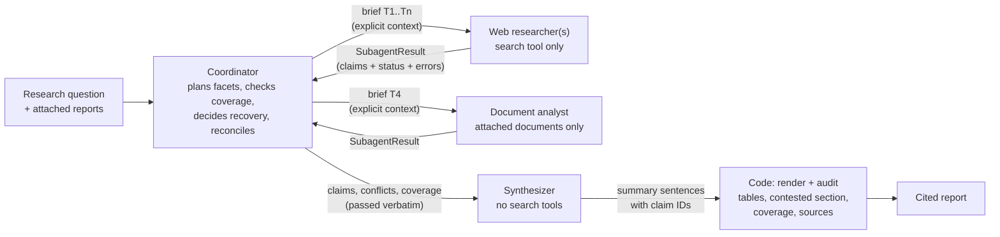
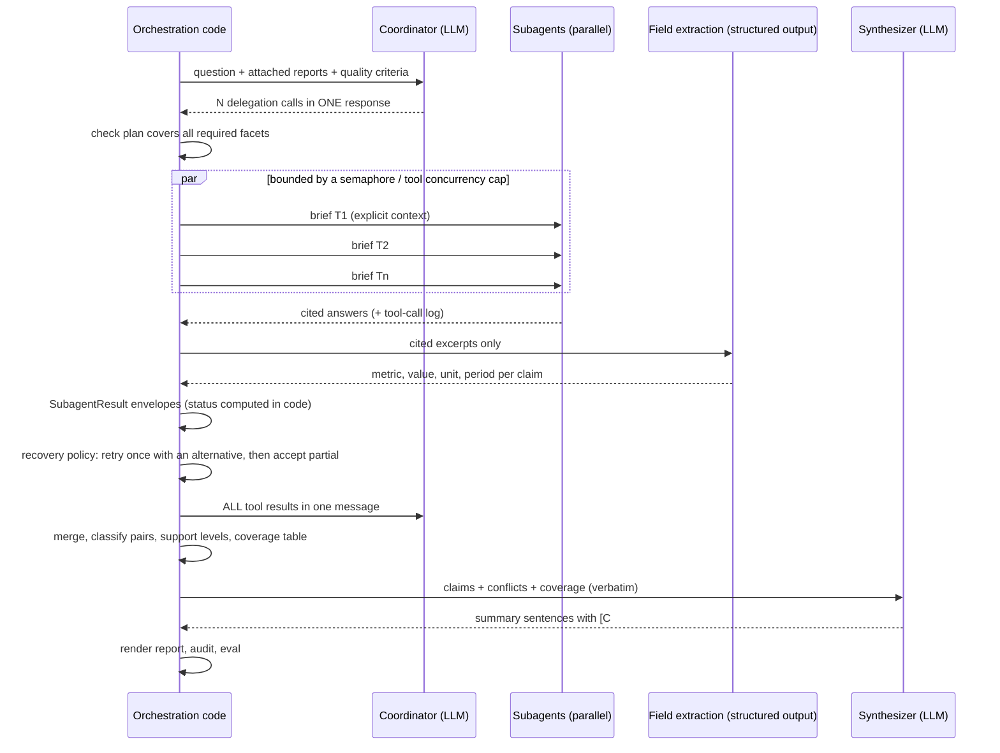

# Capstone 02 — Multi-agent Research System with Provenance

> **Serves:** CCAR-F scenario SC3 (Multi-Agent Research System) and preparation Exercise 4 (Design and Debug a Multi-Agent Research Pipeline) · Domains D1 Agentic Architecture & Orchestration (**27%**), D2 Tool Design & MCP Integration (**18%**), D5 Context Management & Reliability (**15%**)
> **Stacks:** Claude Messages API (orchestrator-workers with `asyncio` and Citations), with a Claude Agent SDK variant · OpenAI Agents SDK (agents as tools, `file_search` and `web_search` annotations)
> **Est. time:** 12–16 hours · **Facts checked:** 2026-10-03 · **Status:** [ ] not started

A research report is only as trustworthy as its weakest sentence. In this capstone you build the system the exam keeps returning to: a coordinator sends specialist subagents out **in parallel**, gives each one exactly the context it needs, gets back **claims kept separate from their metadata**, survives a subagent that **times out**, keeps **conflicting sources side by side**, and writes a report that says plainly what is well established, what is contested and what is missing. You build it twice, once per vendor, on the same corpus, the same data contracts and the same eval suite, so the comparison is fair.



---

## Contents

- [Customer brief](#customer-brief)
- [Scenario and exercise mapping](#scenario-and-exercise-mapping)
- [Requirements](#requirements)
- [Architecture](#architecture)
- [Build checklist](#build-checklist)
- [Acceptance criteria](#acceptance-criteria)
- [Evaluation plan](#evaluation-plan)
- [Failure modes and safeguards](#failure-modes-and-safeguards)
- [Claude vs OpenAI comparison](#claude-vs-openai-comparison)
- [Notebooks](#notebooks)
- [Rubric](#rubric)
- [Common mistakes and anti-patterns](#common-mistakes-and-anti-patterns)
- [Self-check](#self-check)
- [Certification coverage](#certification-coverage)
- [Official documentation](#official-documentation)

---

## Customer brief

**Customer (fictional):** the policy unit of the City of Riverton. Riverton launched shared e-scooters and e-bikes in 2023. Before the council votes on renewing the operator contracts, the unit needs a research brief on five questions: **ridership, safety, emissions, the local economy and regulation**.

**The problem.** A pilot that used one chat assistant produced a fluent brief that the council's analysts could not defend. It gave one ridership number when the transport authority and the operators publish different ones. It quoted an emissions figure nobody could trace. It said "no evidence of economic impact" when the business-registry search had simply failed. One analyst summed it up: *"I don't need a better writer. I need to know where every number came from, and what you didn't manage to check."*

**Business goal.** A brief the analysts can defend line by line in a council session, produced in minutes rather than days.

**Constraints.**

| Constraint | Value |
|---|---|
| Sources | Public web sources (news, press releases, industry updates) and four attached reports (hospital registry, council safety review, university emissions study, regional trip-count audit) |
| Freshness | Data periods and publication dates must be shown; "as of" date on the brief |
| Latency | Under 2 minutes wall-clock for a full brief (interactive use by analysts) |
| Cost | Under $1 per brief at list prices |
| Reliability | One slow or failing source must not block the brief; it must be **reported** |
| Compliance | Every figure traceable to a source; contested figures never presented as settled |

**What "done" means.** The success criteria are fixed **before** the build, in [Acceptance criteria](#acceptance-criteria) and the [Evaluation plan](#evaluation-plan): citation precision ≥ 0.95, every required facet covered or explicitly annotated, every conflict shown with both values, both sources and both dates, and a parallel run at least 2× faster than a sequential one.

> **About the data.** Riverton, its organizations and every number in the corpus are **fictional fixtures** (example.* domains), built so that the corpus contains the situations the exam cares about: two counts that agree, a derivative news article that re-reports a press release, two credible sources that measure differently, one genuine unexplained conflict, a trend that looks like a contradiction, a search that times out, and a search that succeeds with zero results.

---

## Scenario and exercise mapping

**Official scenario SC3** describes a coordinator that delegates to specialized subagents (web search, document analysis, synthesis and report generation) and must produce comprehensive, cited reports. **Exercise 4** asks you to design and debug such a pipeline. Its five steps, restated in this repo's own words, are the backbone of this capstone:

| ID | The step, in our words | Where it is built |
|---|---|---|
| `CCAR-F/EX4/1` | A coordinator delegates to at least two subagent types; the coordinator is allowed to use the subagent-spawning tool (`Task` in the guide, `Agent` today); each subagent gets the findings it needs **inside its own prompt**, not through inherited history | [R1](#r1-coordinator-and-scoped-subagents), [R2](#r2-explicit-context-passing); practice Steps 2–3 and the Agent SDK variant in Step 10 |
| `CCAR-F/EX4/2` | Subagents run in parallel because the coordinator emits several delegation calls **in one response**; you measure the speed-up against sequential execution | [R3](#r3-parallel-fan-out); practice Step 3 (Claude) and Step 8 (OpenAI) |
| `CCAR-F/EX4/3` | Subagent output keeps content (the claim) apart from metadata (evidence excerpt, source URL or document name, publication date), and synthesis keeps the attribution | [R4](#r4-claim-records-that-separate-content-from-metadata), [R8](#r8-attribution-that-survives-synthesis); practice Steps 1, 4 and 7 |
| `CCAR-F/EX4/4` | A simulated subagent timeout reaches the coordinator as **structured error context** (failure type, what was attempted, partial results); the coordinator continues with partial results and the report annotates the gap | [R5](#r5-structured-error-propagation), [R6](#r6-coverage-annotations); practice Steps 5 and 7 |
| `CCAR-F/EX4/5` | Conflicting statistics from credible sources stay in the report as **both values with attribution**, and the report separates well-established findings from contested ones | [R7](#r7-conflict-handling-with-both-sources-and-dates); practice Steps 6–7 |

**Task statements this capstone exercises** (taught in the linked chapters): D1 1.2 (hub-and-spoke coordination, decomposition breadth, and a bounded refinement loop that re-delegates a gap with a targeted query), D1 1.3 (subagent invocation, explicit context passing, parallel spawning), D2 2.3 (scoped tool distribution per agent), D5 5.3 (error propagation, access failure vs valid empty result, coverage annotations) and D5 5.6 (claim-source mappings, conflicts, dates, content-type rendering).

**Role competencies:** multi-agent orchestration, hallucination mitigation and citations, resilience and graceful degradation, evaluation design.

**Prerequisites.** Do these chapters first; the capstone reuses their patterns rather than re-teaching them:

| Topic | Claude chapter | OpenAI chapter |
|---|---|---|
| Subagents, `AgentDefinition`, the `Agent` (formerly `Task`) tool / agents as tools | [Claude 03 — Agent SDK](../../../anthropic-claude/03-agent-sdk/README.md) | [OpenAI 03 — Agents SDK and Agents API](../../../openai-codex/03-agents-sdk-and-agents-api/README.md) |
| Decomposition, orchestrator-workers, `asyncio` fan-out | [Claude 08 — Task decomposition](../../../anthropic-claude/08-task-decomposition/README.md) | [OpenAI 08 — Task decomposition and orchestration](../../../openai-codex/08-task-decomposition-and-orchestration/README.md) |
| Structured error context, coverage annotations | [Claude 10 — Multi-agent error handling](../../../anthropic-claude/10-multi-agent-error-handling/README.md) | [OpenAI 10 — Multi-agent error handling](../../../openai-codex/10-multi-agent-error-handling/README.md) |
| Passing structured data instead of prose between agents | [Claude 11 — Context management](../../../anthropic-claude/11-context-management/README.md) | [OpenAI 11 — Context management](../../../openai-codex/11-context-management/README.md) |
| Claim records, conflicts, dates, Citations API, audit | [Claude 12 — Provenance](../../../anthropic-claude/12-provenance/README.md) | `file_search` / `web_search` citations: [OpenAI 04 — Built-in tools and MCP](../../../openai-codex/04-built-in-tools-and-mcp/README.md) |

You also need the repo venv and `.env` from [00-prerequisites](../../../00-prerequisites/README.md), but only for the optional live cells.

---

## Requirements

Eight requirements. Each one names the failure it prevents, because that is how the exam frames them.

### R1 Coordinator and scoped subagents

A **coordinator** owns the plan, all routing, all error decisions and the reconciliation of conflicts (hub and spoke). It never searches or reads documents itself. Three subagent roles, each with **only the tools its role needs**:

| Role | Tools | Never gets |
|---|---|---|
| `web_researcher` | one search tool | the attached documents, write access |
| `document_analyst` | the attached documents (Claude: `document` blocks; OpenAI: `file_search` over a vector store) | web search |
| `synthesizer` | none (optionally a narrow `verify_fact` lookup) | search, document access, the ability to spawn agents |

The coordinator chooses **which** subagents to invoke and how many, from the question. It must cover every required facet: a plan that leaves a facet unassigned is rejected **in code** before any subagent runs (the over-narrow decomposition failure).

*Prevents:* a synthesis agent that wanders off to search, a coordinator that forgets a facet, and spaghetti routing between subagents.

### R2 Explicit context passing

Subagents do not inherit the coordinator's conversation. Everything a subagent needs is written into its **brief**: the overall goal, its facets, what is out of scope (the facets other subagents own), suggested queries or document IDs, prior findings (as claim records, verbatim), what has already failed, today's date, and the output contract. One `render_brief()` function produces the brief for both stacks. On a retry, the brief carries the partial results and the failed queries, so the subagent does not repeat them. The synthesizer receives **all** claim records, conflict records and the coverage table verbatim in its prompt.

*Prevents:* "the subagent ignored what we already knew", repeated failed queries, and a synthesizer that invents context.

### R3 Parallel fan-out

Independent subagents run concurrently because the coordinator emits **several delegation calls in one response**:

- Claude: several `tool_use` blocks for a `delegate` tool in one assistant message; your code runs them with `asyncio.gather` under a semaphore and returns **all** `tool_result` blocks in **one** user message.
- Claude Agent SDK variant: several `Agent` tool calls in one coordinator turn.
- OpenAI: several function calls to `Agent.as_tool()` workers in one manager turn; the SDK runs them concurrently (cap with `ToolExecutionConfig(max_function_tool_concurrency=N)`).

Measure wall-clock time for sequential vs parallel execution of the same plan. Dependent steps (synthesis after research) stay sequential.

*Prevents:* a brief that takes the sum of all subagent latencies instead of the slowest one.

### R4 Claim records that separate content from metadata

Every finding travels as a **claim record**, never as prose:

| Field | Content or metadata | Rule |
|---|---|---|
| `claim_id` | key | Assigned by code after merging, stable within a run |
| `facet`, `statement`, `subject`, `metric`, `value`, `unit`, `period` | content | `statement` keeps the source's qualifiers ("estimated", "preliminary"); `period` is the **data period** |
| `evidence[]` | metadata | One or more `{source_id, excerpt, location, verbatim}`; at least one per claim |
| Source registry: `title`, `publisher`, `url`, `published`, `methodology`, `derived_from` | metadata | Required but nullable: `null` when unknown, never guessed |

Evidence comes from the **API's citations** wherever the platform offers them (Claude `search_result_location` and `char_location`; OpenAI `url_citation` and `file_citation`), so the model never retypes a URL or a quote. The structured fields (`metric`, `value`, `period`) come from a **second, structured-output step** over the already cited text, because Claude's citations cannot be combined with structured outputs in the same request.

*Prevents:* attribution loss, invented URLs and quotes, and a 2025 report about 2023 data being read as 2025 data.

### R5 Structured error propagation

Every subagent run ends in a `SubagentResult` envelope, whatever happens: `status` (`success` / `empty` / `partial` / `failed`), `failure_type`, `retryable`, `attempted` queries, `claims` (partial results survive), `empty_queries`, `alternatives` and `coverage_impact`. Status is **computed in code** from the tool-call log, not taken from the model's own impression. Transient failures are retried **locally** (inside the search tool, once) and only unresolved failures propagate. The coordinator applies an explicit, testable recovery policy: accept, retry with a modified query, accept partial, or annotate the gap. One failed subagent never cancels its siblings.

*Prevents:* the three classic anti-patterns: a generic "search unavailable", a timeout reported as an empty success, and one failure that kills the whole run.

### R6 Coverage annotations

The report has a **coverage table by facet**, computed in code from the plan and the envelopes: `FULL`, `PARTIAL (reason)` or `NONE (reason)`. A search that succeeded with zero matches is reported as *"searched, no sources found"*; a search that failed is reported as *"source unavailable, findings may be incomplete"*. The summary carries an explicit gap sentence for every facet that is not `FULL`.

*Prevents:* a clean-looking report that silently omits what it could not check, and "no evidence exists" written about a source that never answered.

### R7 Conflict handling with both sources and dates

Before calling anything a conflict, code **classifies** each pair of claims about the same subject, metric and unit: `agree`, `temporal_difference` (different data periods: a trend), `methodology_difference` (both methods known and different), `undetermined` (a period is missing) or `conflict` (same thing, same period, different values, no known explanation). Methods are compared by **independent origin**, so a news article that re-reports a press release inherits the press release's method. The document analyst and the code never pick a winner. The **coordinator** reconciles: present both, request verification, or escalate. Every contested entry in the report shows **both values, both sources, both publication dates, both data periods and both methods**.

*Prevents:* silently picking the "more credible" number, averaging two numbers into one nobody published, and mistaking a trend for a contradiction.

### R8 Attribution that survives synthesis

Claims are **merged, never replaced**: the same value for the same thing from two sources becomes one claim with two pieces of evidence. Support levels come from **independent origins**, not from URL counts or the model's self-rated confidence: `well_established` (≥ 2 independent origins agree), `single_source`, `contested`. The synthesizer writes only summary sentences, each ending in claim references (`[C3]`) or a gap reference (`[gap:economy]`). **Code** renders everything numeric (key figures table, contested section, trends, coverage, numbered sources), and a code audit blocks publication if a sentence has no reference, cites an unknown claim, contains a number that is not in its cited evidence, or states one side of a conflict or of a methodology difference.

*Prevents:* a final summarization hop that drops the sources, numbers that drift while the model writes, and contested figures presented as facts.

---

## Architecture

### Shared design

Both stacks share everything except the model calls: the corpus, the search backend (with the injected timeout and empty result), the data contracts, `render_brief()`, the merge, conflict classifier, support levels, coverage table, renderer, audit and the eval suite. That is what makes the comparison fair.



The data contracts, as Pydantic models (abridged; the practice notebook has the full versions and validators):

```python
Facet = Literal["ridership", "safety", "emissions", "economy", "regulation"]

class Evidence(BaseModel):
    source_id: str
    excerpt: str                  # what the citation points at
    location: str | None          # "chars 0-71", "block 0", "answer chars 0-58", "file D1.txt"
    verbatim: bool                # True: quoted from the source; False: a span of the model's answer

class Claim(BaseModel):
    claim_id: str
    facet: Facet
    statement: str
    subject: str
    metric: str | None
    value: float | None
    unit: str | None
    period: str | None            # the DATA period, not the publication date
    evidence: list[Evidence] = Field(min_length=1)

class SubagentResult(BaseModel):
    task_id: str
    subagent: Literal["web_researcher", "document_analyst"]
    facets: list[Facet]
    status: Literal["success", "empty", "partial", "failed"]
    failure_type: Literal["timeout", "rate_limited", "unavailable", "invalid_input",
                          "permission_denied", "internal_error"] | None = None
    retryable: bool | None = None
    attempted: list[str] = []
    empty_queries: list[str] = []
    claims: list[Claim] = []
    alternatives: list[str] = []
    coverage_impact: str | None = None
```

### Stack A: Claude Messages API

**Orchestrator-workers on the Messages API with `asyncio`**, because every step stays visible and testable, the parallelism is yours to control, and Citations work natively.

- **Coordinator:** one `messages.create` call with a single `delegate` tool. Its system prompt states the goal and quality criteria (cover all five facets, split by source type, no overlap, delegate independent work in the same response), not a step-by-step procedure.
- **Fan-out:** code validates the plan, then runs one worker per `delegate` call with `asyncio.gather` under an `asyncio.Semaphore`, on one shared `AsyncAnthropic` client.
- **Web researcher:** a small tool loop with a `search_web` client tool. The tool returns **`search_result` blocks** with `citations: {"enabled": true}` (one text block per sentence, so citations are sentence-level), or a single text block "No results found." for a valid empty result. If any block in a `tool_result` is a `search_result`, all of them must be. A backend timeout is retried once inside the tool, then returned as an `is_error` result with structured JSON (failure type, query, attempts, retryable).
- **Document analyst:** one call with the attached reports as **`document` blocks** with citations enabled on every block (all or none), and the source ID and publication date in each block's `context` (passed to the model, never cited).
- **Citations to claims:** code turns `search_result_location` (source = the search result's `source` string) and `char_location` (source = the document at `document_index`) into `Evidence`. Then a separate `messages.parse(output_format=ClaimFieldsBatch)` call extracts `metric`, `value`, `unit` and `period` from the cited text. Citations plus `output_config.format` in one request returns a 400, which is why this is two steps.
- **Synthesizer:** a plain `messages.create` with the claims, conflicts and coverage table in the prompt and no tools.

```python
async def fan_out(briefs: list[Brief], limit: int = 4) -> list[SubagentResult]:
    gate = asyncio.Semaphore(limit)

    async def one(brief: Brief) -> SubagentResult:
        async with gate:
            try:
                return await WORKERS[brief.subagent](brief)          # never raises by design...
            except Exception as exc:                                  # ...but a bug must not kill siblings
                return failed_envelope(brief, failure_type="internal_error", retryable=False, message=repr(exc))

    return await asyncio.gather(*(one(b) for b in briefs))           # not TaskGroup: it cancels siblings
```

### Stack A variant: Claude Agent SDK

The exam's own framing (SC3, EX4/1) is the **Agent SDK**: subagents declared as `AgentDefinition`s and spawned with the subagent tool. The practice notebook builds this configuration offline and checks it (no CLI is started), and runs it only behind `RUN_AGENT_SDK = True`, because the Agent SDK drives Claude Code under your own login or key.

```python
AGENTS = {
    "web_researcher": AgentDefinition(
        description="Searches the web index for ONE assigned facet group. Returns claim records.",
        prompt=WEB_RESEARCHER_PROMPT,                       # includes the claim + envelope contract
        tools=["mcp__corpus__search_web"],                  # scoped: search only
    ),
    "document_analyst": AgentDefinition(
        description="Reads the attached reports for the assigned facets. Returns claim records.",
        prompt=DOCUMENT_ANALYST_PROMPT,
        tools=["Read"],                                     # scoped: reading only
    ),
    "synthesizer": AgentDefinition(
        description="Writes summary sentences from claim records passed in the prompt.",
        prompt=SDK_SYNTHESIZER_PROMPT,                      # written for raw subagent JSON (see below)
        tools=[],                                           # intent: no tools (see the note below)
        disallowedTools=["mcp__corpus", "WebSearch", "WebFetch", "Agent"],   # the documented guarantee
    ),
}
options = ClaudeAgentOptions(
    system_prompt=COORDINATOR_PROMPT,
    agents=AGENTS,
    allowed_tools=["Agent", "Read", "mcp__corpus__search_web"],  # "Agent" = the guide's "Task"
    mcp_servers={"corpus": corpus_server},                        # in-process SDK MCP server
    max_budget_usd=1.00,
    env={"CLAUDE_CODE_MAX_SUBAGENT_SPAWN_DEPTH": "1"},            # subagents cannot spawn more
)
```

> [!NOTE]
> **Changed since the guide:** the exam guide says the coordinator's `allowedTools` must include `"Task"`. The tool is called **`Agent`** in current SDK and Claude Code versions (`tool_use` blocks have used `"Agent"` since Claude Code v2.1.63, while the `system:init` tool list still shows `"Task"`), so match both names when you inspect a run. Listing it in `allowed_tools` is common in the official examples, although `Agent` runs without a permission prompt in the default mode. On the exam, read `Task` as "the subagent-spawning tool". Details: [Claude 03 §3.4](../../../anthropic-claude/03-agent-sdk/README.md#34-the-subagent-tool-agent-formerly-task).

**Why both `tools=[]` and `disallowedTools`.** The SDK docs define two cases for `tools`: omitted (the subagent inherits every tool available to subagents) and a list (it gets only those). An empty list is sent as is, but its behavior is not documented, so the explicit `disallowedTools` list is what actually guarantees that the synthesizer cannot search or spawn. The docs confirm that a server-level pattern such as `mcp__corpus` removes every tool from that server.

Four differences from Stack A matter for provenance and error handling. A subagent returns **only its final message** to the coordinator, so there are no API citation blocks on that hop: the claim schema in the subagent prompt is what carries provenance, and the coordinator must validate it. An API error that ends a subagent early (a rate limit, for example) is never delivered as that subagent's result, so the coordinator must treat a missing or invalid envelope as a failure rather than as "nothing found". The coordinator, not your code, decides when to fan out, so verify parallelism by counting `Agent` tool calls per assistant message (subagents run in the background by default). And because a **model** carries the records from the subagents to the synthesizer, your code cannot merge, classify, render or audit in between: there are no code-assigned `C#` IDs, no pair table and no coverage table. The claim contract therefore asks each subagent to number its own claims (`T1-1`, `T1-2`, ...), and the synthesizer gets a prompt written for raw subagent JSON. For an audited brief, take the subagents' JSON out of the run and pass it through the same downstream code as Stack A.

### Stack B: OpenAI Agents SDK

**A manager agent with specialists as tools** (`Agent.as_tool`), because the manager must keep control and synthesize; a handoff would transfer ownership of the turn to one specialist.

- **Manager:** `tools=[research_web, analyze_documents]`, each created with `as_tool(parameters=Brief, input_builder=..., custom_output_extractor=..., failure_error_function=...)`. The structured `parameters=Brief` makes the manager fill a brief; `input_builder` renders it with the same `render_brief()` as Stack A, so the specialist sees the full explicit context.
- **Plan check before delegation:** the SDK runs `as_tool` calls as soon as the manager emits them, so the plan is checked in an agent hook. `AgentHooks.on_llm_end` runs right after the model returns and before the tool calls execute; it parses every delegation call as a `Brief` and runs the same `check_plan()`, and a `PlanError` stops the run before any specialist starts (AC1).
- **Parallelism:** the manager emits several function calls in one turn; the SDK runs the nested agents concurrently. `ModelSettings(parallel_tool_calls=True)` allows the model to emit several calls; `RunConfig(tool_execution=ToolExecutionConfig(max_function_tool_concurrency=4))` caps how many the SDK runs at once.
- **Web researcher:** `WebSearchTool()`. Its answer carries **`url_citation`** annotations (`url`, `title`, `start_index`, `end_index`). These point at a **URL and a span of the model's own answer**, not at a quote from the page. Evidence from them is marked `verbatim=False` and the eval fetches the source to check the number. Add `include=["web_search_call.action.sources"]` (in the Agents SDK: `ModelSettings(response_include=["web_search_call.action.sources"])`) when you want every URL consulted, not only the cited ones. The field is optional in the SDK types, so the extractor treats a missing list (`None`, sources not included) differently from an empty one (`[]`, a search that found nothing).
- **Document analyst:** `FileSearchTool(vector_store_ids=[...], include_search_results=True)` over a vector store holding the four reports, with `source_id` and `published` as file **attributes**. Its answer carries **`file_citation`** annotations (`file_id`, `filename`, `index`), which point at a **file**, not a span. `include_search_results=True` (the API's `include=["file_search_call.results"]`) returns the retrieved chunks with their attributes, which the extractor uses as the verbatim excerpt. Chunk size now decides evidence granularity (the default is 800-token chunks).
- **Extractor in code:** `custom_output_extractor` converts the nested run's items (`web_search_call` / `file_search_call` items and the annotated message) into a `SubagentResult` JSON string: claims from annotations, `attempted` from the `search` actions (`query`, or the `queries` list the docs say a search action usually carries; `open_page` and `find_in_page` actions are not search attempts) and from each `file_search_call`'s `queries`, `status` from the calls' statuses (a `file_search_call` that is not `completed` is a failed source, and a completed one with no results is a valid empty result). Several `file_citation` annotations can share one `index` (the docs' own example does), so citations are grouped by insertion point into one claim, and each one's excerpt is the retrieved chunk that best supports the statement, not simply the last chunk returned for that file. `failure_error_function` turns a nested run that raises (for example `openai.APITimeoutError`) into a `failed` envelope; it receives a `ToolContext`, so it can report the brief it was given (`tool_arguments`).
- **Synthesizer:** a separate agent run by code with the same claims, conflicts and coverage table in its input.

```python
research_web = web_researcher.as_tool(
    tool_name="research_web",
    tool_description="Research one facet group on the web. Returns SubagentResult JSON.",
    parameters=Brief,                                       # structured brief, not a free string
    input_builder=lambda opts: render_brief(Brief.model_validate(opts["params"])),
    custom_output_extractor=web_result_to_envelope,         # annotations -> claims, in code
    failure_error_function=failure_to_envelope,             # a crash becomes a structured error
)
manager = Agent(name="Research coordinator", instructions=COORDINATOR_PROMPT,
                tools=[research_web, analyze_documents],
                model_settings=ModelSettings(parallel_tool_calls=True))
result = await Runner.run(manager, QUESTION, run_config=RunConfig(
    tool_execution=ToolExecutionConfig(max_function_tool_concurrency=4)))
```

### Side-by-side

| Concern | Claude (Messages API) | Claude (Agent SDK variant) | OpenAI (Agents SDK) |
|---|---|---|---|
| Spawning | Your code, from `delegate` `tool_use` blocks | `Agent` tool (guide: `Task`) | `Agent.as_tool()` function calls |
| Parallelism | `asyncio.gather` + semaphore | Several `Agent` calls in one turn | Several function calls in one turn; `max_function_tool_concurrency` |
| Context to subagent | `render_brief()` in the worker's user message | The `Agent` tool's prompt string | `parameters=Brief` + `input_builder` |
| Web provenance | `search_result` blocks → `search_result_location` (verbatim block text) | Schema in the subagent prompt | `web_search` → `url_citation` (URL + answer span) |
| Document provenance | `document` blocks → `char_location` (verbatim, character offsets) | Schema in the subagent prompt | `file_search` → `file_citation` (file + index) + included results (chunk text) |
| Structured fields | Second call: `messages.parse(output_format=...)` | `output_format` on the run, or validate the subagent's JSON | Second agent with `output_type=...` |
| Failure on the hop | Envelope built by your worker wrapper | Subagent prompt + coordinator validation (or a `SubagentStop` hook) | `custom_output_extractor` + `failure_error_function` |
| Tracing | Your own logs per task ID | SDK message stream, `parent_tool_use_id` | Built-in traces (disabled offline with `RunConfig(tracing_disabled=True)`) |

---

## Build checklist

Each step is a section of [`01_practice.ipynb`](01_practice.ipynb) and points to the chapter that teaches it.

- [ ] **Step 0 — Corpus and offline toolkit.** Ten fixture sources, a search backend with an injected timeout and an empty result, scripted clients for both stacks. ([Claude 12](../../../anthropic-claude/12-provenance/README.md))
- [ ] **Step 1 — Data contracts (R4, R5).** `Source`, `Evidence`, `Claim`, `SubagentResult` with validators that reject contradictory envelopes. ([Claude 10 §10.6](../../../anthropic-claude/10-multi-agent-error-handling/README.md#106-the-structured-subagent-result), [Claude 12 §12.1](../../../anthropic-claude/12-provenance/README.md#121-the-attribution-loss-problem))
- [ ] **Step 2 — Plan and briefs (R1, R2).** Coverage check against required facets; `render_brief()`; weak vs strong brief. ([Claude 03 §3.4](../../../anthropic-claude/03-agent-sdk/README.md#34-the-subagent-tool-agent-formerly-task), [OpenAI 08 §8.5](../../../openai-codex/08-task-decomposition-and-orchestration/README.md#85-dynamic-decomposition-orchestrator-workers))
- [ ] **Step 3 — Coordinator and parallel fan-out on Claude (R3).** Several `delegate` calls in one response, all results in one message, sequential vs parallel timing. ([Claude 08 §8.8](../../../anthropic-claude/08-task-decomposition/README.md#88-fan-out-in-code-orchestrator-workers-with-asyncio-and-the-messages-api))
- [ ] **Step 4 — Workers with Citations (R4).** `search_result` and `document` blocks, citations to evidence, the two-step field extraction. ([Claude 12 §12.7](../../../anthropic-claude/12-provenance/README.md#127-the-citations-api-document-blocks-expanded-beyond-the-guide), [§12.8](../../../anthropic-claude/12-provenance/README.md#128-search_result-blocks-citations-for-your-own-retrieval-expanded-beyond-the-guide))
- [ ] **Step 5 — Error propagation (R5).** Local retry, partial results, valid empty result, a model-call timeout, the coordinator's recovery policy and a retry with a modified brief. ([Claude 10](../../../anthropic-claude/10-multi-agent-error-handling/README.md))
- [ ] **Step 6 — Conflicts and dates (R7).** Pair classification by independent origin; conflict records with both sources and dates; coordinator reconciliation. ([Claude 12 §12.2](../../../anthropic-claude/12-provenance/README.md#122-handling-conflicting-data))
- [ ] **Step 7 — Synthesis, rendering and audit (R6, R8).** Merge, support levels, coverage table, report renderer, provenance audit. ([Claude 10 §10.9](../../../anthropic-claude/10-multi-agent-error-handling/README.md#109-coverage-annotations-in-the-final-synthesis), [Claude 12 §12.10](../../../anthropic-claude/12-provenance/README.md#1210-verifying-provenance-before-you-publish-expanded-beyond-the-guide))
- [ ] **Step 8 — The OpenAI build.** Manager with agents as tools, annotations to evidence, structured failures, the same downstream code. ([OpenAI 03 §3.4](../../../openai-codex/03-agents-sdk-and-agents-api/README.md#34-handoffs-vs-agents-as-tools), [OpenAI 10 §10.5](../../../openai-codex/10-multi-agent-error-handling/README.md#105-structured-worker-results-with-partial-results), [OpenAI 04 §4.3](../../../openai-codex/04-built-in-tools-and-mcp/README.md#43-file-search-and-vector-stores-hosted-rag))
- [ ] **Step 9 — Evaluation and comparison.** The eval suite on both builds and on a deliberately lossy baseline. ([OpenAI 11 §11.10](../../../openai-codex/11-context-management/README.md#1110-delegating-to-sub-agents-to-protect-context) for why subagents return compact records)
- [ ] **Step 10 — Live runs (opt-in).** The Claude pipeline against the real API, a real `file_search` run, and the Agent SDK variant.

---

## Acceptance criteria

All of these are checked by code in the practice notebook (Step 9) and must hold for **both** builds.

| # | Criterion | Check |
|---|---|---|
| AC1 | The plan covers all five required facets; a narrower plan is rejected before any subagent runs | `check_plan()` raises on a plan missing a facet |
| AC2 | Each subagent's prompt contains its full brief: goal, facets, out-of-scope facets, prior findings verbatim, failed queries, date, output contract | Inspect recorded requests (Claude) and `ScriptedModel.calls` (OpenAI) |
| AC3 | The coordinator's delegation calls arrive in one response, run concurrently, and their results go back in one message | Parallel wall-clock ≤ 0.5 × sequential; one user message with all `tool_result` blocks |
| AC4 | Every claim has ≥ 1 evidence item; every evidence item names a source in the registry; dates and methods are `null` only when the source does not state them | Pydantic validation + registry lookup |
| AC5 | The timed-out search produces a `partial` envelope with a failure type (`"timeout"` on Claude, where your tool sees the timeout; `"unavailable"` on OpenAI, because a hosted `web_search_call` reports only a status, `failed` or `incomplete`, and no cause), the attempted and failed queries, the partial claims and alternatives; the run continues | Envelope assertions; the report still renders |
| AC6 | The zero-result search is reported as "searched, no sources found", never as a failure; the failed source is never reported as "no evidence" | Coverage section text checks |
| AC7 | Every conflict and methodology difference appears in the contested section with both values, both source IDs, both publication dates and both methods | `conflict_preservation == 1.0` |
| AC8 | Every summary sentence carries `[C#]` or `[gap:facet]` references, and every number in it appears in the cited evidence | `audit(report) == []` |
| AC9 | Citation precision ≥ 0.95: every cited claim's evidence is in its source, and every number in the sentence is in the cited evidence | Eval suite |
| AC10 | Agreeing counts from two independent origins are labeled well established; a derivative article does not count as a second origin | Support-level assertions |

---

## Evaluation plan

Fixed before the build. The dataset is the fixture corpus plus its **gold annotations** (which sentence states which claim, which pairs conflict, which facet should be partial), so every metric is computed by code with no model in the loop. Anthropic's write-up of its own research system reports grading research output against a rubric that includes **factual accuracy, citation accuracy, completeness, source quality and tool efficiency**, with a single LLM judge giving 0.0–1.0 scores plus pass/fail; the code metrics below cover the first three deterministically, and the optional judge covers the rest.

| Metric | Definition | Threshold |
|---|---|---|
| **Citation precision** | Supported (sentence, cited claim) pairs ÷ all pairs. A pair is supported when the claim's evidence is really in the source (verbatim excerpts: substring of the source text; non-verbatim: the claim's value appears in the fetched source) and the sentence's numbers appear in the cited evidence | ≥ 0.95 |
| **Sentence citation coverage** | Summary sentences with ≥ 1 valid reference ÷ all summary sentences | 1.0 |
| **Facet coverage** | Required facets with ≥ 1 claim ÷ required facets | Report it; must match the coverage table |
| **Gap annotation recall** | Non-`FULL` facets with a gap sentence and a coverage-table reason ÷ non-`FULL` facets | 1.0 |
| **Empty vs failed accuracy** | Zero-result queries reported as "no sources found" and failed queries reported as "unavailable", ÷ all such queries | 1.0 |
| **Conflict preservation** | Conflict records shown with both values, sources, dates and methods ÷ conflict records | 1.0 |
| **Attribution survival** | Claims produced by subagents whose sources all appear in the report's source list ÷ claims produced | 1.0 |
| **Parallel speed-up** | Sequential wall-clock ÷ parallel wall-clock for the same plan | ≥ 2.0 |
| **Cost per brief** (live only) | Sum of `usage` across all calls at list prices | < $1 |

**Baselines.** A deliberately **lossy pipeline** (an intermediate summarizer, a synthesizer that picks or averages conflicting values and says nothing about gaps) runs through the same metrics. If your eval suite does not score it clearly worse, the suite is not testing provenance.

**Optional LLM judge (live).** One call per report that scores factual accuracy, citation accuracy, completeness, source quality and tool efficiency from 0.0 to 1.0 with a pass/fail, given the report and the source texts. Use it to catch wording problems code cannot see (a qualifier dropped from "estimated"), and calibrate it against your own judgment on a few reports before you trust it.

**Segments.** Report metrics per facet and per stack. A single aggregate hides the facet that failed.

---

## Failure modes and safeguards

| Failure | Where it is caught | Layer |
|---|---|---|
| Coordinator plans too narrowly (a facet never assigned) | `check_plan()` against `REQUIRED_FACETS` before fan-out (Claude) or in the manager's `on_llm_end` hook before delegation runs (OpenAI) | Code |
| Subagent lacks context the coordinator had | `render_brief()` includes prior findings and failed queries; recorded prompts are checked | Code + test |
| One subagent hangs or crashes | Per-task `try`/`except` around each worker, with a final catch-all so that even a bug becomes an `internal_error` envelope; `gather`, not a `TaskGroup` | Code |
| A worker runs out of tool turns | The loop must end on `end_turn`; an exhausted budget is a `partial`/`failed` envelope that names the unread queries, never `empty` | Code |
| Search backend times out | Local retry in the tool, then `is_error` with structured JSON; envelope `partial`/`failed` | Tool + code |
| Zero results confused with failure | Separate `empty_queries` and `failure_type`; coverage wording differs | Schema + code |
| Model retypes a URL or quote wrongly | Evidence comes from API citations or annotations, never from generated text | Platform |
| Citations combined with structured outputs (400 on Claude) | Two-step design: cite first, extract fields second | Design |
| Conflicting values silently resolved | Pair classifier + conflict records; coordinator reconciles; audit blocks one-sided statements of a conflict or a methodology difference | Code |
| Trend mistaken for conflict | `period` required (nullable) on every claim; classifier checks periods before values | Schema + code |
| Derivative article counted as corroboration | `derived_from` in the source registry; support levels count origins | Data + code |
| Numbers drift in the summary | Audit: every number in a sentence must be in its cited evidence | Code |
| Untrusted web content contains instructions | Retrieved text stays inside `search_result` / document / tool-result content, never in system prompts; subagents have no write tools | Design |
| Runaway cost (subagents spawning subagents) | Fixed plan size, spawn depth 1, `max_budget_usd` (Agent SDK), `max_turns` (OpenAI) | Config |

---

## Claude vs OpenAI comparison

| Dimension | Claude | OpenAI | What it means for Riverton |
|---|---|---|---|
| Evidence quality | `char_location` and `search_result_location` return the **exact cited text**; `cited_text` does not count toward output tokens | `file_citation` points at a file (excerpt comes from included search results, chunk-sized); `url_citation` points at a URL plus a span of the answer, not a page quote | Claude gives sentence-level verbatim evidence out of the box; on OpenAI, plan smaller chunks and a fetch-and-check step for web claims |
| Retrieval | Bring your own (search backend, vector store) and pass results as `search_result` blocks | Hosted `file_search` with vector stores, attributes and filters; hosted `web_search` | OpenAI is less code for document retrieval; Claude gives you full control of chunking and IDs |
| Orchestration | Your `asyncio` code (Messages API) or the Agent SDK's `Agent` tool | `as_tool()` with structured `parameters`, concurrency cap, `failure_error_function` | Both are first class; the Messages API build is the most transparent to test |
| Structured fields | Separate `messages.parse` call (citations and structured outputs do not mix) | Separate agent with `output_type` (kept separate here for parity) | Same two-step design on both |
| Observability | Your own per-task logs (or the Agent SDK message stream) | Built-in tracing, disabled offline | OpenAI gives traces for free; on Claude, log brief, status and usage per task ID |
| Lock-in | Data contracts, renderer, audit and evals are vendor-neutral | Same | The 80% that makes the report trustworthy is portable |

**Recommendation template** (write your own in the homework): pick the stack whose evidence granularity matches the customer's audit needs, keep the shared layer vendor-neutral, and decide on observability and hosting requirements separately from model choice.

---

## Notebooks

| Notebook | Sections covered | What you build / run |
|---|---|---|
| [`01_practice.ipynb`](01_practice.ipynb) | Steps 0–10 above, R1–R8, both stacks, offline by default (scripted clients for the Claude Messages API and `agents.testing.ScriptedModel` for the OpenAI Agents SDK); live cells behind `RUN_LIVE = False` and `RUN_AGENT_SDK = False` | **The full system twice:** a coordinator that fans out four briefs in one response, workers with Citations (Claude) or `url_citation` / `file_citation` annotations (OpenAI), an injected timeout with local retry and a modified-brief retry, a zero-result search, conflict classification by independent origin, a code-rendered report with established / contested / trends / coverage / sources sections, a provenance audit, and an eval table comparing both stacks with a lossy baseline |
| [`02_homework.ipynb`](02_homework.ipynb) | Self-assessment for R1–R8 | 10-question original scenario quiz (hashed key), 6 auto-checked extensions (brief renderer, bounded fan-out with failure isolation, envelope from a tool log, **a new source-conflict rule**, **coverage annotations added to a report**, a citation-precision metric), weighted rubric self-scoring with red-flag caps, two design-review scenarios with model answers, and a scorecard (pass mark 72%) |

Theory stays in this README and the linked chapters; notebooks hold code. Run them from the repo root venv (see [../../../00-prerequisites/README.md](../../../00-prerequisites/README.md)).

**Not yet run live.** The live cells (`RUN_LIVE`: the Claude pipeline and a real `file_search` run; `RUN_AGENT_SDK`: the Agent SDK variant) are written against current docs and the installed SDKs, but no live run has been recorded yet. Whether real models fill the `delegate` schema, cite every sentence and pass `check_plan()`, how a failing hosted `web_search_call` actually reports itself, and the real cost (estimated at $0.10–0.30 in total from list prices: `claude-sonnet-5-5` at $2 / $10 and `gpt-6-luna` at $0.10 / $0.50 per million input / output tokens, plus $2.50 per 1,000 `file_search` calls) are what the first live run will show. The offline checks do not depend on any of them.

---

## Rubric

Scored 0–3 per dimension (0 missing, 1 happy path only or no evidence, 2 meets the brief with evidence from checks or evals, 3 production-grade with edge cases and trade-offs explained), as described in the [capstones overview](../README.md#grading-rubric-approach). A dimension scores 2 or more only when the evidence covers **both** builds. Weights follow the scenario's domains (D1 heaviest).

| Dimension | Weight | A score of 3 looks like | Evidence |
|---|---|---|---|
| **Orchestration and context passing** (D1 1.2, 1.3) | 25 | Coordinator plans by goals and quality criteria; plan coverage is checked in code; briefs are self-contained; parallel fan-out measured; bounded retries with modified briefs | AC1–AC3, recorded prompts, timing |
| **Tool and agent scoping** (D2 2.3) | 15 | Each role has only its tools; the synthesizer cannot search; a narrow `verify_fact` is justified if added; tool descriptions are unambiguous | Agent definitions, tool lists |
| **Error propagation and coverage** (D5 5.3) | 20 | Envelopes computed in code; local retry for transient failures only; empty vs failed distinct end to end; gap sentences and coverage table | AC5, AC6, gap annotation recall |
| **Provenance and conflicts** (D5 5.6) | 20 | Evidence from platform citations; two-step field extraction; classification by independent origin; both values, sources, dates and methods shown; audit blocks bad drafts | AC4, AC7, AC8, AC10, conflict preservation |
| **Evaluation** | 10 | Thresholds set before the build; metrics per facet and stack; the lossy baseline is clearly worse; optional judge calibrated | Eval table |
| **Cost, latency and operations** | 5 | Parallel speed-up measured; live usage and cost logged; spawn depth, budgets and turn limits set | Timing, usage log |
| **Communication** | 5 | A one-page recommendation for Riverton's policy unit that a non-engineer can act on | Write-up |

**Red flags (cap the dimension at 1, whatever else is good):** a contested figure stated as settled anywhere in the report; a failed source described as "no evidence" or omitted; a report sentence with a number that is not in its evidence; subagents passing results to each other around the coordinator; no eval numbers.

**Pass mark:** 72% of the weighted maximum (216 of 300 weighted points) with no capped dimension.

---

## Common mistakes and anti-patterns

- **"The subagents share the coordinator's memory."** They do not. If a fact is not in the brief, the subagent does not know it.
- **One delegation call per turn.** Spawning subagents across separate turns serializes them; put independent calls in one response.
- **A `TaskGroup` around the workers.** One failure cancels the healthy siblings; catch per worker and return an envelope.
- **Letting the model report its own status.** Compute `success` / `empty` / `partial` / `failed` from the tool log.
- **Generic errors.** "Search unavailable" hides the failure type, the query and the partial results the coordinator needs to recover.
- **An intermediate summarizer to save tokens.** It is exactly the hop where sources, dates and qualifiers disappear; pass compact claim records instead.
- **Asking the final writer to "add citations".** The links were lost upstream; citations must be produced where the evidence is read.
- **Combining Claude citations with structured outputs in one request.** It returns a 400; cite first, structure second.
- **Counting URLs as corroboration.** Two articles quoting one press release are one origin.
- **Treating a `url_citation` span as a quote.** It is a span of the model's answer; verify the number against the page.
- **Picking the "more credible" number.** Show both, with methods and dates, and let the coordinator (or a human) decide.

---

## Self-check

Original questions on this capstone's design decisions. The [homework](02_homework.ipynb) has ten more, with a hashed answer key.

**Q1.** In the Agent SDK variant, a reviewer asks how you *guarantee* that the synthesizer subagent cannot call `mcp__corpus__search_web`. Its definition has `tools=[]` and nothing else. What do you add?

- A) A sentence in the synthesizer prompt: "Never search"
- B) `disallowedTools=["mcp__corpus", ...]` on its `AgentDefinition`
- C) Remove `mcp__corpus__search_web` from the coordinator's `allowed_tools`
- D) Nothing: an empty list obviously means no tools

<details><summary>Answer</summary>

**B.** The docs define omitted `tools` (inherit everything) and a listed set (only those); a server-level deny pattern such as `mcp__corpus` is documented to remove every tool from that server. A is a probabilistic instruction. C stops auto-approval but does not remove the tool, and the web researcher needs it. D relies on behavior the docs do not state.
</details>

**Q2.** The economy subagent's search timed out twice. It returns `{"status": "success", "claims": []}`, and the report says "no evidence of economic impact". Which change fixes the root cause?

- A) Tell the subagent to be honest about failures
- B) Compute the envelope status in code from the tool-call log, so a timed-out search yields `partial` or `failed` with the failure type, the attempted query and alternatives, and the coverage table marks the gap
- C) Retry the whole research run whenever any facet comes back empty
- D) Drop the economy section from the report when it has no claims

<details><summary>Answer</summary>

**B.** A timeout is an access failure, not a valid empty result, and the coordinator needs the structured context to recover. A still trusts the model's own status. C hides the distinction and multiplies cost. D silently removes a gap the analysts need to see.
</details>

**Q3.** The transport authority reports 3.1 million trips in 2024 from automatic counters; an operator reports 3.4 million trips in 2024 from app rentals. Both are credible. What belongs in the report?

- A) The average, 3.25 million, as the best estimate
- B) The transport authority's figure, because a public body is more credible
- C) Both values in the contested section, each with its source, publication date, data period and method, labeled as a methodology difference
- D) Neither figure, because the sources disagree

<details><summary>Answer</summary>

**C.** Same subject, same period, known and different methods: that is a methodology difference, and the coordinator reconciles by presenting both with attribution. A publishes a number nobody measured. B picks a winner the system has no basis to pick. D throws away evidence the council can use.
</details>

**Q4.** On the OpenAI build, the document analyst's answer carries `file_citation` annotations. A reviewer wants the exact passage behind each claim. What do you need?

- A) Nothing: `file_citation` already contains the quoted text
- B) `include_search_results=True` on `FileSearchTool` (the API's `include=["file_search_call.results"]`), then take the retrieved chunk text as the excerpt, knowing its granularity is the chunk
- C) Switch to `web_search`, whose `url_citation` spans are page quotes
- D) Ask the model to quote the passage in its answer

<details><summary>Answer</summary>

**B.** A `file_citation` points at a file and an index, not at a span of the source. The included search results carry the chunk text, so chunk size decides how precise the evidence is. C is wrong twice: a `url_citation` span is a span of the model's answer. D makes the model retype evidence, which is what platform citations avoid.
</details>

## Certification coverage

This table maps requirement IDs from the official exam guides, the OpenAI Academy pathway and the role competency matrix to this capstone. **Primary** means this capstone is the item's main home in the repo. **Supporting** means the capstone applies an item that a chapter teaches in depth. "practice" is [01_practice](01_practice.ipynb), "hw" is [02_homework](02_homework.ipynb).

| Requirement ID | What it asks (short) | Where in this chapter | Depth (Primary/Supporting) |
|---|---|---|---|
| `CCAR-F/EX4/1` | Coordinator delegating to two or more subagent types, with the spawning tool allowed and context passed in each prompt | [R1](#r1-coordinator-and-scoped-subagents), [R2](#r2-explicit-context-passing), [Agent SDK variant](#stack-a-variant-claude-agent-sdk); practice Steps 2–3, 10; hw Ex1 | Primary |
| `CCAR-F/EX4/2` | Parallel subagents from several delegation calls in one response; latency measured against sequential | [R3](#r3-parallel-fan-out); practice Steps 3, 8, 9; hw Ex2 | Primary |
| `CCAR-F/EX4/3` | Subagent output that separates claims from metadata (excerpt, source, date); attribution kept through synthesis | [R4](#r4-claim-records-that-separate-content-from-metadata), [R8](#r8-attribution-that-survives-synthesis); practice Steps 1, 4, 7 | Primary |
| `CCAR-F/EX4/4` | Simulated timeout reaches the coordinator as structured error context; run continues; report annotates the gap | [R5](#r5-structured-error-propagation), [R6](#r6-coverage-annotations); practice Steps 5, 7; hw Ex3, Ex5; Self-check Q2 | Primary |
| `CCAR-F/EX4/5` | Conflicting sources kept as both values with attribution; established vs contested sections | [R7](#r7-conflict-handling-with-both-sources-and-dates); practice Steps 6–7; hw Ex4; Self-check Q3 | Primary |
| `CCAR-F/SC3` | The Multi-Agent Research System scenario end to end | Whole capstone | Supporting |
| `CCAR-F/PREP/1` | Agent SDK practice: spawning subagents and passing context between them | [Agent SDK variant](#stack-a-variant-claude-agent-sdk); practice Step 10 | Supporting |
| `CCAR-F/D1/1.2/K1`, `CCAR-F/D1/1.2/K2`, `CCAR-F/D1/1.2/K3`, `CCAR-F/D1/1.2/K4` | Hub and spoke; isolated subagent context; coordinator's role; risk of too-narrow decomposition | [R1](#r1-coordinator-and-scoped-subagents), [R2](#r2-explicit-context-passing); practice Step 2 (`check_plan()`) | Supporting |
| `CCAR-F/D1/1.2/S1`, `CCAR-F/D1/1.2/S2`, `CCAR-F/D1/1.2/S4` | Coordinator selects subagents; scope partitioned by source type; all communication through the coordinator | [R1](#r1-coordinator-and-scoped-subagents); [Rubric](#rubric) red flags; practice Steps 2–3 | Supporting |
| `CCAR-F/D1/1.2/S3` | Refinement loop that re-delegates a gap with a targeted query (one bounded retry here, not a full synthesis loop) | [R5](#r5-structured-error-propagation); practice Step 5; hw Q1 | Supporting |
| `CCAR-F/D1/1.3/K1`, `CCAR-F/D1/1.3/K2`, `CCAR-F/D1/1.3/K3` | The subagent tool (`Task`, now `Agent`) in `allowedTools`; explicit context; `AgentDefinition` | [Agent SDK variant](#stack-a-variant-claude-agent-sdk); practice Step 10 | Supporting |
| `CCAR-F/D1/1.3/S1`, `CCAR-F/D1/1.3/S2`, `CCAR-F/D1/1.3/S3`, `CCAR-F/D1/1.3/S4` | Prior findings in the prompt; structured content/metadata; parallel spawning in one response; goal-and-criteria coordinator prompts | [R2](#r2-explicit-context-passing)–[R4](#r4-claim-records-that-separate-content-from-metadata), [Stack A](#stack-a-claude-messages-api); practice Steps 2–4 | Supporting |
| `CCAR-F/D2/2.2/S3` | Local recovery for transient failures; propagate only what cannot be resolved | [R5](#r5-structured-error-propagation); practice Step 5 | Supporting |
| `CCAR-F/D2/2.3/K2`, `CCAR-F/D2/2.3/K3`, `CCAR-F/D2/2.3/S1`, `CCAR-F/D2/2.3/S3` | Scoped tools per role; a synthesizer must not search; an optional narrow `verify_fact` | [R1](#r1-coordinator-and-scoped-subagents), [Agent SDK variant](#stack-a-variant-claude-agent-sdk); hw Q3; Self-check Q1 | Supporting |
| `CCAR-F/D5/5.3/K1`, `CCAR-F/D5/5.3/K2`, `CCAR-F/D5/5.3/K3`, `CCAR-F/D5/5.3/K4` | Structured error context; access failure vs valid empty; no generic statuses; no silent suppression or whole-run abort | [R5](#r5-structured-error-propagation), [R6](#r6-coverage-annotations); practice Step 5; hw Q4 | Supporting |
| `CCAR-F/D5/5.3/S1`, `CCAR-F/D5/5.3/S2`, `CCAR-F/D5/5.3/S3`, `CCAR-F/D5/5.3/S4` | Envelopes with partial results and alternatives; empty vs failed; local recovery; coverage annotations | [R5](#r5-structured-error-propagation), [R6](#r6-coverage-annotations); practice Steps 5, 7; hw Ex3, Ex5 | Supporting |
| `CCAR-F/D5/5.6/K1`, `CCAR-F/D5/5.6/K2`, `CCAR-F/D5/5.6/K3`, `CCAR-F/D5/5.6/K4` | Attribution loss in summaries; claim-source mappings; conflicts annotated, not resolved; dates against false contradictions | [R4](#r4-claim-records-that-separate-content-from-metadata), [R7](#r7-conflict-handling-with-both-sources-and-dates), [R8](#r8-attribution-that-survives-synthesis); practice Steps 6–7 | Supporting |
| `CCAR-F/D5/5.6/S1`, `CCAR-F/D5/5.6/S2`, `CCAR-F/D5/5.6/S3`, `CCAR-F/D5/5.6/S4`, `CCAR-F/D5/5.6/S5` | Claim-source mappings preserved; established vs contested sections; analyst keeps conflicts for the coordinator; data periods; tables for figures, prose for the summary | [R7](#r7-conflict-handling-with-both-sources-and-dates), [R8](#r8-attribution-that-survives-synthesis); practice Steps 6–7; hw Ex4 | Supporting |
| `OAI/api/design-build-agentic-systems/9` | Deliverable: a multi-agent workflow tested against outcome and safety requirements (the multi-agent half; capstone 01 is the main home) | [Evaluation plan](#evaluation-plan); practice Step 9 | Supporting |
| `OAI/api/design-build-agentic-systems/4`, `OAI/api/design-build-agentic-systems/8`, `OAI/api/design-build-agentic-systems/17` | Route work between agents; agents that use tools and coordinate; the agent-as-tool pattern | [Stack B](#stack-b-openai-agents-sdk); practice Step 8; hw Q5 | Supporting |
| `OAI/tracks/building-agents/18` | Multi-agent benefits: separation of concerns, parallelism, agent-as-tool | [Stack B](#stack-b-openai-agents-sdk), [Side-by-side](#side-by-side); practice Step 8 | Supporting |
| `OAI/api/build-with-rag/21`, `OAI/tracks/building-agents/9` | Grounded answers with File Search; managed vector stores | [Stack B](#stack-b-openai-agents-sdk); practice Steps 8, 10; Self-check Q4 | Supporting |
| `ROLE/AGENT/4`, `ROLE/AGENT/7`, `ROLE/AGENT/8` | Multi-agent orchestration on the Claude and OpenAI agent stacks | Whole capstone | Supporting |
| `ROLE/SAFE/3`, `ROLE/SAFE/7` | Hallucination mitigation with citations; provenance and audit | [R4](#r4-claim-records-that-separate-content-from-metadata), [R8](#r8-attribution-that-survives-synthesis); practice Steps 4, 7 | Supporting |
| `ROLE/ARCH/5` | Resilience: local retries, fallbacks, failure isolation | [R5](#r5-structured-error-propagation), [Failure modes](#failure-modes-and-safeguards); practice Step 5; hw Ex2 | Supporting |
| `ROLE/EVAL/1`, `ROLE/EVAL/2` | Use-case evals; code-based graders and a calibrated LLM judge | [Evaluation plan](#evaluation-plan); practice Step 9; hw Ex6 | Supporting |
| `ROLE/COMM/1` | A recommendation a non-engineer can act on | [Claude vs OpenAI comparison](#claude-vs-openai-comparison); [Rubric](#rubric) (communication) | Supporting |

---

## Official documentation

- Claude: [Citations](https://platform.claude.com/docs/en/build-with-claude/citations) · [Search results](https://platform.claude.com/docs/en/build-with-claude/search-results) · [Parallel tool use](https://platform.claude.com/docs/en/agents-and-tools/tool-use/parallel-tool-use) · [Structured outputs](https://platform.claude.com/docs/en/build-with-claude/structured-outputs) · [Rate limits](https://platform.claude.com/docs/en/api/rate-limits)
- Claude Agent SDK: [Subagents in the SDK](https://code.claude.com/docs/en/agent-sdk/subagents) · [Python SDK reference](https://code.claude.com/docs/en/agent-sdk/python)
- OpenAI: [File search](https://developers.openai.com/api/docs/guides/tools-file-search) · [Web search](https://developers.openai.com/api/docs/guides/tools-web-search) · [Agents SDK: tools and agents as tools](https://openai.github.io/openai-agents-python/tools/) · [Agents SDK: multi-agent orchestration](https://openai.github.io/openai-agents-python/multi_agent/)
- Anthropic Engineering: [How we built our multi-agent research system](https://www.anthropic.com/engineering/multi-agent-research-system): parallel subagents, a separate citation step, and rubric-based LLM-judge evaluation
- Exam source: the official *Claude Certified Architect – Foundations* exam guide (scenario SC3, Exercise 4); steps are restated here in this repo's own words
- Syllabus companion: [Claude Certified Architect study guide](https://github.com/paullarionov/claude-certified-architect/blob/main/guide_en.md) by paullarionov (community guide; scenario summaries restated and expanded here)

## Share your progress

```text
AI Solution Architect journey: Capstone 2, a multi-agent research system with provenance.

Built twice: Claude (Messages API + asyncio + Citations) and OpenAI (Agents SDK, agents as tools).

3 takeaways:
1. Subagents know only what is in their brief. Context passing is a function you test.
2. A timeout is a finding about your coverage. Report it, keep the partial results, never call it "no evidence".
3. Two numbers that disagree go into the report side by side, with sources, dates and methods. Code renders the numbers; the model writes the sentences.

#ClaudeAI #OpenAI #MultiAgent #AIArchitecture #BuildInPublic
```

---

[← Capstone 01 — Customer support resolution agent](../01-support-resolution-agent/README.md) | [↑ Capstones overview](../README.md) | [Capstone 03 — Structured extraction pipeline at scale →](../03-extraction-pipeline-at-scale/README.md)
