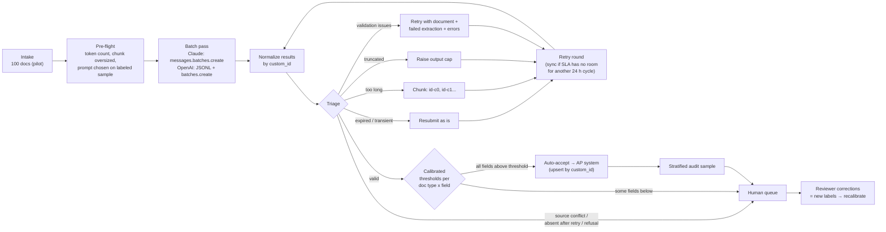

# Capstone 3 — Structured Extraction Pipeline at Scale

> **Official anchor:** CCAR-F Scenario 6 (Structured Data Extraction) and Preparation Exercise 3 (Build a Structured Data Extraction Pipeline) · **Exam domain(s):** Domain 4 — Prompt Engineering & Structured Output (**20%**, tasks 4.2–4.5) · Domain 5 — Context Management & Reliability (**15%**, task 5.5, plus 5.3 for failure handling) · also CCDV-F 2.3 (batch vs realtime) and 5.4 (cost) · OpenAI API pathway (Structured Outputs, Batch API, human-in-the-loop)
> **Stacks:** Claude Message Batches API + structured outputs (or a strict extraction tool) · OpenAI Batch API (JSONL) + Structured Outputs
> **Est. time:** 8–12 hours (README + 2 notebooks) · **Status:** [ ] not started

## Why this capstone matters

Document extraction is the most common "first production workload" an applied AI architect is asked to design: invoices, claims, contracts, KYC files, lab reports. The demo always works on ten clean PDFs. The production system fails in the gaps: values the document does not contain, layouts nobody planned for, a batch where 5% of the requests fail for five different reasons, an SLA that the "usually under an hour" batch window quietly breaks, and an aggregate accuracy number that hides one document type going wrong 15% of the time. This capstone makes you build every one of those gaps on purpose, on **both** vendors' batch stacks, and close each one with a design decision you can defend to a customer and on the exam.

It is a capstone, not a chapter: the theory lives in the chapters linked below, and this folder is where you prove you can put it together.

| Concept you need | Claude chapter | OpenAI chapter |
|---|---|---|
| Strict schemas, `tool_choice`, syntax vs semantic errors | [2 — Tool use, 2.3–2.5](../../../anthropic-claude/02-tool-use/README.md#24-json-schemas-for-structured-output) | [02 — Structured Outputs, 2.3 and 2.6–2.8](../../../openai-codex/02-function-calling-and-structured-outputs/README.md#23-strict-mode-schema-rules) |
| Few-shot for varied formats, validation and retry with feedback | [6 — Prompt engineering, 6.1 and 6.5](../../../anthropic-claude/06-prompt-engineering/README.md#65-validation-and-retry-with-feedback) | [06 — Prompts and evals, 6.3 and 6.6](../../../openai-codex/06-prompt-engineering-and-evals/README.md#66-validation-and-retry-with-feedback) |
| Batch lifecycle, `custom_id`, resubmitting failures, SLA math | [7 — Message Batches](../../../anthropic-claude/07-message-batches/README.md#76-result-types-and-resubmitting-only-the-failures) | [07 — Batch and cost](../../../openai-codex/07-batch-and-cost/README.md#74-reading-results-and-handling-failures) |
| Confidence calibration, segment accuracy, stratified sampling, review routing | [9 — Human in the loop, 9.7–9.9](../../../anthropic-claude/09-escalation-human-in-the-loop/README.md#97-confidence-calibration) | [09 — Human in the loop, 9.8–9.9](../../../openai-codex/09-escalation-human-in-the-loop/README.md#98-confidence-calibration-with-labeled-sets) |

## The brief

**Client (fictional):** Harbor & Pine Facilities, a facilities-management company with 40 sites. Its accounts-payable (AP) team keys in supplier documents by hand: about **4,000 per day**, rising to 100,000 per month after an acquisition.

**What they send:** a mix of six layouts. Tabular PDF invoices, invoices written as letters, phone photos of till receipts (OCR'd), credit notes, purchase orders that arrive in the same mailbox, and remittance advices that are not invoices at all. Some documents lack values (no invoice number, a torn receipt total), some are wrong at the source (lines that do not add up to the printed total), and a few carry 30-page delivery-log annexes.

**What they want:**

- Fifteen fields per document in their AP system, as structured data, **within 30 hours of arrival**.
- No invented values. "The document does not say" is an acceptable answer; a plausible guess is not.
- Their four AP clerks review only what needs a human, most important first. They can absorb a limited number of field reviews per day.
- Evidence, by document type and by field, before they agree to reduce manual review.
- A cost per accepted document they can put in a budget, and a recommendation on vendor.

**Pilot scope (this capstone):** a batch of **100 documents** with labels, run end to end on both stacks, plus a labeled calibration set. The notebooks generate all of it in code, so nothing private is involved and every run is reproducible.

## Requirements

| ID | Requirement | Source in the exam guide | Built in |
|---|---|---|---|
| R1 | One canonical extraction contract with **required and optional** fields, **nullable** fields for values a document may lack, and enums with **`"other"` + detail** (and `"unclear"` where ambiguity is real) | `CCAR-F/EX3/1`, task 4.3 (K4, S4, S5) | 3.2 |
| R2 | Demonstrate that a document with absent values returns `null`, not a fabricated value, and show what a naive schema does instead | `CCAR-F/EX3/1`, 4.3/S4 | 3.2 |
| R3 | Few-shot examples covering the varied formats (table vs prose, decimal commas, delivery vs due dates, out-of-list categories), measured on a labeled sample **before** the batch run | `CCAR-F/EX3/3`, 4.2 (K4, S4, S5), 4.5/S4 | 3.3 |
| R4 | A validation-retry loop: Pydantic + semantic checks; a follow-up that sends the **document, the failed extraction and the specific errors**; a record of which errors retry fixes and which it cannot | `CCAR-F/EX3/2`, 4.4 (K1, K2, K4, S1, S2, S4) | 3.4 |
| R5 | Submit **100 documents** as a batch on the Claude Message Batches API **and** the OpenAI Batch API; handle failures **by `custom_id`**; resubmit **only** the failures, each with the right modification (chunk oversized documents, raise the output cap, add feedback, resend transient/expired as is) | `CCAR-F/EX3/4`, 4.5 (K1, K3, K4, S3) | 3.5 |
| R6 | Compute total processing time against the 30-hour SLA, choose a submission window, and decide when retries must go synchronous | `CCAR-F/EX3/4`, 4.5 (K2, S1, S2) | 3.6 |
| R7 | Field-level confidence from the model, **calibrated on a labeled validation set** into thresholds per document type × field; route low-confidence fields, contradictory sources and unresolved failures to humans, prioritized for limited capacity; a **stratified audit sample** of auto-accepted output | `CCAR-F/EX3/5`, 5.5 (K2, K3, S1, S3, S4), 4.6/S3 | 3.7 |
| R8 | Accuracy **by document type and field**, compared with the aggregate, before any reduction in review | `CCAR-F/EX3/5`, 5.5 (K1, K4, S2) | 3.8 |
| R9 | Cost per accepted document on both stacks (batch discount, retries, human review), with a projection to 100,000 documents per month | CCDV-F 5.4; role competencies `ROLE/COST/1`, `ROLE/COST/3` | 3.9 |
| R10 | Reliability: crash-safe, resumable state (a manifest with the in-flight batch ID and the full pending requests, written before each wait; a restart or a wait timeout re-attaches instead of resubmitting; results read only after a terminal status; synchronous errors caught per request), no silent loss (every document ends in exactly one terminal state), structured failure records, coverage report | 5.3 (K1, K4, S1), 5.4/S4 | 3.5, mini-project |

## Architecture



Two adapters (`ClaudeBatchBackend`, `OpenAIBatchBackend`) hide the vendor plumbing behind four methods: `submit`, `wait`, `results` (normalized `Outcome`s keyed by `custom_id`) and `call_sync`. Everything else (schema contract, validation, triage, chunking, calibration, routing, reporting) is shared code. That separation is what lets the client switch or mix vendors later without rewriting the pipeline (`ROLE/ARCH/6`).

## Build steps

The practice notebook has one section per step, numbered the same way.

### 3.1 The synthetic corpus and its labels

`make_corpus()` generates documents deterministically from a seed, each with a **label**: the extraction a careful human would produce. The pilot batch has 100 documents (34 tabular invoices, 16 letter invoices, 20 receipts, 10 credit notes, 12 purchase orders, 8 remittance advices) with planted scenarios: 4 oversized documents, 2 with 90 line items, 4 genuine source conflicts, 3 torn receipt totals, missing invoice numbers, vague payment terms, 2 transient server errors and 2 requests that expire. Separate seeds produce a 60-document **prompt-selection sample** and a 600-document **calibration set**.

Labels are the expensive part of a real project. Budget for them in the plan: a few hundred labeled documents per segment you intend to automate, re-labeled whenever the document mix changes.

### 3.2 Extraction schema design

One Pydantic model is the contract; two strict wire schemas are generated from the same field list.

| Design rule | In this schema | Why |
|---|---|---|
| Nullable for values a document may lack | `document_number`, `issue_date`, `due_date`, `stated_total_cents`, `payment_terms` | A required non-null field forces the model to invent a value (task 4.3/S4) |
| Required vs optional | `po_reference` is optional on Claude (not in `required`); every other key is required | Claude strict mode allows optional keys (up to 24 per request); OpenAI strict mode requires every property, so the same field becomes **required + nullable** there |
| Enum + `"other"` + detail | `doc_type` + `doc_type_detail`, `currency` + `currency_detail`, `payment_terms` + `payment_terms_detail` | Closed enums force unlisted cases into a wrong bucket; `"other"` keeps them, and the detail string keeps the information |
| `"unclear"` | `payment_terms: "unclear"` for "as agreed" | An honest "unclear" routes cleanly; a confident wrong category does not |
| Printed vs computed values | `stated_total_cents` is the total **as printed**; the sum of `line_items` is computed in code; `conflict_detected` flags a mismatch in the source | Self-correction without letting the model "make the numbers match" (task 4.4/S4) |
| Field-level confidence | `field_confidence` object, one number per scored field | Input for calibrated routing (5.5/S3). The 0–1 range is checked in code: Claude strict schemas reject `minimum`/`maximum` |
| Descriptions are prompts | Units (integer cents), formats (ISO 8601), and "a delivery date is not a due date" live in field descriptions | Normalization rules alongside the strict schema (4.3/S6) |

Limits to stay inside: on Claude, at most 24 optional parameters and 16 union-typed parameters (`["string","null"]` or `anyOf`) across all strict schemas in one request, nested objects included; this schema uses 1 and 8. On OpenAI, the root must be an object, every object needs `additionalProperties: false`, and `anyOf` is allowed inside properties. The notebook's `lint_schema()` checks both rule sets before anything is sent.

**How the structured output is requested:**

| | Claude | OpenAI |
|---|---|---|
| Recommended | `output_config={"format": {"type": "json_schema", "schema": ...}}` | `text={"format": {"type": "json_schema", "name": ..., "schema": ..., "strict": True}}` |
| Tool alternative | A tool with `"strict": true` whose `input_schema` is the contract. Forced `tool_choice` (`any` / `{"type": "tool"}`) guarantees the call on models that accept it (for example Claude Haiku 4.5); Claude Sonnet 5.5, Opus 5.5 and Fable 5.1 reject forced tool use with a 400, also inside batches, so on those use `auto` + a code check, or `output_config.format` | A strict function tool; in a batch file you write the raw schema yourself (`responses.parse(text_format=...)` does not exist inside JSONL) |
| Still possible despite the schema | Refusal (`stop_reason: "refusal"`), truncation (`max_tokens`), enum letter-casing | Refusal content part, `status: "incomplete"` |

### 3.3 Prompt and few-shot examples for varied formats

The system prompt states the normalization rules once (null when absent, ISO dates, integer cents, printed total, payment due date only, `"other"` + detail). Four short examples then show the cases instructions alone handle badly: a total inside a sentence, a decimal comma on a receipt, a purchase order's delivery date, and a remittance advice in CHF.

Measure before you batch: run both prompts on the labeled sample, per layout. In the simulation the examples lift first-pass validity on letters and receipts sharply and halve the purchase-order due-date mistakes, while tabular invoices stay where they were and OCR typos stay too (those need routing, not prompting). The same few-shot block is identical in every request, which also makes it a cacheable prefix (3.9).

### 3.4 Validation and retry with error feedback

`validate_extraction()` returns field-level issues, each marked retryable or not: Pydantic schema errors, non-ISO dates, `"other"` without detail, confidence outside 0–1, line items that do not add up to the printed total without `conflict_detected`, and a missing total on a document type that needs one.

A retry sends the **original document, the failed extraction and the specific errors** as a pre-built conversation (Claude: user → assistant → user, or a `tool_result` with `is_error: true` in tool mode; OpenAI: the same three turns as `input` items). The notebook records what one retry fixes, split by root cause:

| Issue | Root cause | Retry outcome |
|---|---|---|
| `date_format`, `other_without_detail`, `sum_mismatch` from a misread amount | Format or structural slip; the value is in the source | Fixed |
| `missing_total` on a letter invoice | Value is in the source (in prose) | Fixed |
| `missing_total` on a torn receipt | Value is **absent** from the source | Not fixed, correctly: `null` again → human queue after one try |
| `sum_mismatch` on a document whose printed total really is wrong | Error in the source | The retry sets `conflict_detected` → human queue with both numbers |

The anti-pattern is demonstrated too: feedback that says "every field must not be null" turns the torn receipt into a schema-valid, wrong total. Cap retries per issue type, and never pressure the model for a value the source does not contain.

### 3.5 Batch processing on both stacks

The first pass submits all 100 documents as **one batch** with `custom_id = doc_id`. The pipeline waits (polling with backoff), normalizes every result into an `Outcome` keyed by `custom_id`, and triages:

| Result | Claude (one results stream) | OpenAI (output + error files) | Action |
|---|---|---|---|
| Valid extraction | `succeeded`, `stop_reason: "end_turn"` | `status_code: 200`, `status: "completed"` | Validate → accept, retry with feedback, or human |
| Never ran | `expired` (or `canceled`) | Error line with `error.code: "batch_expired"`; batch status `expired` | Resubmit **as is** |
| Transient server error | `errored`, `overloaded_error` / `api_error` | `status_code` 5xx | Resubmit **as is** |
| Document too long | `errored`, `invalid_request_error` "prompt is too long" | 4xx (context length) | **Chunk** into `doc-0042-c0`, `-c1`... and resubmit only the chunks; merge chunk results per parent |
| Truncated output | `succeeded` with `stop_reason: "max_tokens"` | `status: "incomplete"`, `max_output_tokens` | Double the output cap and resubmit |
| Refusal | `succeeded` with `stop_reason: "refusal"` | `refusal` content part | Human queue (or a fallback model) |
| Request shape rejected | `errored`, `invalid_request_error` (for example forced `tool_choice` on Sonnet 5.5) | Batch `failed` at validation (whole file) or a 4xx line | Fix the request; dry-run one synchronous call before the next large run |

Round 1 contains **only** the failures from round 0, each with its modification; nothing that succeeded is resubmitted. The ledger gives every document exactly one terminal state (`accepted` first pass, `accepted` after retry, or `human_review` with a reason), and any `custom_id` missing from the results is treated as expired rather than silently dropped. The manifest holds everything a new process needs to continue: the in-flight batch ID, the **full** pending requests (retry feedback, chunk texts, raised output caps), chunk results, token usage and the ledger. It is written atomically right after each submit and after each round, and `ExtractionPipeline.resume()` rebuilds the pipeline from it and re-attaches to the in-flight batch instead of paying for it twice. A wait that gives up is not a result: results are requested only after the batch reaches a terminal status (Claude has no `results_url` before that, and an unfinished OpenAI batch has no output file, which a naive reconciliation would misread as "expired" and resubmit), so a timeout raises `BatchStillRunning` with the ID saved. Synchronous retries catch SDK errors per request and turn them into `errored` outcomes (connection errors count as transient), so one network failure cannot abort a round; the round limit bounds the retries and a document still failing ends in `human_review` with "attempts exhausted". The notebook injects all three failures (a killed process, a timed-out wait, a dropped connection) and checks that nothing is submitted twice.

| Mechanic | Claude Message Batches API | OpenAI Batch API |
|---|---|---|
| Submit | `client.messages.batches.create(requests=[{custom_id, params}])` | Write JSONL (`custom_id`, `method`, `url`, `body`) → `files.create(purpose="batch")` → `batches.create(input_file_id, endpoint="/v1/responses", completion_window="24h")` |
| Discount and window | 50%; most batches finish within an hour; up to 24 h; no latency SLA | 50%; completes within 24 h; separate rate-limit pool |
| Limits | 100,000 requests or 256 MB per batch | 50,000 requests, 200 MB per file, one model per file |
| `custom_id` | `^[a-zA-Z0-9_-]{1,64}$`, unique per batch | Each request in the input file needs a unique `custom_id` (use the Claude pattern for portability) |
| Status | `in_progress` → `ended` (`canceling` after a cancel request; outcome counts stay 0 until the end) | `validating` → `in_progress` → `finalizing` → `completed` / `expired` (also `failed`, `cancelling`, `cancelled`) |
| Results order | Not guaranteed: match by `custom_id` | Not guaranteed: match by `custom_id` |
| Retention | Results for 29 days after creation | Output file deleted 30 days after completion by default (`output_expires_after` from 1 h to 30 days) |
| Multi-turn requests | Pre-built conversations are fine; a client tool cannot be executed mid-request | Same: pre-built `input` items are fine; no mid-request tool round trips |
| Data governance | Not ZDR- or HIPAA-eligible; request and response data kept up to 29 days (delete a batch sooner with `DELETE /v1/messages/batches/{id}`); endpoint not available on Bedrock, Vertex AI or Foundry | Input files uploaded with `purpose="batch"` expire 30 days after upload by default (`expires_after` on upload, 1 h to 30 days); output and error files are deleted 30 days after completion by default; delete files sooner if your policy requires it, and check your organization's data controls |

### 3.6 SLA math

Batches promise **up to 24 hours**, not "about an hour". For documents that arrive continuously and are submitted every `W` hours, the worst-case age is `W + 24 h + B` (buffer for validation, retries and loading). With the 30-hour SLA and a 2-hour buffer, `W = 4 h`; 6-hour windows breach the SLA for a third of the documents in the simulation. Retries change the math: every further **batch** cycle adds up to another 24 hours, and the budget must count the cycles the configuration **allows**, not the ones a typical run uses. With `max_rounds = 3` an all-batch pipeline may submit four times (`W + 96 + B = 102 h`). The pipeline therefore caps batch rounds at what the SLA absorbs (`batch_cycles`) and sends later rounds **synchronously**: with a 30-hour SLA only the first pass is a batch (a small remainder at standard price); a 54-hour SLA absorbs exactly two cycles (`W + 48 + B`), so the first retry round can be batch-priced and any later round runs synchronously. An urgent class of documents with a 20-hour SLA cannot use batches at all.

### 3.7 Confidence calibration and human review routing

Self-reported confidence is a ranking, not a probability. The notebook runs the 600-document labeled set through the same prompt, builds a reliability table per field, and picks the **lowest threshold per (document type, field)** whose auto-accepted set reaches 97% accuracy with at least 25 samples; where none exists, that field always goes to review. In the simulation, receipt `vendor_name` is the field that never earns a threshold: OCR mistakes come back with ~0.9 confidence.

Routing works on **fields**, not documents: a reviewer sees two flagged fields next to the source instead of re-keying an invoice. Each flagged field gets a priority of `P(error) × cost of that field being wrong` (a wrong total outranks wrong payment terms), and a **stratified random audit** (by document type, with a minimum per type) samples the auto-accepted documents so their error rate keeps being measured and new error patterns surface. Everything people must look at shares **one** daily capacity budget, counted in field checks: the audit sample is reserved first and never deferred, then the documents that ended in `human_review` (source conflicts, unresolved failures, refusals, exhausted attempts, each with its reason and costed as a full check), then the flagged fields by priority; the low-priority field tail is what waits. Reviewer corrections become new labels for the next calibration run.

### 3.8 Accuracy by document type and field

Report a matrix, not a number. In the simulation the pilot's aggregate field accuracy before review is about 99%, while receipts sit at roughly 85% on `vendor_name` and 90% on `issue_date`, and invoices miss the 97% target on `document_number` and `due_date`. The fields that routing auto-accepts are far more accurate than the aggregate because calibration sent exactly those weak segments to people. That table, per document type × field, with sample sizes, is what the client signs off before manual review is reduced, and it is re-run whenever the model, prompt, schema or document mix changes.

### 3.9 Cost comparison

List prices checked on 2026-10-03, USD per million tokens (input / output). Both vendors' batch price is 50% of standard.

| Model | Standard | Batch | Notes |
|---|---|---|---|
| Claude Sonnet 5.5 (`claude-sonnet-5-5`) | $2 / $10 | **$1 / $5** | Minimum cacheable prefix 512 tokens |
| Claude Haiku 4.5 (`claude-haiku-4-5`) | $1 / $5 | **$0.50 / $2.50** | Accepts forced `tool_choice`; minimum cacheable prefix 4,096 tokens |
| `gpt-6-luna` | $0.10 / $0.50 | **$0.05 / $0.25** | Reasoning tokens are billed as output |
| `gpt-6.1-sol` | $2.00 / $10.00 | **$1.00 / $5.00** | |

**Worked example (illustrative): 100,000 documents per month.** Assume 2,500 input tokens per request (about 1,000 of shared instructions, examples and schema plus a 1,500-token document) and 600 output tokens (on OpenAI, add the reasoning tokens you observe at your `reasoning.effort`).

| Option | Input | Output | Model cost per month |
|---|---|---|---|
| Sonnet 5.5, batch | 250M × $1 = $250 | 60M × $5 = $300 | **$550** (synchronous: $1,100) |
| Haiku 4.5, batch | 250M × $0.50 = $125 | 60M × $2.50 = $150 | **$275** |
| `gpt-6-luna`, batch | 250M × $0.05 = $12.50 | 60M × $0.25 = $15 | **$27.50** + reasoning tokens |
| `gpt-6.1-sol`, batch | 250M × $1 = $250 | 60M × $5 = $300 | **$550** + reasoning tokens |
| Human review | If 10% of documents need 2 field reviews at $0.40 each | | **$8,000** |

Three conclusions the client needs to hear:

1. **Human review dominates.** A model that is cheaper per token but sends a few percent more fields to reviewers costs more overall. Compare candidate models on the labeled sample by **cost per accepted document** (tokens + retries + review), not by token price. The notebook's cost table reuses one simulated quality profile for every model on purpose, to show the arithmetic; real models differ, so measure.
2. **Retries are a small, priced line.** Synchronous retries cost twice the batch rate but only for the remainder; that is the price of meeting a 30-hour SLA.
3. **Caching is a bonus, not a plan.** The shared prefix is cacheable on Sonnet 5.5 and Opus 5.5 (512-token minimum) but below Haiku 4.5's 4,096-token minimum, and around OpenAI's 1,024-token minimum on GPT-6 models. Anthropic documents batch cache hits as best-effort, and OpenAI's caching guide does not cover batches, so model cost without them.

Pricing arithmetic is out of scope for the CCAR-F exam (`CCAR-F/APPX/OUT/11`); it is in scope for CCDV-F 5.4 and for every real proposal.

## Acceptance criteria

Tick each one from your own run of the notebooks.

- [ ] `lint_schema()` returns no problems for both wire schemas, and the naive-schema experiment shows fabricated values that the nullable + `"other"` schema avoids.
- [ ] The prompt was chosen on the labeled sample, and the per-layout before/after table is saved with your notes.
- [ ] The retry table separates fixable issues from absent-information issues; no document is retried more than the cap; torn receipts end in human review with `stated_total_cents: null`.
- [ ] Both batch runs (Claude and OpenAI) finish with **100/100 documents** in exactly one terminal state, and round 1 contains only round-0 failures.
- [ ] Oversized documents are processed as chunks with `-cN` IDs and merged; truncated outputs are resubmitted with a larger cap; transient and expired requests are resubmitted unchanged.
- [ ] The SLA calculation gives a submission window and states whether retries go batch or synchronous, with the arithmetic.
- [ ] Thresholds come from the labeled calibration set per document type × field, with a minimum sample size; at least one field has no safe threshold and is always reviewed.
- [ ] One review plan covers the audit sample, every `human_review` document and the flagged fields, prioritized and cut at capacity (the audit is never deferred); the stratified audit sample covers every document type.
- [ ] The accuracy matrix (document type × field) is reported next to the aggregate, with the below-target cells marked.
- [ ] The cost table reports cost per accepted document including human review, for both vendors.
- [ ] Optional: the live cell ran on a 5-document sample on both APIs and your results are matched by `custom_id`.
- [ ] Homework: 72% or better.

## Notebooks

| Notebook | Sections covered | What you will build / run |
|---|---|---|
| [`01_practice.ipynb`](01_practice.ipynb) | 3.1–3.9: deterministic corpus with labels; canonical Pydantic contract and two strict wire schemas with a linter; a naive-schema fabrication experiment; few-shot prompt chosen on a labeled sample; validator with retryable/non-retryable issues and retry-with-feedback through the **real** SDKs; `FakeClaudeBatches` and `FakeOpenAIBatches` (real `anthropic` / `openai` clients over `httpx2.MockTransport`, virtual clock); `ClaudeBatchBackend` (JSON outputs or strict tool) and `OpenAIBatchBackend` (JSONL + files); a resumable manifest with crash, timeout and network-error recovery; the forced-`tool_choice` trap; SLA windows and an arrival simulation; calibration on a 600-document labeled set, thresholds per document type × field, field-level routing with capacity and a stratified audit; accuracy matrix; cost table | **Mini-project:** `run_end_to_end()` runs the full pipeline on both stacks with and without pre-flight chunking and prints terminal states, auto-accept rate, review load, accuracy and cost per accepted document. A `RUN_LIVE = False` flag guards a small live run on both real batch APIs |
| [`02_homework.ipynb`](02_homework.ipynb) | Self-test for the whole capstone | 10 original scenario questions (hashed answer key); 6 offline exercises with auto-checks (schemas for both vendors' strict modes, a semantic validator, the retry follow-up and its stopping rule, a failures-only resubmission plan with chunking, SLA window and cost per accepted document, thresholds per segment and routing); an architecture scenario with a rubric; a scorecard (pass mark 72%) |

Theory stays in the chapters; notebooks hold code. Run them from the repo root venv (see [../../../00-prerequisites/README.md](../../../00-prerequisites/README.md)).

## Rubric

Score yourself (or ask a peer to) after the build. Each row is 0 (missing), 1 (partly there) or 2 (complete and justified). **16 of 24** is a pass; **20+** is portfolio-ready.

| # | Criterion | 2 points looks like | Maps to |
|---|---|---|---|
| 1 | Schema | Nullable where absence is possible, enum + `"other"` + detail, `"unclear"` where honest; vendor-specific strict rules respected; a naive-schema counter-example shown | D4 4.3 · `ROLE/SAFE/3` |
| 2 | Prompt and few-shot | Examples target the observed failure layouts; the choice is backed by a per-layout table from a labeled sample | D4 4.2, 4.5/S4 · `ROLE/PROMPT/1` |
| 3 | Validation and retry | Field-level semantic checks; feedback contains document, failed extraction and specific errors; fixable vs absent tracked separately; retry caps | D4 4.4 |
| 4 | Batch mechanics | `custom_id` design, crash-safe state, both lifecycles handled, results normalized by `custom_id`, nothing lost | D4 4.5 · `ROLE/COST/3` |
| 5 | Failure handling | Only failures resubmitted, each with the right modification (chunk, cap, feedback, as is); refusals and conflicts routed | D4 4.5/S3 · D5 5.3 |
| 6 | SLA | Window computed from the 24 h bound, buffer stated, retry path chosen by arithmetic, urgent class handled | D4 4.5/S2 · `ROLE/COST/7` |
| 7 | Calibration | Labeled set, reliability table, thresholds per document type × field with minimum n, recalibration triggers | D5 5.5/K3, S3 · `ROLE/EVAL/3` |
| 8 | Routing | Field-level routing, priority by expected cost, capacity cut, stratified audit never skipped | D5 5.5/S1, S4 · `ROLE/EVAL/4` |
| 9 | Segment accuracy | Matrix with sample sizes and target, compared with the aggregate, used to decide where review can shrink | D5 5.5/K1, K4, S2 · `ROLE/EVAL/1` |
| 10 | Cost | Cost per accepted document including review, both vendors, assumptions dated and stated | CCDV-F 5.4 · `ROLE/COST/1` |
| 11 | Vendor portability | Adapters isolate vendor plumbing; differences (limits, statuses, files, retention, strict-mode rules) documented | `ROLE/ARCH/6` |
| 12 | Communication | A one-page recommendation for the AP director: design, SLA, review load, cost, risks, vendor choice | `ROLE/COMM/1` |

## Common mistakes and anti-patterns

- **Required non-null fields for values a document may lack.** The model fills them with plausible inventions that no validator can see.
- **Closed enums without `"other"`.** Remittance advices filed as invoices; CHF reported as EUR.
- **"Strict schema, so the data is correct."** Strict mode removes syntax errors only. Dates in the wrong format inside a valid string, and totals that do not add up, still need code.
- **Retrying absent information**, or worse, telling the model the field "must not be null". Retries fix format and structure, not missing facts.
- **Asking the model to make the totals match.** Extract the printed total, compute the sum in code, flag the conflict, and let a person decide.
- **Submitting 100,000 documents with an untested prompt.** Choose the prompt on a labeled, stratified sample first.
- **Resubmitting the whole batch**, or resubmitting oversized documents unchanged.
- **Matching results by position**, or treating OpenAI's `expired` batch status (or Claude's `succeeded`) as the whole story without reading each result.
- **Planning the SLA from the typical hour**, or planning batch-priced retries that need a second 24-hour cycle the SLA does not have.
- **Forced `tool_choice` on a model that rejects it**, discovered only when a large batch ends.
- **One global confidence threshold**, or raw self-reported confidence used as a probability.
- **Routing only low-confidence items** with no audit of the auto-accepted ones.
- **Reporting one aggregate accuracy number** to justify reducing review.
- **Comparing vendors on token price** instead of cost per accepted document.

## Self-check

Five quick questions on the decisions this capstone turns on. The [homework](02_homework.ipynb) has ten more, with a graded answer key.

**1.** A pilot extracts 15 fields from supplier invoices. `due_date` is a required, non-nullable string. On 8% of documents the reviewers find a due date that appears nowhere in the source. What is the root-cause fix?

- A) Add "never invent values" to the system prompt
- B) Make `due_date` nullable, and say in its description that the field is `null` when the document states no due date
- C) Retry those documents with feedback until the date validates
- D) Raise the model's effort setting

<details><summary>Answer</summary>

**B.** A required non-null field forces the model to produce *something*. Nullable plus a clear description removes the pressure to invent (3.2). A helps a little but leaves the schema contradicting the instruction. C asks the model again for information the source does not contain (3.4). D does not change what the schema demands.
</details>

**2.** After one retry with error feedback, `missing_total` is fixed on letter invoices but not on torn receipts. What should the pipeline do with the receipts?

- A) Retry up to five times with stronger wording
- B) Tell the model the total must not be `null`
- C) Stop after one try and send them to the human queue with `stated_total_cents: null` and the reason
- D) Fill the total from the sum of the line items without flagging it

<details><summary>Answer</summary>

**C.** The value is absent from the source, so retries cannot fix it (task 4.4/K2). B is the anti-pattern from 3.4: it produces a schema-valid, wrong total. D hides a computed value inside a field defined as the *printed* total.
</details>

**3.** A Claude batch of 100 documents ends with 91 `succeeded`, 4 `errored` with "prompt is too long", 3 `expired` and 2 `succeeded` with `stop_reason: "max_tokens"`. What goes into the next batch?

- A) All 100 documents with a larger `max_tokens`
- B) The 9 failures: the 4 split into chunks (`-c0`, `-c1`...), the 3 expired resubmitted unchanged, and the 2 truncated with a larger output cap
- C) The 4 errored documents only, because `expired` and `succeeded` are final
- D) The 9 failures unchanged

<details><summary>Answer</summary>

**B.** Resubmit only the failures, matched by `custom_id`, each with the modification that fixes its cause (3.5). A reprocesses 91 good results and fixes the wrong limit for the oversized ones. C misses that `succeeded` with `max_tokens` is truncated output, and that expired requests never ran. D repeats the oversized requests, which will fail again.
</details>

**4.** Documents arrive around the clock and must be extracted within 30 hours. You plan with 24 hours of worst-case batch time and a 2-hour buffer. Failures need one retry round. Which plan meets the SLA?

- A) Submit every 6 hours; retries go in the next batch
- B) Submit every 4 hours; retries go synchronous
- C) Submit every 4 hours; retries go in a second batch
- D) Submit once a day, because most batches finish within an hour

<details><summary>Answer</summary>

**B.** Worst-case age is `W + 24 + B`, so `W = 30 − 24 − 2 = 4` hours (3.6). A second batch cycle adds up to 24 more hours (C), which the SLA cannot absorb, so retries go synchronous at standard price. A breaches the SLA for the oldest documents. D plans from the typical case, not the bound.
</details>

**5.** Overall field accuracy on the pilot is 99%. The client wants to stop reviewing everything above 0.9 confidence. What do you show them first?

- A) The 99% figure with a confidence interval
- B) Accuracy per document type × field with sample sizes, thresholds calibrated on a labeled set per segment, and a stratified audit plan for the auto-accepted output
- C) The model's average self-reported confidence per field
- D) A comparison with last month's aggregate accuracy

<details><summary>Answer</summary>

**B.** An aggregate can hide a weak segment, such as receipt `vendor_name` at about 85% in this simulation (3.8). Self-reported confidence is a ranking until it is calibrated on labels (3.7), so C and a single global 0.9 cut are not evidence. A stratified audit keeps measuring what is auto-accepted. A and D are still aggregates.
</details>

## Certification coverage

Requirement IDs come from the official exam guides, Academy course outlines and the role-competency list (see the [Claude path overview](../../../anthropic-claude/README.md)). **Primary** means this capstone is where the item is built end to end; **Supporting** means it is applied here and taught in full in the linked chapters. "Practice" and "homework" refer to this folder's two notebooks.

| Requirement ID | What it asks (short) | Where in this chapter | Depth (Primary/Supporting) |
|---|---|---|---|
| `CCAR-F/SC6` | Scenario 6: Structured Data Extraction | Whole capstone | Primary |
| `CCAR-F/PREP/4` | Prepare by building a structured data extraction pipeline | Whole capstone; practice mini-project | Primary |
| `CCAR-F/EX3/1` | Extraction schema: required/optional, enum + `"other"` + detail, nullable; absent fields return `null` | 3.2, Self-check 1; practice 3.2 (naive-schema experiment); homework Exercise 1 | Primary |
| `CCAR-F/EX3/2` | Validation-retry loop with document, failed extraction and specific errors; track fixable vs unfixable | 3.4, Self-check 2; practice 3.4; homework Exercises 2–3 | Primary |
| `CCAR-F/EX3/3` | Few-shot examples for varied formats; verify the improvement | 3.3; practice 3.3 (per-layout before/after table) | Primary |
| `CCAR-F/EX3/4` | 100-document batch, failures by `custom_id`, resubmit with modifications, SLA calculation | 3.5, 3.6, Self-checks 3–4; practice 3.5–3.6 and mini-project; homework Exercises 4–5 | Primary |
| `CCAR-F/EX3/5` | Field-level confidence, human review routing, accuracy by document type and field | 3.7, 3.8, Self-check 5; practice 3.7–3.8; homework Exercise 6 | Primary |
| `CCAR-F/D4/4.2/K4` | Few-shot reduces hallucination in extraction from varied structures | 3.3 | Supporting |
| `CCAR-F/D4/4.2/S4` | Few-shot for varied document structures | 3.3; practice 3.3 | Supporting |
| `CCAR-F/D4/4.2/S5` | Few-shot to fix empty/null extraction of fields present in varied formats | 3.3 (total inside a sentence, decimal comma) | Supporting |
| `CCAR-F/D4/4.3/K1` | Tool use / strict schemas eliminate JSON syntax errors | 3.2 (structured-output table) | Supporting |
| `CCAR-F/D4/4.3/K2` | `tool_choice` `auto` vs `any` vs forced tool | 3.2, 3.5 (forced `tool_choice` trap); practice 3.5; homework Q5 | Supporting |
| `CCAR-F/D4/4.3/K3` | Strict schemas do not prevent semantic errors | 3.2, 3.4; homework Q4 | Supporting |
| `CCAR-F/D4/4.3/K4` | Required vs optional fields; enum + `"other"` + detail | 3.2 | Supporting |
| `CCAR-F/D4/4.3/S1` | Extraction tool with a JSON schema; read the `tool_use` result | 3.2 (tool alternative); practice 3.5 (strict-tool backend) | Supporting |
| `CCAR-F/D4/4.3/S2` | `tool_choice: "any"` when several schemas exist and the type is unknown | Homework Q5 | Supporting |
| `CCAR-F/D4/4.3/S4` | Nullable fields so the model does not fabricate | 3.2, Self-check 1; practice naive-schema experiment | Supporting |
| `CCAR-F/D4/4.3/S5` | `"unclear"` and `"other"` + detail enum values | 3.2 | Supporting |
| `CCAR-F/D4/4.3/S6` | Format normalization rules alongside strict schemas | 3.2 (descriptions are prompts), 3.3 | Supporting |
| `CCAR-F/D4/4.4/K1` | Retry with specific validation errors | 3.4 | Supporting |
| `CCAR-F/D4/4.4/K2` | Retries fail when information is absent from the source | 3.4, Self-check 2; homework Q3 | Supporting |
| `CCAR-F/D4/4.4/K4` | Semantic validation errors vs schema syntax errors | 3.4 (`validate_extraction()`) | Supporting |
| `CCAR-F/D4/4.4/S1` | Follow-up with original document, failed extraction and errors | 3.4; practice retry loop; homework Exercise 3 | Supporting |
| `CCAR-F/D4/4.4/S2` | Tell when a retry will work and when it will not | 3.4 retry table; homework Exercise 3 | Supporting |
| `CCAR-F/D4/4.4/S4` | Printed vs calculated total with `conflict_detected` | 3.2, 3.4 | Supporting |
| `CCAR-F/D4/4.5/K1` | Message Batches: 50% saving, up to 24 h, no latency SLA | 3.5, 3.6 | Supporting |
| `CCAR-F/D4/4.5/K3` | No multi-turn tool calling inside one batch request | 3.5 (multi-turn row) | Supporting |
| `CCAR-F/D4/4.5/K4` | `custom_id` correlates requests and results | 3.5; practice adapters | Supporting |
| `CCAR-F/D4/4.5/S2` | Submission frequency from the SLA (4 h windows for 30 h) | 3.6, Self-check 4; practice 3.6; homework Exercise 5 | Supporting |
| `CCAR-F/D4/4.5/S3` | Resubmit only failures by `custom_id`, with modifications such as chunking | 3.5, Self-check 3; homework Exercise 4 | Supporting |
| `CCAR-F/D4/4.5/S4` | Refine the prompt on a sample before a large batch | 3.3 (prompt chosen on a labeled sample) | Supporting |
| `CCAR-F/D4/4.6/S3` | Model self-reports confidence alongside each output for calibrated routing | 3.2 (`field_confidence`), 3.7 | Supporting |
| `CCAR-F/D5/5.3/K1` | Structured error context enables recovery decisions | 3.5 (structured failure records per `custom_id`) | Supporting |
| `CCAR-F/D5/5.3/K4` | Neither silently suppress errors nor stop on one failure | 3.5 (one terminal state per document; missing IDs treated as expired) | Supporting |
| `CCAR-F/D5/5.3/S1` | Failure records with type, what was attempted and partial results | 3.5; practice ledger | Supporting |
| `CCAR-F/D5/5.3/S4` | Coverage annotations on output | Practice 3.5 and mini-project (`coverage_report()`) | Supporting |
| `CCAR-F/D5/5.4/S4` | Crash recovery from a persisted manifest | 3.5 (resumable manifest written before each wait; injected crash and timeout) | Supporting |
| `CCAR-F/D5/5.5/K1` | Aggregate accuracy can mask weak document types or fields | 3.8, Self-check 5 | Supporting |
| `CCAR-F/D5/5.5/K2` | Stratified random sampling of high-confidence output | 3.7; homework Q9 | Supporting |
| `CCAR-F/D5/5.5/K3` | Field-level confidence calibrated on labeled validation sets | 3.7; homework Q8 | Supporting |
| `CCAR-F/D5/5.5/K4` | Validate accuracy by document type and field before automating | 3.8 | Supporting |
| `CCAR-F/D5/5.5/S1` | Stratified audit of auto-accepted extractions | 3.7; practice 3.7 | Supporting |
| `CCAR-F/D5/5.5/S2` | Analyze accuracy per segment before reducing review | 3.8; practice 3.8 | Supporting |
| `CCAR-F/D5/5.5/S3` | Calibrate review thresholds on labeled sets | 3.7; homework Exercise 6 | Supporting |
| `CCAR-F/D5/5.5/S4` | Route low-confidence or contradictory documents to humans within limited capacity | 3.7; homework Exercise 6 | Supporting |
| `CCAR-F/APPX/TECH/5` | Claude API: `tool_use`, `tool_choice`, `stop_reason`, `max_tokens` | 3.2, 3.5 | Supporting |
| `CCAR-F/APPX/TECH/6` | Message Batches: savings, 24 h window, `custom_id`, polling, no multi-turn tools | 3.5 | Supporting |
| `CCAR-F/APPX/TECH/7` | JSON Schema: required/optional, enums, nullable, `"other"` + detail, strict mode | 3.2 | Supporting |
| `CCAR-F/APPX/TECH/8` | Pydantic: schema and semantic validation, validation-retry loops | 3.2, 3.4 | Supporting |
| `CCAR-F/APPX/TECH/10` | Few-shot prompting | 3.3 | Supporting |
| `CCAR-F/APPX/TECH/14` | Field-level confidence, calibration, stratified sampling | 3.7 | Supporting |
| `CCAR-F/APPX/IN/13` | Structured output via `tool_use`: schema design, `tool_choice`, nullable fields | 3.2 | Supporting |
| `CCAR-F/APPX/IN/14` | Few-shot prompting for format consistency | 3.3 | Supporting |
| `CCAR-F/APPX/IN/15` | Batch appropriateness, latency tolerance, failure handling by `custom_id` | 3.5, 3.6 | Supporting |
| `CCAR-F/APPX/IN/17` | Human review: calibration, stratified sampling, accuracy by segment | 3.7, 3.8 | Supporting |
| `CCDV-F/D2/2.3/K9` | Batch API use | 3.5 | Supporting |
| `CCDV-F/D2/2.3/K10` | Realtime vs batch API selection | 3.6 (synchronous retries, urgent class) | Supporting |
| `CCDV-F/D5/5.4/K1` | Token budgeting | 3.9 (worked example) | Supporting |
| `CCDV-F/D5/5.4/K3` | Cost modeling | 3.9; homework Exercise 5 | Supporting |
| `CCDV-F/D5/5.4/K4` | Prompt caching | 3.9 (conclusion 3) | Supporting |
| `OAI/api/design-build-agentic-systems/22` | Strict structured outputs for application-consumed output | 3.2 | Supporting |
| `OAI/tracks/ai-app-development/9` | Structured Outputs and strict function schemas | 3.2; homework Exercise 1 | Supporting |
| `OAI/bootcamp/api-builder/5` | Structured outputs | 3.2 | Supporting |
| `OAI/api/optimize-ai-app-performance/15` | Batch API for asynchronous work at 50% | 3.5, 3.9 | Supporting |
| `OAI/tracks/ai-app-development/26` | Batch API (50% discount, async only) | 3.5, 3.9; homework Q10 | Supporting |
| `OAI/api/design-build-agentic-systems/24` | Human-in-the-loop review designs | 3.7 | Supporting |
| `OAI/foundations/applied-ai-foundations/10` | Build human review into the process | 3.7 | Supporting |
| `ROLE/COST/1` | Cost-latency-quality trade-offs and unit economics | 3.9 (cost per accepted document) | Primary |
| `ROLE/COST/3` | Batch processing | 3.5, 3.9 | Supporting |
| `ROLE/COST/7` | Throughput and scaling at production volume | 3.6, 3.9 (100,000 documents per month) | Supporting |
| `ROLE/EVAL/1` | Use-case-specific evaluation | 3.8 | Supporting |
| `ROLE/EVAL/3` | Representative labeled datasets and human judgment | 3.1, 3.3, 3.7 | Supporting |
| `ROLE/EVAL/4` | Production feedback loops | 3.7 (reviewer corrections become labels; audit sample) | Supporting |
| `ROLE/SAFE/3` | Hallucination mitigation | 3.2, 3.4 | Supporting |
| `ROLE/SAFE/7` | Auditability and provenance per record | 3.5 (ledger per `custom_id`) | Supporting |
| `ROLE/ARCH/5` | Resilience and reliability patterns | 3.5 (retries, crash-safe manifest) | Supporting |
| `ROLE/ARCH/6` | Provider-agnostic architecture | Architecture (two adapters behind one interface) | Primary |
| `ROLE/PROMPT/3` | Structured outputs and schema enforcement | 3.2 | Supporting |

## Official documentation

- Claude: [Batch processing](https://platform.claude.com/docs/en/build-with-claude/batch-processing) · [Structured outputs](https://platform.claude.com/docs/en/build-with-claude/structured-outputs) · [Handling stop reasons](https://platform.claude.com/docs/en/build-with-claude/handling-stop-reasons) · [Token counting](https://platform.claude.com/docs/en/build-with-claude/token-counting) · [Pricing](https://platform.claude.com/docs/en/about-claude/pricing) · [API and data retention](https://platform.claude.com/docs/en/manage-claude/api-and-data-retention)
- OpenAI: [Batch API](https://developers.openai.com/api/docs/guides/batch) · [Structured Outputs](https://developers.openai.com/api/docs/guides/structured-outputs) · [Pricing](https://developers.openai.com/api/docs/pricing) · [Webhooks](https://developers.openai.com/api/docs/guides/webhooks)
- Exam guide: Claude Certified Architect – Foundations, Scenario 6 and Preparation Exercise 3 (official PDF; this capstone's items are original and test the same competencies).
- Syllabus companion: community study guide by paullarionov, [Scenario 6: Structured Data Extraction](https://github.com/paullarionov/claude-certified-architect/blob/main/guide_en.md#scenario-6-structured-data-extraction), used for orientation; everything here is written in my own words and built from current docs.

## Share your progress

```text
Capstone 3 of my AI Solution Architect journey: a document-extraction pipeline at scale, built twice
(Claude Message Batches + OpenAI Batch API) on 100 synthetic documents.

3 takeaways:
1. Nullable fields and "other" + detail stop fabrication before validation ever runs.
2. Resubmit only what failed, by custom_id, with the right fix: chunk, raise the cap, add feedback.
3. 99% overall can hide 85% on receipt vendor names. Calibrate per document type x field; review fields, not documents.

#ClaudeAI #OpenAI #AIArchitecture #LLMOps #BuildInPublic
```

---

[← Capstone 2 — Multi-agent research with provenance](../02-multi-agent-research-with-provenance/README.md) | [↑ Capstones](../README.md) | [Capstone 4 — Coding agents for a team →](../04-coding-agents-for-a-team/README.md)
