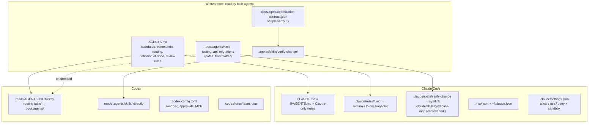
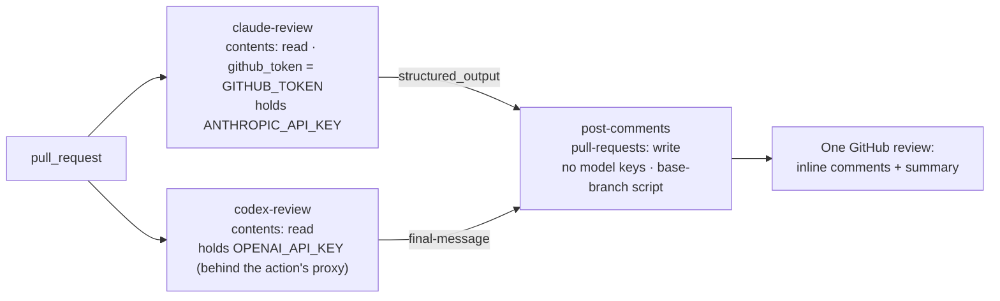

# Capstone 4 — Coding Agents for a Team (Claude Code and Codex)

> **Exam scenarios:** CCAR-F *Code Generation with Claude Code*, *Developer Productivity with Claude* and *Claude Code for Continuous Integration*, plus official preparation **Exercise 2** (*Configure Claude Code for a Team Development Workflow*)
> **Exam domain(s):** Domain 3 — Claude Code Configuration & Workflows (**20%**, all of 3.1–3.6) · Domain 4 — Prompt Engineering & Structured Output (**20%**, structured CI output, multi-pass review) · Domain 2 — Tool Design & MCP Integration (**18%**, MCP scopes and credentials) · Domain 5 — Context Management & Reliability (**15%**, isolating noisy work)
> **OpenAI Academy (Codex pathway) deliverables:** a verified, Codex-supported change with reviewer evidence; a reusable team skill; a verification contract
> **Est. time:** 10–14 hours (design 2 h, notebooks 6–8 h, optional live runs 2–4 h) · **Status:** [ ] not started

---

## Why this capstone matters

Most teams that adopt coding agents end up with **two of them**. Some developers prefer Claude Code, others Codex, and CI may run either. If each agent gets its own copy of the team's conventions, the copies drift within weeks, and the two agents start giving different answers to the same question. If neither agent is boxed in by permissions, one bad prompt can push to `main`.

This capstone asks you to do what an Applied AI architect does on a real engagement: take one repository and make it **safe, consistent and reviewable for both agents at once**. You decide:

- where each convention lives so that it is written **once** and both agents load it
- which conventions load always, per file type, or per task
- which guardrails are **guidance** (instruction files) and which are **enforcement** (permissions, sandbox, rules)
- how both agents review pull requests in CI with **schema-validated output** that becomes inline comments
- what "done" means: a **verification contract** that every agent change must satisfy, with evidence a reviewer can check

Everything here builds on two chapters. Read them first, because this capstone does not re-teach their basics:

- [Claude Chapter 5 — Claude Code: Configuration and Workflows](../../../anthropic-claude/05-claude-code/README.md)
- [OpenAI Chapter 5 — Codex: Configuration, Sandboxing and CI](../../../openai-codex/05-codex/README.md)

Useful but optional: [Claude Chapter 13 — Claude Code Built-in Tools](../../../anthropic-claude/13-claude-code-builtin-tools/README.md), for the Read/Grep/Glob exploration habits that the `codebase-map` skill relies on.

## The brief

> **Kestrel Supply** (a fictional parts retailer) has a 14-person team working on `kestrel-shop`, a small Python pricing and orders service. Eight developers use Claude Code, six use Codex. Last month, three things went wrong:
>
> 1. A new developer's agent kept using `float` for prices. The money rule lived in a senior developer's personal instruction file.
> 2. Claude and Codex were given different testing rules, because the team kept two hand-copied instruction files.
> 3. An AI review bot posted 40 comments on a 6-file pull request. Half repeated earlier comments and several pointed at lines the PR never touched.
>
> The engineering manager asks you to **configure the repository for both agents** and to **prove the setup works** with one real change, before the team scales to 40 people.

## Deliverables

| # | Deliverable | Where it lives in the sample repo | Requirement IDs |
|---|---|---|---|
| D1 | Shared instruction layer: `AGENTS.md` as the source of truth, `CLAUDE.md` that imports it | `AGENTS.md`, `CLAUDE.md` | `CCAR-F/EX2/1` |
| D2 | Path-scoped conventions for tests, API and migrations, written once | `docs/agents/*.md`, `.claude/rules/` | `CCAR-F/EX2/2` |
| D3 | A shared skill for both agents, plus a Claude skill that runs in an isolated context | `.agents/skills/verify-change/`, `.claude/skills/` | `CCAR-F/EX2/3`, `OAI/codex/extend-codex-workflows/9` (reusable skill) |
| D4 | MCP config for both agents: team server with credentials from the environment, plus a personal experimental server | `.mcp.json`, `.codex/config.toml`, `~/.claude.json`, `~/.codex/config.toml` | `CCAR-F/EX2/4` |
| D5 | Permissions, sandbox and approval policy for laptops and CI | `.claude/settings.json`, `.codex/config.toml`, `.codex/rules/team.rules` | CCAR-F 3.2, 3.6 |
| D6 | Plan-vs-direct decision record for three tasks | your notes (notebook section 4.6) | `CCAR-F/EX2/5` |
| D7 | CI review by both agents with structured output, deduplicated inline PR comments, and a test-generation run | `.github/workflows/agent-review.yml`, `.github/agent-review/` | `CCAR-F/SC5`, CCAR-F 3.6 |
| D8 | A verification contract and one verified change with an evidence bundle | `AGENTS.md` (Definition of done), `docs/agents/verification-contract.json`, `evidence/` | `OAI/codex/get-started-with-codex/9`, `OAI/codex/scale-codex-governed-teams/10` (verification contract) |

The notebooks build all of this in a temporary directory, validate it offline, and only call the real CLIs if you opt in.



---

## Requirements and acceptance criteria

Each requirement has a test you can run. The practice notebook's mini-project runs all of them as one audit.

| ID | Requirement | Acceptance criteria (offline check) |
|---|---|---|
| R1 | One source of truth for shared conventions | `CLAUDE.md` starts with an `@AGENTS.md` import; no bullet in `CLAUDE.md` repeats one from `AGENTS.md`; `AGENTS.md` has no `@path` imports (Codex would read them as plain text) and stays under 200 lines and well under 32 KiB |
| R2 | Conventions for scattered file types load only when relevant | Each `docs/agents/*.md` guide has valid `paths:` frontmatter; each `.claude/rules/*.md` resolves to its guide; the glob matcher loads `testing.md` for `src/shop/api/test_routes.py` and `tests/test_pricing.py` but not for `src/shop/pricing.py`; every guide is listed in the `AGENTS.md` routing table |
| R3 | Skills for both agents without duplication | `verify-change` exists once under `.agents/skills/` with spec-only frontmatter (`name` matches the folder, description ≤ 1,024 chars); `.claude/skills/verify-change` resolves to the same folder; `codebase-map` has `context: fork`, a read-only `agent`, and tool restrictions |
| R4 | MCP for both agents, no secrets in git | `.mcp.json` and `.codex/config.toml` parse; credentials come from environment variables (`${TRACKER_TOKEN}`, `bearer_token_env_var`); no credential variable that Claude Code blanks for remote servers; a personal server is visible alongside the team server in each tool's resolved view |
| R5 | Guardrails are enforced, not just written down | Claude `deny` covers `.env` reads, force-push (flag first or last, `--force` or `-f`) and `terraform apply`; `git push` is `ask`; Codex project defaults are `workspace-write` + `on-request` with network off; Codex rules pass their own `match`/`not_match` examples |
| R6 | Plan mode is used where it pays off | A written decision for the three Exercise 2 tasks, with the commands that enter plan mode in each tool |
| R7 | CI review produces machine-readable findings from both agents | One review schema file (strict subset) used by `--json-schema` and `--output-schema`; the inline copy in the workflow matches the file; jobs that hold API keys cannot write to the PR; the job that writes holds no API key |
| R8 | PR comments are actionable and not repeated | Findings on lines outside the diff go to the summary, not inline; findings whose `evidence` text is not on the cited line are dropped; findings already reported on an earlier commit are not posted again |
| R9 | Generated tests do not duplicate existing ones | The prompt includes the inventory of existing tests; proposed tests that match an existing scenario are rejected |
| R10 | Every agent change is verified and comes with evidence | `scripts/verify.py` writes `evidence/verify.json`; the evidence validator rejects "verified" claims with failing commands, fewer tests than the baseline, deleted or skipped tests, or missing reviewer fields |

---

## Reference design

The sections below are one good answer. Other answers can score well too, as long as they meet the acceptance criteria and you can defend the trade-offs. Section numbers match the practice notebook.

### 4.1 Instruction layering: one source of truth

Both agents read instruction files at session start, but they read **different files by default**:

| | Claude Code | Codex |
|---|---|---|
| Reads | `CLAUDE.md`, `.claude/CLAUDE.md`, `CLAUDE.local.md` (plus managed and user files). Since v2.1.277 it reads `AGENTS.md` **instead** when none of those three exist in the working directory or above it | `AGENTS.md` (or `AGENTS.override.md`) from `~/.codex`, then from the project root down to the working directory, at most one file per directory |
| Imports | `@path` imports are expanded (four hops) | No import syntax; `@path` is plain text |
| Subdirectories below the working directory | `CLAUDE.md` loads lazily when Claude reads a file there | Never read; start Codex (or `--cd`) in the directory instead |

The layering that gives both agents the same rules, written once:

```markdown
<!-- CLAUDE.md (root) -->
@AGENTS.md

## Claude Code only
- Use plan mode for changes that touch more than 3 files or anything in `src/shop/db/migrations/`.
- Run `/codebase-map <package>` before exploring a package you have not read; it runs in a forked context.
- Path-scoped rules in `.claude/rules/` load the `docs/agents/*.md` guides automatically.
```

`AGENTS.md` holds everything both agents need: stack, money rule, commands, the routing table (4.2), the definition of done (4.10) and the `## Code Review Rules` section that Codex code review reads.

Why not let Claude read `AGENTS.md` on its own and skip `CLAUDE.md`? Three reasons from the current docs:

1. A developer who adds a personal `CLAUDE.local.md` silently switches Claude back to `CLAUDE.md`-only mode for themselves, and `AGENTS.md` stops loading.
2. Sessions on older versions, or with the built-in `agents-md` plugin disabled, read `CLAUDE.md` files only.
3. You need somewhere to put Claude-only notes.

An explicit `@AGENTS.md` import works in every one of those cases and never loads the file twice. A symlink `CLAUDE.md → AGENTS.md` also works, but it breaks on Windows clones without `core.symlinks` and leaves no room for Claude-only notes.

> **Exam trap:** "Half the team gets the money rule and half doesn't." Look for the rule in someone's `~/.claude/CLAUDE.md` or `~/.codex/AGENTS.md`. Personal files are never shared through git. The fix is the **project** file, not "ask the agent to remember".

> **Gotcha:** Don't write nested `AGENTS.md` files for rules that matter when Codex starts at the repo root: Codex never reads directories below its working directory. That is why this design routes to `docs/agents/` from the root file instead (4.2).

### 4.2 Path-scoped conventions

Test files live in `tests/` **and** next to the code (`src/shop/api/test_routes.py`). Conventions that follow a **file type** across directories are exactly what Claude's path-scoped rules are for (`paths:` globs in YAML frontmatter; they load when Claude reads, writes or edits a matching file). Codex has no glob-scoped instruction files; its instruction files are scoped by directory only.

The design keeps one canonical guide per topic in a tool-neutral place and gives each agent its own way in:

```markdown
<!-- docs/agents/testing.md: canonical; Claude reads the frontmatter, others ignore it -->
---
paths:
  - "**/test_*.py"
  - "tests/**/*.py"
---
# Testing conventions
- Use `unittest`; one behavior per test method, named `test_<behavior>`.
- Build inputs with the helpers in `tests/factories.py`; never hardcode order IDs.
- Every bug fix adds a regression test that fails before the fix.
- Before adding a test, list the existing tests for that function and skip scenarios already covered.
```

| Agent | How the guide reaches it |
|---|---|
| Claude Code | `.claude/rules/testing.md` is a relative symlink to `../../docs/agents/testing.md`. `.claude/rules/` supports symlinks; targets inside the project behave like normal rules |
| Codex | The root `AGENTS.md` routing table: "when you touch any `test_*.py`, read `docs/agents/testing.md` first". Paths are in backticks, so Claude does not import them |

The routing table is **guidance**: Codex reads the guide because the instructions tell it to, not because a loader forces it. For a rule that must hold, add enforcement (a review rule, a CI check or a hook), as 4.5 and 4.7 do.

> **Windows fallback:** if some clones cannot check out symlinks, generate `.claude/rules/*.md` as copies with a small sync script and make CI fail when a copy drifts from `docs/agents/`. The notebook implements that drift check.

> **Exam trap:** When a convention follows a **file type** rather than a folder, the scalable Claude answer is a glob in `.claude/rules/` (for example `**/test_*.py` or `**/*.sql`). Watch for answers that copy the rule into many folders, rely on the model to notice which section of a long file applies, or depend on someone remembering to invoke something.

### 4.3 Skills both agents can use

Both tools implement the open [Agent Skills](https://agentskills.io) format (a folder with `SKILL.md`), but they scan different places:

| | Claude Code | Codex |
|---|---|---|
| Project skills | `.claude/skills/<name>/SKILL.md` (legacy `.claude/commands/`) | `.agents/skills/<name>/SKILL.md`, from the working directory up to the repo root |
| Personal skills | `~/.claude/skills/` | `$HOME/.agents/skills/` |
| Symlinked skill folders | Supported | Supported |
| Isolated execution | `context: fork` (+ `agent: Explore` for read-only) | Subagents / custom agents (`.codex/agents/*.toml`); skills have no fork option |
| Stop automatic invocation | `disable-model-invocation: true` in `SKILL.md` | `policy.allow_implicit_invocation: false` in `agents/openai.yaml` |

The pattern:

- **Shared skill** (`verify-change`) lives once in `.agents/skills/verify-change/`. `.claude/skills/verify-change` is a symlink to it. Its frontmatter uses only fields from the Agent Skills spec (`name`, `description`), so neither tool sees keys it does not understand.
- **Claude-only skill** (`codebase-map`) lives in `.claude/skills/` and uses Claude extensions:

```markdown
---
name: codebase-map
description: Map an unfamiliar package (entry points, call paths, tests, risky spots) and return a short summary. Use before changing code you have not read yet.
argument-hint: "[package-path]"
context: fork
agent: Explore
allowed-tools: Read Grep Glob
disallowed-tools: Edit Write
---
Map the package at `$ARGUMENTS`. ...
```

- **Codex counterpart** of the isolated mapper is a read-only custom agent, `.codex/agents/mapper.toml` (`name`, `description`, `developer_instructions`, `sandbox_mode = "read-only"`).

Remember from Chapter 5: in Claude Code, `allowed-tools` **pre-approves** tools; it does not remove the others. The real restriction here comes from `agent: Explore` (read-only) and `disallowed-tools`. The exam guide (task 3.2, Exercise 2) still frames `allowed-tools` as the way to restrict a skill's tools, so expect "restrict the skill's `allowed-tools`" to be the intended answer when a question says a skill with broad tool access did something destructive.

> **Exam trap:** "After `/codebase-map`, Claude has forgotten the original task." The fix is `context: fork`, which keeps the verbose exploration in a subagent and returns only the summary. Shorter output or a cheaper model does not isolate anything.

### 4.4 MCP servers: team and personal

| | Claude Code | Codex |
|---|---|---|
| Team (in git) | `.mcp.json` at the repo root (project scope). Interactive sessions ask for approval before first use; `claude -p` loads it **without asking** (so do SDK sessions whose `settingSources` include project settings) | `[mcp_servers.<name>]` in `.codex/config.toml`, loaded **only in trusted projects** |
| Personal | `~/.claude.json`: local scope (this project only, the default for `claude mcp add`) or user scope (all projects) | `~/.codex/config.toml` |
| Credentials | `${VAR}` and `${VAR:-default}` expansion in `command`, `args`, `env`, `url`, `headers` | `env_vars` (stdio), `bearer_token_env_var`, `env_http_headers` (HTTP). The Codex docs show no `${VAR}` interpolation |
| Same name in two places | Local > project > user; the whole entry from the winner is used | Closest config layer wins |

```json
{
  "mcpServers": {
    "tracker": {
      "type": "http",
      "url": "${TRACKER_MCP_URL:-https://tracker.kestrel.example/mcp}",
      "headers": { "Authorization": "Bearer ${TRACKER_TOKEN}" }
    }
  }
}
```

```toml
# .codex/config.toml (team, trusted projects only)
[mcp_servers.tracker]
url = "https://tracker.kestrel.example/mcp"
bearer_token_env_var = "TRACKER_TOKEN"
```

> **Gotcha:** In a remote server's `url` and `headers`, Claude Code reads its **own** credentials (`ANTHROPIC_API_KEY`, `ANTHROPIC_AUTH_TOKEN`, cloud-provider tokens, `NPM_TOKEN` and similar) as **empty**, even with a `:-default`. `Bearer ${ANTHROPIC_API_KEY}` sends `Bearer ` and fails with 401. Give the tracker token its own variable name.

> **Exam trap:** "Add a personal experimental server without affecting teammates." `claude mcp add` (local scope, stored in `~/.claude.json`) or `--scope user`, never a commit to `.mcp.json`. For Codex, `~/.codex/config.toml`. Both then show the personal server **and** the team server in the same session.

### 4.5 Permissions, sandbox and approvals

Instruction files are guidance. These settings are what actually stops an agent.

| Context | Claude Code | Codex |
|---|---|---|
| Laptop default | `.claude/settings.json`: `allow` for the verify script and read-only git, `ask` for `git push`, `deny` for `.env` reads, force-push and `terraform apply`; `sandbox.enabled` with an allow-list of package domains | `.codex/config.toml`: `sandbox_mode = "workspace-write"`, `approval_policy = "on-request"`, `network_access = false`; `.codex/rules/team.rules` |
| Exploring or reviewing | Plan mode (`Shift+Tab`, `/plan`, `--permission-mode plan`) | `read-only` sandbox (`/permissions`), `/plan` |
| CI review | `claude -p --tools "Read,Grep,Glob" --disallowedTools "mcp__*" --permission-mode dontAsk` (the diff arrives on stdin) | `codex exec` (read-only by default) with `--sandbox read-only` stated explicitly |
| CI test generation | `--permission-mode acceptEdits` + `--allowedTools` for the verify command | `codex exec --sandbox workspace-write` |
| Must never happen, on any machine | Managed-settings `deny` rules (project rules are a start) | Admin `requirements.toml` with `forbidden` rules (project rules are a start) |

```json
{
  "$schema": "https://json.schemastore.org/claude-code-settings.json",
  "permissions": {
    "allow": ["Bash(python scripts/verify.py *)", "Bash(git diff *)", "Bash(git status *)"],
    "ask": ["Bash(git push *)"],
    "deny": ["Read(./.env)", "Read(./.env.*)", "Bash(terraform apply *)",
             "Bash(git push --force *)", "Bash(git push -f *)", "Bash(git push * --force*)", "Bash(git push * -f*)"]
  },
  "sandbox": { "enabled": true, "network": { "allowedDomains": ["pypi.org", "files.pythonhosted.org"] } }
}
```

```python
# .codex/rules/team.rules (Starlark; experimental feature)
prefix_rule(
    pattern = ["git", "push", ["--force", "-f"]],
    decision = "forbidden",
    justification = "Force-push rewrites shared history. Push a new commit instead.",
    match = ["git push --force origin main", "git push -f"],
    not_match = ["git push origin main"],
)
```

How each side resolves conflicts:

- **Claude Code** evaluates `deny`, then `ask`, then `allow`; the first match wins, and an `allow` can never carve an exception out of a `deny`. A trailing ` *` matches the bare command too (`Bash(git push *)` matches `git push`), and the space matters (`Bash(ls *)` does not match `lsof`). Project `allow` rules apply only after the workspace trust dialog; `deny` and `ask` always apply.
- **Codex** applies the most restrictive matching rule (`forbidden` > `prompt` > `allow`) and validates each rule's `match`/`not_match` examples when it loads. Project rules, like all project `.codex/` layers, load only in trusted projects. Rules are experimental, and the rules page frames them as controlling commands Codex runs **outside** the sandbox; it does not say whether `forbidden` also blocks a command that would run inside it. Do not rely on the rule alone: with `network_access = false` a push fails inside the sandbox anyway, and server-side branch protection is the control that holds for every client.
- **Both match command text, so test the spellings.** A force push can be written `git push -f`, `git push origin main --force`, `git push origin +main` or `git -C . push -f`. The Claude deny list above covers the flag first or last; Codex prefix rules compare arguments position by position and have no wildcards, so `git push origin main --force` only reaches the `git push` rule and **prompts** rather than being forbidden. Neither engine matches the `+` refspec, `git -C`, or a push inside `sh -c` (Claude's permissions page lists such forms under "what a Bash rule doesn't match"). The notebook tests five spellings and shows the gaps; branch protection that rejects force pushes to `main` is the real "never".

> **Exam trap:** "Put 'never push to main' in `CLAUDE.md`/`AGENTS.md`." That is guidance. The enforceable answer is a `deny` rule (Claude) or a `forbidden` rule (Codex), ideally pushed through managed settings so it binds every machine.

### 4.6 Plan mode vs direct execution

Exercise 2 asks you to compare the two on three tasks. The decision depends on **scope** and **ambiguity**, not on how "important" the task feels.

| Task | Mode | Why |
|---|---|---|
| Fix `apply_discount` raising `KeyError` for an unknown code (stack trace points at one line) | Direct execution | One file, clear cause, one obvious fix |
| Migrate every module from `datetime.utcnow()` to timezone-aware `datetime.now(UTC)` across the codebase | Plan mode, then execute the plan | Many files, ordering and test fallout to map first; the plan is the checklist |
| Add order-status notifications (webhook vs polling export vs message queue) | Plan mode | Several valid designs with different infrastructure and failure modes; a human must pick one |

Entering plan mode: Claude Code `Shift+Tab`, `/plan`, or `--permission-mode plan`; Codex `/plan` in the TUI. For discovery-heavy plans, keep the exploration in a subagent (Claude's Explore subagent or `codebase-map`; Codex's `mapper` agent) so the main context stays free for design.

### 4.7 CI review with structured output

Both CLIs can force their final answer into a JSON Schema. Use **one schema file** for both, written in the strict subset (every property listed in `required`, `additionalProperties: false`, enums for categories), so neither tool hits a dialect difference.

| | Claude Code | Codex |
|---|---|---|
| Headless command | `claude -p "<prompt>"` | `codex exec "<prompt>"` |
| Schema flag | `--output-format json --json-schema '<schema JSON>'` (inline JSON) | `--output-schema <file>` |
| Where the data is | `structured_output` in the single JSON result (`is_error`, `subtype`, `session_id`, `total_cost_usd` alongside) | Final `agent_message` text, a JSON string (`--json` streams JSONL events; `-o` writes the final message to a file) |
| Failure signal | `is_error: true` / `subtype` other than `success` (for example `error_max_turns`) | `turn.failed` or a top-level `error` event; non-zero exit |
| GitHub Action | `anthropics/claude-code-action@v1`, schema in `claude_args`, output `structured_output` | `openai/codex-action@v1`, `output-schema-file`, output `final-message` |

```bash
# Claude Code (locally or on a runner)
git diff origin/main...HEAD | claude -p "$(cat .github/agent-review/review-prompt.md)" \
  --output-format json --json-schema "$(cat .github/agent-review/review.schema.json)" \
  --tools "Read,Grep,Glob" --disallowedTools "mcp__*" --permission-mode dontAsk --max-turns 8 \
  | jq '.structured_output.findings'

# Codex
CODEX_API_KEY="$OPENAI_API_KEY" codex exec --json --ephemeral --sandbox read-only \
  --output-schema .github/agent-review/review.schema.json \
  "$(cat .github/agent-review/review-prompt.md)"
```

The workflow the notebook generates (`.github/workflows/agent-review.yml`) has three jobs:



Design choices worth defending in a review:

- **Key isolation.** Jobs that hold model API keys cannot write to the PR. The job that writes holds no model key. This follows the Codex Action guidance and applies equally to Claude, with one catch: unless you pass `github_token`, `claude-code-action` uses `id-token: write` to exchange the workflow's OIDC token for a Claude GitHub App token. A job's `permissions:` block scopes only `GITHUB_TOKEN`; the action's source (`src/github/token.ts`) requests the App token without reference to that block, and the App itself holds Contents, Pull requests and Issues write. The review job therefore passes `github_token: ${{ secrets.GITHUB_TOKEN }}`, which the action's security guide describes as scoped to the job's declared permissions, and has no `id-token: write`. (The action's input table says to include `github_token` "only if you're connecting a custom GitHub app"; passing the workflow token is nonetheless the pattern its security guide recommends for locked-down workflows, and the Claude Code docs list it as a supported input. The one documented side effect, that commits made with `GITHUB_TOKEN` do not trigger workflows, does not matter for a read-only review job.)
- **Explicit sandbox for Codex.** `codex exec` defaults to read-only, but `openai/codex-action` falls back to `workspace-write` when you set neither `sandbox` nor the newer `permission-profile` input. The review job sets `sandbox: read-only`. The action's `action.yml` now labels `sandbox` as legacy and suggests `permission-profile` (for example `":read-only"`) for new workflows; the two inputs are mutually exclusive, and either one keeps this job read-only.
- **Trusted poster code.** `post-comments` checks out the **base** commit, so a PR cannot change the script that runs with a write token.
- **Read-only means removed, not just un-approved.** On the CLI, `--allowedTools` only pre-approves the tools it names; every other tool stays available and is then decided by the permission mode and by any settings the checkout carries (and a `-p` session that does not fetch feature flags, for example with telemetry off, starts in `auto` mode from Claude Code v2.1.285). `--tools "Read,Grep,Glob"` removes every other built-in tool, `--disallowedTools "mcp__*"` removes MCP tools (which `--tools` does not cover), and `--permission-mode dontAsk` denies anything that would still prompt. In the Action, the prompt-driven automation mode grants no shell or GitHub API access until `--allowedTools` (or a settings `allow` rule) grants it, which is why the workflow only pre-approves `Bash(git diff *)` there.
- **Fail closed.** `post-comments` runs with `always()` so it can still report, but it receives `needs.<job>.result` for both reviewers and exits 1 when either is not `success` (`failure`, `cancelled`, `skipped`) or its output is missing or unparseable, and says so in the review body. A required check that passes when no review happened is worse than no check.
- **What a PR can change.** Without `--bare`, `claude -p` loads the checkout's hooks, `.mcp.json` servers and `CLAUDE.md` without a trust prompt. Codex skips project `.codex/` layers unless the project is trusted. Trust is recorded per path in the user's `~/.codex/config.toml` (`projects.<path>.trust_level`), which a fresh runner does not have; the docs do not say how `codex exec` treats a path with no entry, so put CI-critical Codex settings in the runner's own config, a profile or `-c` overrides rather than in the project layer. Treat PR-controlled config as untrusted input: on public repos GitHub withholds secrets from fork PRs, and for the CLI path you can run `claude --bare -p ... --append-system-prompt-file AGENTS.md` (note: `AGENTS.md`, because `--bare` skips `CLAUDE.md` and therefore its `@AGENTS.md` import).
- **CI context comes from the repo.** Testing standards and review criteria live in `AGENTS.md` (`## Code Review Rules`), which both agents read, so the CI prompt stays short.

> **Checked offline only.** The practice notebook parses and audits `agent-review.yml` and tests `post_review.py` against a fake GitHub API (the poster reads the first page of 100 earlier comments and reviews; paginate for long-lived PRs). Neither has run on GitHub. Before relying on them, open one test PR and confirm that the Claude job passes the action's write-access check with the read-only `GITHUB_TOKEN`, that both `findings` outputs reach `post-comments`, and that the review posts once. The workflow pins `actions/checkout@v6` as in the Claude Code docs example; the Codex Action docs example uses `@v5`, and newer majors exist, so pin the major you have tested.

> **Exam trap:** An agent step that waits for keyboard input will stall a pipeline. The documented non-interactive entry points are `claude -p` and `codex exec`; be suspicious of answers built on invented flags or environment variables.

> **Exam trap:** "Ask for JSON in the prompt and parse it with a regex." Use the schema flags; they validate the output for you.

### 4.8 PR comments that stay useful

Scenario 5 is about **actionable feedback with few false positives**. Three filters, all deterministic, run before anything is posted:

1. **Is the line in the diff?** GitHub accepts inline comments only on lines that are part of the diff. Findings elsewhere go to the review summary.
2. **Is the evidence real?** The schema requires an `evidence` field: the exact text of the offending line. If that text is not on the cited line of the new file, the finding is dropped as unsupported.
3. **Was it already reported?** On a new commit, the prompt includes the previous findings and asks for **new or still-unresolved** issues only, and the poster also skips anything already posted: same file, category and normalized `evidence` text, a key that survives line shifts. It reads the keys back from hidden markers in its earlier inline comments and review summaries.

For large PRs, review per file and then run one cross-file integration pass, instead of one giant prompt. A **separate** review instance (or the other agent) reviews the change; the session that wrote the code is the worst reviewer of it.

### 4.9 Test generation without duplicates

Test generation goes wrong in two predictable ways: it repeats scenarios the suite already covers, and it writes tests that do not follow team conventions. Both are context problems:

- **Conventions** come from `docs/agents/testing.md` (path rule for Claude, routing for Codex) and the definition of done in `AGENTS.md`.
- **Existing coverage** goes into the prompt: the notebook extracts an inventory of existing test names and docstrings with `ast` and includes it, with the instruction "skip scenarios already covered".
- **A post-filter** rejects proposed tests whose scenario matches an existing one, because instructions alone do not guarantee it.

| | Claude Code | Codex |
|---|---|---|
| Write access | `--permission-mode acceptEdits` + `--allowedTools "Read,Grep,Glob,Edit,Write,Bash(python scripts/verify.py *)"` | `--sandbox workspace-write` |
| Output | `--json-schema` with `tests_added`, `skipped_as_duplicate`, `verify_exit_code` | same schema via `--output-schema` |
| In CI | Generate in a job without write permissions, upload the diff as an artifact, open the PR from a separate job (the Codex autofix pattern from [Chapter 5](../../../openai-codex/05-codex/README.md#510-github-openaicodex-actionv1-and-codex-review)) | same |

### 4.10 The verification contract and evidence

The Codex pathway asks for "a verified change with the evidence a reviewer needs" and for "a verification contract that tells each workstream what evidence to produce and what to do if it fails". The same contract serves Claude Code. It has three parts:

1. **Human-readable rules** in `AGENTS.md` (`## Definition of done`): run `python scripts/verify.py --evidence evidence/verify.json`; done means exit 0; never delete, skip or weaken a test to pass; stop after two failed fix attempts and report `failed`; list files changed, commands with exit codes, tests added and risks.
2. **A machine-readable contract**, `docs/agents/verification-contract.json`: required commands, pass criteria (zero failures, test count never below the baseline, no new skips), required evidence fields, failure policy.
3. **A validator** that CI (or the reviewer) runs against the agent's evidence bundle. An agent that says "verified" while a command failed, or while the test count dropped, is caught by code, not by trust.

```json
{
  "task": "Unknown discount codes must not crash a quote",
  "status": "verified",
  "files_changed": ["src/shop/pricing.py", "tests/test_pricing.py"],
  "commands": [{"cmd": "python scripts/verify.py --evidence evidence/verify.json", "exit_code": 0}],
  "tests": {"run": 7, "failed": 0, "errors": 0, "skipped": 0},
  "baseline_tests_run": 6,
  "tests_added": ["tests.test_pricing.PricingTests.test_unknown_code_keeps_price"],
  "tests_removed": [],
  "risks": ["Unknown codes now leave the price unchanged without telling the caller; surfacing them is a follow-up."],
  "attempts": 2
}
```

> **Exam trap:** "The agent fixed the failing test by changing its expected value." The contract forbids weakening tests, and the validator flags it: the same test count with a changed assertion is caught in code review, and a removed or skipped test is caught by the validator.

---

## Claude Code ↔ Codex comparison

| Concern | Claude Code | Codex | Architect takeaway |
|---|---|---|---|
| Team instruction file | `CLAUDE.md` / `.claude/CLAUDE.md`; reads `AGENTS.md` only when no `CLAUDE.md`-family file exists | `AGENTS.md` (`AGENTS.override.md` replaces it per directory) | Make `AGENTS.md` the source of truth and import it from `CLAUDE.md` |
| Modularity | `@path` imports (four hops), lazy subdirectory files | None; 32 KiB combined cap | Keep `AGENTS.md` short; route to guides |
| File-type conventions | `.claude/rules/` with `paths:` globs | Directory-scoped files only | Canonical guides + symlinked rules + routing table |
| Skills location | `.claude/skills/` | `.agents/skills/` | One folder, one symlink; spec-only frontmatter for shared skills |
| Isolated skill run | `context: fork`, `agent: Explore` | Subagents / custom agents | Same goal, different mechanism |
| Invocation control | `disable-model-invocation` in `SKILL.md` | `allow_implicit_invocation` in `agents/openai.yaml` | Tool-specific settings stay out of shared frontmatter |
| Team MCP | `.mcp.json`, `${VAR}` expansion | `.codex/config.toml`, `bearer_token_env_var` / `env_vars` | Credentials from env in both; separate variable names |
| Personal MCP | `~/.claude.json` (local or user scope) | `~/.codex/config.toml` | Never commit experiments |
| Permission model | Modes + `allow`/`ask`/`deny` rules, optional OS sandbox for Bash | OS sandbox mode + approval policy + `.rules` | Decide "what is possible" and "when to ask" separately |
| Org-wide enforcement | Managed settings | `requirements.toml` | Project files are defaults, not guarantees |
| Repo config trust | Interactive: trust dialog; `-p`: loads hooks/MCP/`CLAUDE.md` without asking (use `--bare` to skip) | Project `.codex/` layers only when trusted | Never run either agent with secrets on untrusted config |
| Plan mode | `Shift+Tab`, `/plan`, `--permission-mode plan` | `/plan` | Same decision rule |
| Headless | `claude -p` | `codex exec` (read-only by default) | Both need explicit write permission for edits |
| Structured output | `--output-format json --json-schema` → `structured_output` | `--output-schema` → final message JSON | One strict schema file serves both |
| GitHub | `claude-code-action@v1` (`structured_output` output) | `codex-action@v1` (`final-message` output), managed `@codex review` | Separate key-holding and writing jobs |

---

## Notebooks

| Notebook | What it covers | What you build |
|---|---|---|
| [`01_practice.ipynb`](01_practice.ipynb) | Sections 4.1–4.10: builds `kestrel-shop` in a temp dir, writes both agents' configuration, and validates it offline (YAML frontmatter, TOML, JSON, Starlark rules parsed with `ast`, glob matching, permission evaluation, MCP scope resolution with env expansion). Builds CI argv for both CLIs, parses **sample** Claude JSON and Codex JSONL outputs, generates and audits the GitHub workflow, filters review findings against the real diff, dedupes generated tests, and runs the real `scripts/verify.py` before and after a scripted fix. Live CLI cells are off by default (`RUN_CLAUDE = False`, `RUN_CODEX = False`) | **Mini-project:** `team_kit_audit()`, one command that checks R1–R10 and prints the acceptance table, plus a reviewer-ready evidence bundle and PR description |
| [`02_homework.ipynb`](02_homework.ipynb) | Self-test: 10 original scenario questions (hashed answer key), 6 offline auto-checked config-writing exercises (layered `CLAUDE.md`, path-scoped rule, MCP config for both tools, permission evaluation, CI argv + findings parsing for both CLIs, evidence validator), and a rollout scenario with a rubric | A scorecard against the 72% pass mark; solutions are collapsed at the bottom |

Theory stays in this README; notebooks hold code. Run them from the repo root venv (see [../../../00-prerequisites/README.md](../../../00-prerequisites/README.md)).

---

## Rubric

Score yourself (or ask a peer) after finishing both notebooks. **Pass:** at least 18 of 27 points with no zero in R1, R5 or R10.

| Criterion | 0 — missing | 1 — partial | 2 — meets | 3 — exceeds | Maps to |
|---|---|---|---|---|---|
| Instruction layering (R1) | Two hand-copied files | Shared file, but duplication or `@` imports in `AGENTS.md` | Meets R1 acceptance criteria | Also explains the `CLAUDE.local.md` and older-version pitfalls and how the design survives them | CCAR-F 3.1, EX2/1 |
| Scoped conventions (R2) | All rules in the root file | Path rules for Claude only | Canonical guides, symlinked rules, routing table | Drift check for symlink-less clones, plus enforcement for the one rule that must hold | CCAR-F 3.3, EX2/2 |
| Skills (R3) | None | Skills for one tool | Shared skill + forked Claude skill | Explains `allowed-tools` vs `disallowed-tools` and the Codex invocation policy | CCAR-F 3.2, EX2/3; Codex reusable-skill deliverable |
| MCP (R4) | Secrets in git | One tool configured | Both tools, env credentials, personal server alongside | Handles the blanked-credential rule and Codex trust | CCAR-F D2, EX2/4 |
| Guardrails (R5) | Instructions only | Rules for one tool | Both tools enforce the "never" list; laptop vs CI matrix | Managed/admin rollout plan for the "never" list | CCAR-F 3.2, 3.6 |
| Plan vs direct (R6) | No reasoning | Right modes, weak reasons | Right modes with scope/ambiguity reasoning | Adds Explore/mapper isolation for the discovery phase | CCAR-F 3.4, EX2/5 |
| CI review (R7) | Prose output | Schema for one tool | Shared strict schema, key isolation, drift check | Handles untrusted PR config explicitly | CCAR-F 3.6, SC5 |
| PR comments and tests (R8, R9) | Raw findings posted | One filter | Diff, evidence and duplicate filters; test inventory in the prompt | Per-file + integration pass design for large PRs | CCAR-F 3.6, 4.x, SC5 |
| Verification (R10) | "Tests pass" in prose | Script but no contract | Contract + evidence + validator; one verified change | Failure policy exercised (a failing attempt is reported, not hidden) | Codex pathway deliverables |

---

## Common mistakes and anti-patterns

- **Copying `AGENTS.md` into `CLAUDE.md`** instead of importing it. The copies drift.
- **Putting `@path` imports in `AGENTS.md`.** Claude expands them; Codex reads the raw text.
- **Relying on nested `AGENTS.md` files** for rules Codex needs when started at the root. Directories below the working directory are never read.
- **Skills in `.codex/skills/`** (Codex scans `.agents/skills/`) or a shared skill with Claude-only frontmatter.
- **Committing a personal MCP server to `.mcp.json`**, or a literal token anywhere in git.
- **Referencing `${ANTHROPIC_API_KEY}` in a remote MCP header.** Claude Code blanks it on purpose.
- **"Never do X" only in an instruction file.** Use `deny` / `forbidden` rules and managed settings.
- **One CI job that holds the API key and can write to the PR.**
- **Posting every finding inline**, including lines outside the diff and repeats from the last commit.
- **Letting the generating session review its own change.**
- **"Tests pass" without evidence**, or a contract that allows deleting tests.

---

## Self-check

**Q1.** Your repo has a root `AGENTS.md` and, since last week, a root `CLAUDE.md` containing only "Use plan mode for migrations." Claude Code users report that the money rule from `AGENTS.md` is ignored. Codex users see no problem. What is the best fix?

- A) Delete `AGENTS.md` and move everything into `CLAUDE.md`
- B) Add `@AGENTS.md` as the first line of `CLAUDE.md`
- C) Add "Read AGENTS.md before every task" to `CLAUDE.md`
- D) Set **Project instructions** to `claude-md-and-agents-md` in the project's `.claude/settings.json`

<details><summary>Answer</summary>

**B.** Once a `CLAUDE.md` exists, Claude Code reads `CLAUDE.md` files instead of `AGENTS.md` by default. An import brings the shared file back for everyone, in every session type. A breaks Codex. C depends on the model choosing to open the file. D does not work: Claude Code ignores that setting in project and local settings files (it is honored in user, `--settings` and managed settings).
</details>

**Q2.** Codex never lists the team's `verify-change` skill, but Claude Code does. The skill is in `.claude/skills/verify-change/SKILL.md`. What change serves both tools without duplicating the skill?

- A) Copy the folder to `.codex/skills/verify-change/`
- B) Move the folder to `.agents/skills/verify-change/` and make `.claude/skills/verify-change` a symlink to it
- C) Paste the skill's steps into `AGENTS.md`
- D) Add `codex: true` to the skill's frontmatter

<details><summary>Answer</summary>

**B.** Codex scans `.agents/skills/`; Claude Code scans `.claude/skills/`; both follow symlinked skill folders. A uses a directory Codex does not scan and duplicates the skill. C costs context in every session. D is not a real field.
</details>

**Q3.** The PR-review job must post inline comments from both agents' findings. Which job layout is safest?

- A) One job with both API keys and `pull-requests: write`
- B) Two review jobs with `contents: read` that hold the model keys and output findings; a third job with `pull-requests: write`, no model keys, running the posting script from the base commit
- C) One job per agent, each with its key and `pull-requests: write`, posting its own comments
- D) Give the review jobs `contents: write` so they can commit fixes as well

<details><summary>Answer</summary>

**B.** The jobs that run model-driven code and hold keys cannot write; the job that writes never sees a model key, and it runs trusted code. A and C combine keys with write access. D widens permissions for no review benefit.
</details>

**Q4.** After a second commit, the review bot reposts six of the eight comments it made on the first commit. What fixes the root cause?

- A) Raise the model's temperature so it phrases things differently
- B) Pass the previous findings into the review prompt and ask for new or still-unresolved issues only, and skip already-posted findings in the poster
- C) Delete all old comments before each run
- D) Review only the latest commit's diff, never the full PR

<details><summary>Answer</summary>

**B.** Giving the reviewer its prior findings is the documented pattern for re-reviews; a deterministic duplicate check in the poster backs it up. A changes wording, not behavior. C loses discussion history. D misses issues that span commits.
</details>

## Certification coverage

Requirement IDs come from the official exam guides, Academy course outlines and the role-competency list (see the [Claude path overview](../../../anthropic-claude/README.md) and the [OpenAI path overview](../../../openai-codex/README.md)). **Primary** means this capstone is where the item is built end to end; **Supporting** means it is applied here and taught in full in [Claude Chapter 5](../../../anthropic-claude/05-claude-code/README.md), [OpenAI Chapter 5](../../../openai-codex/05-codex/README.md) or the other linked chapters. "Practice" and "homework" refer to this folder's two notebooks.

| Requirement ID | What it asks (short) | Where in this chapter | Depth (Primary/Supporting) |
|---|---|---|---|
| `CCAR-F/SC2` | Scenario: Code Generation with Claude Code | 4.1–4.6, 4.10 | Supporting |
| `CCAR-F/SC4` | Scenario: Developer Productivity with Claude | 4.3 (`codebase-map`), 4.4, 4.6 | Supporting |
| `CCAR-F/SC5` | Scenario: Claude Code for Continuous Integration | 4.7–4.9; practice 4.7–4.9; homework Exercise 5 | Primary |
| `CCAR-F/PREP/2` | Prepare by configuring Claude Code for a real project | Whole capstone; practice mini-project `team_kit_audit()` | Primary |
| `CCAR-F/EX2/1` | Project-level `CLAUDE.md` with standards and testing conventions, applied for every team member | 4.1, Self-check Q1; practice 4.1; homework Exercise 1, Q1 | Primary |
| `CCAR-F/EX2/2` | `.claude/rules/` with glob `paths:`; rules load only for matching files | 4.2; practice 4.2 (glob matcher); homework Exercise 2 | Primary |
| `CCAR-F/EX2/3` | Project skill with `context: fork` and tool restrictions, running in isolation | 4.3, Self-check Q2; practice 4.3; homework Q3 | Primary |
| `CCAR-F/EX2/4` | `.mcp.json` with env-var credentials plus a personal server in `~/.claude.json`, both available | 4.4; practice 4.4 (resolved view); homework Exercise 3, Q4 | Primary |
| `CCAR-F/EX2/5` | Plan mode vs direct execution on a bug fix, a migration and a multi-approach feature | 4.6; practice 4.6; homework Q9 | Primary |
| `CCAR-F/PREP/5` | Explicit review criteria and multi-pass review for large reviews | 4.7 (`## Code Review Rules`), 4.8 | Supporting |
| `CCAR-F/SQ6` | Official sample: test files across directories need `.claude/rules/` globs | 4.2 (exam trap) | Supporting |
| `CCAR-F/SQ10` | Official sample: a CI job that hangs needs `claude -p` | 4.7 (exam trap) | Supporting |
| `CCAR-F/SQ12` | Official sample: per-file passes plus a cross-file integration pass | 4.8 | Supporting |
| `CCAR-F/D2/2.4/K1` | MCP scoping: project `.mcp.json` vs user `~/.claude.json` | 4.4 | Supporting |
| `CCAR-F/D2/2.4/K2` | Env-var expansion in `.mcp.json` for credentials | 4.4 (including blanked credential variables) | Supporting |
| `CCAR-F/D2/2.4/K3` | Tools from all configured servers are available together | 4.4 (team and personal server in one session); practice 4.4 | Supporting |
| `CCAR-F/D2/2.4/S1` | Shared servers in `.mcp.json` with env-var auth | 4.4; homework Exercise 3 | Supporting |
| `CCAR-F/D2/2.4/S2` | Personal servers in `~/.claude.json` | 4.4 (exam trap) | Supporting |
| `CCAR-F/D3/3.1/K1` | `CLAUDE.md` hierarchy: user, project, directory | 4.1 | Supporting |
| `CCAR-F/D3/3.1/K2` | User-level instructions are not shared through git | 4.1 (exam trap), Self-check Q1 | Supporting |
| `CCAR-F/D3/3.1/K3` | `@import` for modular `CLAUDE.md` | 4.1 (`@AGENTS.md`) | Supporting |
| `CCAR-F/D3/3.1/K4` | `.claude/rules/` as an alternative to one monolithic file | 4.2 | Supporting |
| `CCAR-F/D3/3.1/S1` | Diagnose a new member missing user-level instructions | 4.1 (exam trap) | Supporting |
| `CCAR-F/D3/3.1/S3` | Split a large `CLAUDE.md` into topic files in `.claude/rules/` | 4.2 (`testing.md`, `api.md`, `migrations.md`) | Supporting |
| `CCAR-F/D3/3.2/K2` | Skills with `SKILL.md` frontmatter: `context: fork`, `allowed-tools`, `argument-hint` | 4.3 (`codebase-map`) | Supporting |
| `CCAR-F/D3/3.2/K3` | `context: fork` isolates skill output from the main conversation | 4.3 (exam trap) | Supporting |
| `CCAR-F/D3/3.2/S2` | Fork verbose skills such as codebase analysis | 4.3 (`codebase-map`) | Supporting |
| `CCAR-F/D3/3.2/S3` | `allowed-tools` to restrict a skill's tools | 4.3 (`allowed-tools` vs `disallowed-tools` and the exam framing) | Supporting |
| `CCAR-F/D3/3.2/S4` | `argument-hint` for required parameters | 4.3 | Supporting |
| `CCAR-F/D3/3.3/K1` | `paths:` glob frontmatter for conditional rules | 4.2 | Supporting |
| `CCAR-F/D3/3.3/K2` | Path rules load only for matching files | 4.2; practice 4.2 (glob matcher) | Supporting |
| `CCAR-F/D3/3.3/K3` | Glob rules beat directory files for conventions spread across directories | 4.2 | Supporting |
| `CCAR-F/D3/3.3/S2` | Globs that match a file type regardless of directory | 4.2 (`**/test_*.py`); homework Exercise 2 | Supporting |
| `CCAR-F/D3/3.3/S3` | Choose path rules over subdirectory files | 4.2; homework Q2 | Supporting |
| `CCAR-F/D3/3.4/K1` | Plan mode for large, multi-approach, multi-file work | 4.6 | Supporting |
| `CCAR-F/D3/3.4/K2` | Direct execution for simple, well-scoped changes | 4.6 | Supporting |
| `CCAR-F/D3/3.4/K4` | Explore subagent isolates verbose discovery | 4.3 (`agent: Explore`), 4.6 | Supporting |
| `CCAR-F/D3/3.4/S1` | Plan mode for migrations and choices between integrations | 4.6 (`datetime` migration, notification design) | Supporting |
| `CCAR-F/D3/3.4/S2` | Direct execution for a single-file fix with a clear stack trace | 4.6 (`apply_discount`) | Supporting |
| `CCAR-F/D3/3.4/S3` | Explore subagent for discovery phases | 4.6 | Supporting |
| `CCAR-F/D3/3.4/S4` | Plan first, then execute the plan | 4.6 (migration row) | Supporting |
| `CCAR-F/D3/3.6/K1` | `-p` / `--print` for non-interactive runs | 4.7 | Supporting |
| `CCAR-F/D3/3.6/K2` | `--output-format json` with `--json-schema` | 4.7; practice 4.7 | Supporting |
| `CCAR-F/D3/3.6/K3` | `CLAUDE.md` gives CI-invoked Claude its project context | 4.7 (review rules in `AGENTS.md`, imported by `CLAUDE.md`) | Supporting |
| `CCAR-F/D3/3.6/K4` | The generating session is a weak reviewer of its own change | 4.8 | Supporting |
| `CCAR-F/D3/3.6/S1` | `-p` in CI to prevent input hangs | 4.7 | Supporting |
| `CCAR-F/D3/3.6/S2` | Structured findings posted as inline PR comments | 4.7, 4.8; practice 4.7–4.8; homework Exercise 5 | Supporting |
| `CCAR-F/D3/3.6/S3` | Prior findings in context on re-review; only new or unresolved issues | 4.8, Self-check Q4 | Supporting |
| `CCAR-F/D3/3.6/S4` | Existing tests in context so generation skips duplicates | 4.9; practice 4.9 | Supporting |
| `CCAR-F/D3/3.6/S5` | Testing standards documented for CI test generation | 4.2 (`testing.md`), 4.9 | Supporting |
| `CCAR-F/D4/4.1/S1` | Explicit review criteria: what to report and what to skip | 4.7 (`## Code Review Rules`, review prompt) | Supporting |
| `CCAR-F/D4/4.6/K2` | Independent review instances catch more than self-review | 4.8 | Supporting |
| `CCAR-F/D4/4.6/K3` | Multi-pass review: per-file plus cross-file integration | 4.8 | Supporting |
| `CCAR-F/D4/4.6/S1` | A second, independent instance reviews generated code | 4.8 (the other agent reviews) | Supporting |
| `CCAR-F/D4/4.6/S2` | Per-file passes plus an integration pass for large reviews | 4.8 | Supporting |
| `CCAR-F/D5/5.4/K3` | Subagent delegation isolates verbose exploration | 4.3, 4.6 | Supporting |
| `CCAR-F/APPX/TECH/3` | Claude Code configuration: `CLAUDE.md` hierarchy, rules, skills, MCP | 4.1–4.4 | Supporting |
| `CCAR-F/APPX/TECH/4` | Claude Code CLI: `-p`, `--output-format json`, `--json-schema` | 4.7 | Supporting |
| `CCAR-F/APPX/IN/6` | MCP configuration: project vs user scope, env-var expansion, servers side by side | 4.4 | Supporting |
| `CCAR-F/APPX/IN/9` | `CLAUDE.md` hierarchy, `@import`, `.claude/rules/` globs | 4.1, 4.2 | Supporting |
| `CCAR-F/APPX/IN/10` | Skills: scope, `context: fork`, `allowed-tools`, `argument-hint` | 4.3 | Supporting |
| `CCAR-F/APPX/IN/11` | Plan mode vs direct execution | 4.6 | Supporting |
| `OAI/codex/get-started-with-codex/9` | A verified, Codex-supported change with the evidence a reviewer needs | 4.10; practice 4.10 (`scripts/verify.py` before and after a fix, evidence bundle) | Primary |
| `OAI/codex/get-started-with-codex/4` | Give Codex the right repository context | 4.1, 4.2 (`AGENTS.md` routing table) | Supporting |
| `OAI/codex/get-started-with-codex/5` | Completion criteria that keep Codex on task | 4.10 (definition of done) | Supporting |
| `OAI/codex/get-started-with-codex/6` | Verify code changes | 4.10 | Supporting |
| `OAI/codex/get-started-with-codex/7` | Produce the evidence a reviewer needs | 4.10; homework Exercise 6 | Supporting |
| `OAI/codex/get-started-with-codex/17` | `AGENTS.md` repository guidance | 4.1 | Supporting |
| `OAI/codex/extend-codex-workflows/2` | Shared guidance placed where Codex can use it | 4.1, 4.2 | Supporting |
| `OAI/codex/extend-codex-workflows/3` | Create reusable skills | 4.3 (`verify-change`) | Supporting |
| `OAI/codex/extend-codex-workflows/4` | Keep review evidence visible to reviewers | 4.8, 4.10 | Supporting |
| `OAI/codex/extend-codex-workflows/9` | A reusable team skill people can maintain | 4.3 (`verify-change`, shared with Claude Code) | Supporting |
| `OAI/codex/extend-codex-workflows/15` | Shared context and `AGENTS.md` hierarchy | 4.1 (gotcha on nested files) | Supporting |
| `OAI/codex/extend-codex-workflows/16` | Team approval and sandbox defaults | 4.5 | Supporting |
| `OAI/codex/extend-codex-workflows/17` | MCP connections | 4.4 | Supporting |
| `OAI/codex/scale-codex-governed-teams/3` | Define the evidence each workstream produces | 4.10 (required evidence fields) | Supporting |
| `OAI/codex/scale-codex-governed-teams/4` | Define what a workstream does when verification fails | 4.10 (failure policy) | Supporting |
| `OAI/codex/scale-codex-governed-teams/10` | A verification contract: evidence to produce and what to do on failure | 4.10; homework Exercise 6, Q10 | Supporting |
| `OAI/codex/scale-codex-governed-teams/16` | Permissions and sandboxing | 4.5 | Supporting |
| `OAI/codex/scale-codex-governed-teams/17` | Sub-agents | 4.3 (`mapper` custom agent) | Supporting |
| `OAI/codex/scale-codex-governed-teams/18` | Plan mode | 4.6 | Supporting |
| `OAI/codex/scale-codex-governed-teams/20` | Execution rules | 4.5 (`.rules`, `forbidden`) | Supporting |
| `OAI/codex/scale-codex-governed-teams/22` | `codex exec` for headless runs | 4.7; homework Q6 | Supporting |
| `OAI/codex/scale-codex-governed-teams/23` | Codex in CI and code review | 4.7, 4.8 | Supporting |
| `ROLE/BUILD/6` | AI coding agents (Claude Code and Codex) | Whole capstone | Primary |
| `ROLE/BUILD/7` | CI/CD for AI apps | 4.7 (`agent-review.yml`) | Supporting |
| `ROLE/AGENT/3` | MCP servers and connectors | 4.4 | Supporting |
| `ROLE/AGENT/7` | Claude agent stack: Agent Skills, Claude Code configuration | 4.1–4.5 | Supporting |
| `ROLE/AGENT/8` | OpenAI agent stack: Codex | 4.1–4.7 | Supporting |
| `ROLE/SAFE/10` | Securing agent and tool access | 4.5, 4.7 (key isolation, untrusted PR config) | Supporting |
| `ROLE/EVAL/7` | Regression testing and release quality gates | 4.10 (test count never below baseline) | Supporting |
| `ROLE/ARCH/6` | Provider-agnostic architecture | 4.1–4.3 (one source of truth for both agents), comparison table | Supporting |

## Official documentation

- Claude Code: [Memory, CLAUDE.md, AGENTS.md and rules](https://code.claude.com/docs/en/memory) · [Skills](https://code.claude.com/docs/en/skills) · [MCP](https://code.claude.com/docs/en/mcp) · [Settings](https://code.claude.com/docs/en/settings) · [Permissions](https://code.claude.com/docs/en/permissions) · [Sandboxing](https://code.claude.com/docs/en/sandboxing) · [Headless mode](https://code.claude.com/docs/en/headless) · [CLI reference](https://code.claude.com/docs/en/cli-reference) · [GitHub Actions](https://code.claude.com/docs/en/github-actions) · [claude-code-action usage](https://github.com/anthropics/claude-code-action/blob/main/docs/usage.md)
- Codex: [AGENTS.md](https://learn.chatgpt.com/docs/agent-configuration/agents-md) · [Customization overview](https://learn.chatgpt.com/docs/customization/overview) · [Build skills](https://learn.chatgpt.com/docs/build-skills) · [MCP](https://learn.chatgpt.com/docs/extend/mcp) · [Config basics](https://learn.chatgpt.com/docs/config-file/config-basic) · [Advanced config](https://learn.chatgpt.com/docs/config-file/config-advanced) · [Rules](https://learn.chatgpt.com/docs/agent-configuration/rules) · [Subagents](https://learn.chatgpt.com/docs/agent-configuration/subagents) · [Non-interactive mode](https://learn.chatgpt.com/docs/non-interactive-mode) · [GitHub Action](https://learn.chatgpt.com/docs/github-action) · [Review GitHub pull requests](https://learn.chatgpt.com/docs/third-party/github)
- [Agent Skills specification](https://agentskills.io/specification)
- [GitHub REST: create a review for a pull request](https://docs.github.com/en/rest/pulls/reviews#create-a-review-for-a-pull-request)
- Community study guide this track builds on (restructured and updated): [paullarionov/claude-certified-architect](https://github.com/paullarionov/claude-certified-architect/blob/main/guide_en.md)

## Share your progress

```text
Capstone 4 of my AI Solution Architect journey: one repo, two coding agents, zero copy-pasted rules.

3 takeaways:
1. AGENTS.md is the source of truth; CLAUDE.md imports it. Skills live once in .agents/skills/ and are symlinked for Claude.
2. Instruction files are guidance. deny rules, sandboxes and Codex forbidden rules are enforcement.
3. CI review: one strict JSON schema for both CLIs, key-holding jobs can't write, and every finding must point at a real diff line.

Notes + notebooks: https://github.com/EldanGS/Applied-AI-Solution-Architect
#ClaudeCode #Codex #AIArchitecture #LearningInPublic
```

---

[← Capstone 3 — Structured extraction pipeline at scale](../03-extraction-pipeline-at-scale/README.md) | [↑ Capstones](../README.md) | Capstone 5 — Enterprise RAG assistant with evals and observability (planned) · Preparing for CCAR-F? Continue with [CCAR-F exam prep →](../../../anthropic-claude/exam-prep/ccar-f/README.md)
